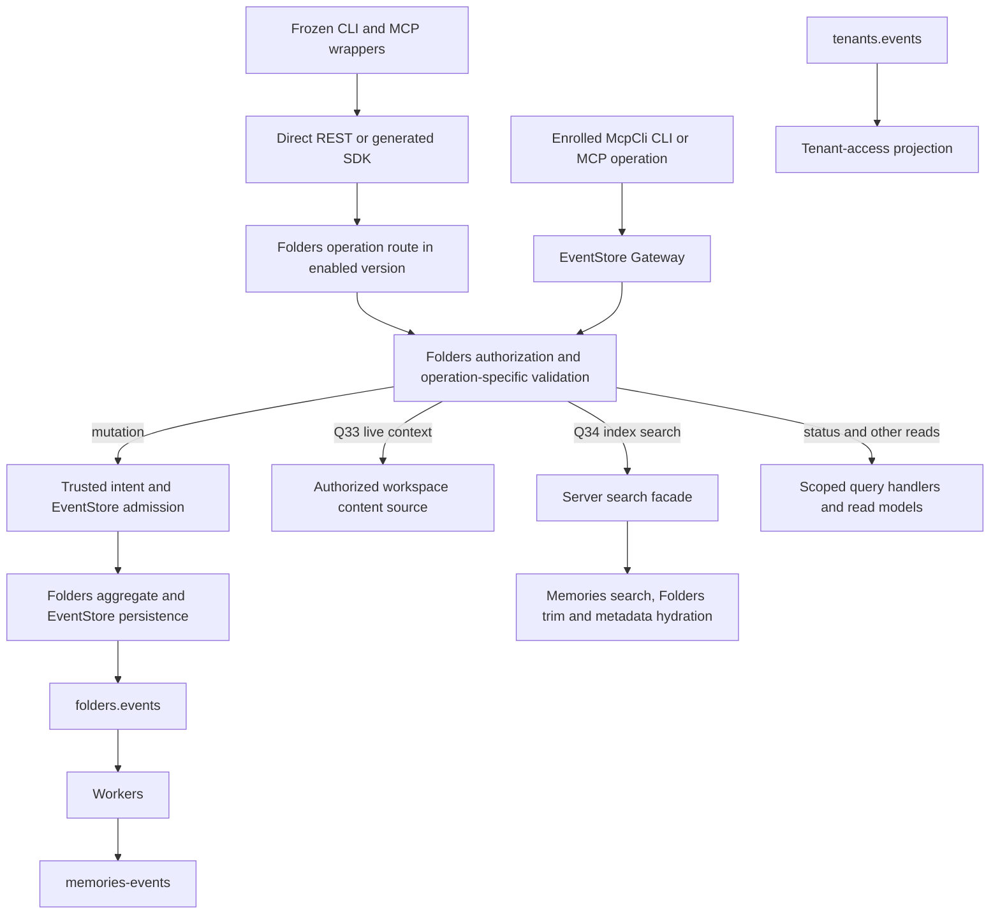

---
stepsCompleted:
  - 1
  - 2
  - 3
  - 4
  - 5
  - 6
  - 7
  - 8
inputDocuments:
  - "_bmad-output/planning-artifacts/prd.md"
  - "_bmad-output/planning-artifacts/prd-validation-report.md"
  - "_bmad-output/planning-artifacts/product-brief-Hexalith.Folders.md"
  - "_bmad-output/planning-artifacts/research/technical-forgejo-and-github-api-research-2026-05-05.md"
  - "_bmad-output/planning-artifacts/research/technical-hexalith-eventstore-domain-aggregates-research-2026-05-05.md"
  - "_bmad-output/planning-artifacts/research/technical-hexalith-tenants-integration-for-folder-management-application-research-2026-05-05.md"
  - "_bmad-output/planning-artifacts/research/technical-hexalith-memories-semantic-indexing-rag-research-2026-05-11.md"
  - "_bmad-output/planning-artifacts/research/technical-frontcomposer-integration-for-hexalith-folders-ui-research-2026-05-11.md"
  - "_bmad-output/planning-artifacts/ux-design-specification.md"
  - "_bmad-output/planning-artifacts/implementation-readiness.md"
  - "_bmad-output/planning-artifacts/reconcile-architecture-downstream-2026-09-16.md"
  - "_bmad-output/planning-artifacts/sprint-change-proposal-2026-11-20.md"
  - "_bmad-output/implementation-artifacts/story-1-17-closure-owner-intake-2026-11-16.md"
  - "_bmad-output/planning-artifacts/sprint-change-proposal-2026-09-15.md"
documentCounts:
  prd: 1
  prdValidation: 1
  productBriefs: 1
  uxDesign: 1
  research: 5
  projectDocs: 0
  projectContext: 0
workflowType: 'architecture'
project_name: 'Hexalith.Folders'
user_name: 'Jerome'
date: '2026-05-07'
status: 'complete'
statusSemantics: 'architecture workflow document complete; implementationReadiness below remains the release/execution posture'
lastStep: 8
completedAt: '2026-05-11'
resumedAt: '2026-05-11'
completionRefreshedAt: '2026-05-11'
uxDesignIncludedAt: '2026-05-11'
updated: '2026-11-20'
reconciledTo: '2026-11-20 repository and PRD audit, validation findings, September corrective approvals, and October–November owner decisions'
implementationReadiness: 'MVP release blocked. Story 1.17 operational entry and closure on hold.'
---

# Architecture Decision Document

> **Current McpCli disposition (Story 5.11 candidate):** C13 remains the adopted four-surface accounting denominator, not evidence that every operation is public-agent eligible. The separate owner-approved K12 successor must resolve restricted and mixed operation classifications and C13 cells before any enrollment or retirement claim; existing 1.1.0 approval does not waive it. Current shipped McpCli has no Folders enrollment. Legacy adapters below remain retained compatibility; no resource/stream fallback is admitted.


**Approved McpCli course correction (2026-09-27, extended 2026-11-10):** `Hexalith.McpCli` is the only target Hexalith-owned CLI/MCP surface for Folders; decision A-12 defines the enrollment architecture. Any proprietary module CLI, MCP host, plug-in, or planned adapter described below is a frozen compatibility surface or historical design. That includes `Hexalith.Folders.Cli`, `Hexalith.Folders.Mcp`, `src/shared/AdapterCore`, and the CLI/MCP columns of §"Adapter Parity Contract". These receive safety and continuity fixes only and are never a template or a release-qualifying surface. Replacement or approved withdrawal plus parity evidence precede retirement (Story 5.15). External development CLIs are unaffected.

The [delivery posture](#current-delivery-posture) records what the shipped composition can prove. Decision IDs identify the mechanisms implementers must share. Story eligibility and release evidence are tracked separately.

## Project Context Analysis

### Requirements Overview

**Functional Requirements:**

The PRD defines 58 functional requirements across 12 capability blocks: Capability Contract Terms (FR1–FR3), Authorization & Tenant Boundary (FR4–FR10), Folder Lifecycle (FR11–FR14), Provider Readiness & Repository Binding (FR15–FR23), Workspace & Lock Lifecycle (FR24–FR31), File Operations & Context Queries (FR32–FR36), Commit/Evidence/Idempotency (FR37–FR42), Error/Status/Diagnostics (FR43–FR46), Cross-Surface Contract (FR47–FR51), Audit & Operations Visibility (FR52–FR57), and Authorized Search Facade (FR58). The capability density centers on three things architecture must encode consistently: (1) one canonical workspace task lifecycle (provider-readiness → folder/repository binding → workspace prepare → task lock → file add/change/remove → commit → query → audit), (2) one set of error/status semantics shared across REST, CLI, MCP, and SDK surfaces, and (3) one tenant authorization decision evaluated before any file/workspace/credential/repository/lock/commit/provider/audit access.

**Non-Functional Requirements:**

Eleven NFR categories drive architecture (nine original, plus Edge Security & Deployment Hardening and Durable Operation & Release Evidence admitted 2026-09-15 as NFR74–NFR84): Security and Tenant Isolation (zero-tolerance cross-tenant leakage; metadata-only events/logs/traces; least-privilege provider credentials), Reliability/Idempotency/Failure Visibility (idempotency keys for every mutating Contract Spine operation; deterministic single-active-writer locks serialized on the canonical repository/ref identity; inspectable failure state, no silent repair), Performance and Query Bounds (1s p95 command-ack, 500ms p95 status/audit, 2s p95 context queries; bounded input enforcement), Scalability and Capacity (no single-tenant/single-repository/single-workspace assumptions), Integration and Contract Compatibility (versioned contracts, REST/CLI/MCP/SDK parity, provider contract tests for GitHub and Forgejo), Observability/Auditability/Replay (status-freshness target, read-model determinism, metadata-only audit with classified sensitive metadata), Data Retention and Cleanup (per-data-class retention, no audit erasure, tenant-deletion semantics), Operations Console Accessibility (WCAG 2.2 AA, keyboard navigation, no color-only indicators), Verification Expectations (each NFR category has at least one automated or release-validation path), Edge Security & Deployment Hardening (NFR74–NFR78: transport, destination denial, deny-by-default authority, credential-at-rest, untrusted content), and Durable Operation & Release Evidence (NFR79–NFR84: restart survival, multi-replica convergence, true readiness, demonstrated telemetry, classified evidence, edge-security verification).

**Scale & Complexity:**

- Primary domain: API/backend service module (developer infrastructure / AI workspace storage)
- Project context: Greenfield product built on top of mature Hexalith ecosystem modules (Hexalith.Tenants, Hexalith.EventStore, Hexalith.FrontComposer)
- The REST host and generated SDK share the versioned OpenAPI contract. For eligible operations, the McpCli CLI and MCP heads dispatch decorated Folders Contracts through the EventStore Gateway. Both paths enforce tenant and folder authority, mutation idempotency and the same result policy at the domain boundary. Audit, diagnostics and cross-workspace search expose metadata only. Authorized live-workspace reads may return bounded ranges or snippets under file policy and C4. McpCli owns its error documents and CLI exit codes. Decision A-12 and the C13 parity oracle bind the mappings.
- Folders declares 13 commands and 28 queries. Inventory 1.1.0 defers confidential operations C01 and C10. Seven console diagnostics remain undecorated. Runtime enrollment requires authorization, persisted outcomes and parity evidence for the included operations. The two legacy binaries remain available for compatibility until the Story 5.15 retirement gates pass. [Declaration handoff](../../docs/contract/mcpcli-folders-operation-declarations.md) · [Approved inventory](../../references/Hexalith.McpCli/_bmad-output/implementation-artifacts/folders-migration-inventory-v1.1.0.md)
- C1–C5 have approved targets for capacity, freshness, retention, input bounds and scale. The Architecture Exit Criteria section identifies the governing artifacts and the evidence needed at release.

### Technical Constraints & Dependencies

**Ecosystem-imposed (non-negotiable):**

- Folders targets `net11.0` with the .NET SDK pinned in `global.json` and C# language settings inherited from the build. [SDK](../../global.json) · [Build properties](../../Directory.Build.props)
- Hexalith.EventStore as command/query/event/projection mechanics (no parallel write-side framework)
- Hexalith.Tenants as the source of truth for tenant identity, lifecycle, and membership; consumed via Dapr pub/sub on `tenants.events` with a local fail-closed tenant-access projection
- Dapr sidecars for pub/sub, state store, service invocation, actors, access control, resiliency
- .NET Aspire AppHost for local topology orchestration
- Aggregate identity scheme `<tenant>:<domain>:<aggregateId>`; managed-tenant-scoped folders MUST NOT use the `system` tenant (reserved for tenant management); aggregate IDs are opaque immutable identifiers — folder hierarchy and human-readable paths are projected metadata, not identity
- OpenTelemetry observability for traces/metrics/logs
- xUnit v3, Shouldly, NSubstitute for testing (**as-built**; `Testcontainers` was named here in the 2026-05 draft, has zero usage in Folders, and is not a constraint — provider and topology evidence runs through the Aspire test host and the hermetic fixture lanes instead)
- **Single source-of-truth artifact for cross-surface generation** must be named and frozen as the Contract Spine (see C0); independent regeneration of any surface from a different source is forbidden

**Provider boundaries (explicit, capability-tested):**

- GitHub and Forgejo are NOT API-compatible base-URL swaps; capability differences must be modeled through provider ports and validated through provider contract tests before a provider is marked ready
- Provider port surfaces only credential references and capability metadata; provider-specific permission scoping (GitHub Apps fine-grained permissions, Forgejo scoped tokens) lives inside the adapter and is not flattened to a lowest common denominator
- Capability-discovery model must accommodate N providers, not be hardcoded for 2; adding a third provider must not require port redesign
- Provider version pinning + runtime capability-drift detection (see C12); each provider has a documented upgrade ritual
- Webhooks are at-least-once event notifications; receivers must validate signatures, persist delivery IDs, deduplicate, and reconcile via API rather than mutate state directly

**Hard product boundaries (forbidden content/behavior):**

- No file contents, diffs, generated context payloads, provider tokens, credential material, secrets, or unauthorized resource existence in events, logs, traces, metrics, projections, audit records, console responses, provider diagnostics, or error messages
- No mutation paths, credential reveal, file-content browsing, file-editing UI, raw diff display, hidden repair actions, or unrestricted filesystem browsing in the MVP read-only operations console
- No silent repair, discard, or commit when a workspace is interrupted; the MVP must leave inspectable terminal/intermediate state and prevent overwrites
- No secret material storage in Hexalith.Folders; only credential references may appear where authorized
- No webhook ingestion in MVP — explicit architectural posture, not absence-by-omission; when webhooks are introduced post-MVP, tenant-routing model must be designed first

### Cross-Cutting Concerns Identified

These concerns recur across multiple components and must be designed once, not per surface:

1. **Tenant isolation enforcement** — every command/query/event/projection/lock key/cache key/temporary path/provider callback/audit record MUST be tenant-scoped; cross-tenant access denied before any resource access; safe error shapes that prevent unauthorized resource enumeration.
2. **Layered authorization** — JWT validation → authoritative tenant claim → local tenant-access projection (with fail-closed-on-stale policy) → folder ACL → EventStore validators → production Dapr deny-by-default policies + mTLS.
3. **Idempotency and correlation** — every mutating Contract Spine operation uses one EventStore-owned admission contract partitioned by managed tenant plus protected opaque-key digest; every read rejects an idempotency key before query/source execution. Authentication, authoritative authorization, and canonical validation precede descriptor construction and admission, so no key disposition is disclosed to a denied caller. The trusted descriptor covers operation, canonical target, semantic payload/options, policy version, delegated task scope, and behavior-affecting credential scope while excluding correlation, token, clock, trace, delivery, and retry metadata. Admission durably serializes `reserved`, `pending`, `recoverable`, `unknown_provider_outcome`, `terminal`, and `expired` states with a fencing token. Live equivalent intent replays only after current authorization; live different intent conflicts; at `now >= expiresAt`, either intent returns `idempotency_key_expired` without execution. Replay-result retention is separate from the minimal metadata-only consumed-key lifetime, and raw keys, prior intent, paths, content, repository metadata, credentials, and results never enter tombstones or diagnostics. Correlation IDs remain request-scoped and propagate through every surface, event, projection, log, and audit record without participating in equivalence.
4. **Workspace state machine** — six canonical product-visible states (`ready`, `locked`, `dirty`, `committed`, `failed`, `inaccessible`) plus lifecycle/failure states (`requested`, `preparing`, `changes_staged`, `unknown_provider_outcome`, `reconciliation_required`); transitions are keyed on `(state, event, guard)`, never on the pair alone (see the guard register); single active mutation writer serialized on the canonical identity **managed tenant + canonical provider/repository identity + normalized target-ref token** (folder/workspace/task IDs are lock metadata, never collision identity; aliases resolving to the same remote/ref collide — per S-6 the token is tenant-keyed and is the same value every writer derives); lock state is exclusively `unlocked`/`locked`/`expired`/`stale`/`revoked`, kept distinct from workspace lifecycle, operation state, and operator disposition; deterministic conflict response across surfaces; **a total state-transition matrix where every `(state, event, guard)` triple has a defined transition or explicit rejection** is part of the architecture, not just the state set; **each state carries a paired operator-disposition label** (`available`, `auto-recovering`, `degraded-but-serving`, `awaiting-human`, `terminal-until-intervention` — five canonical dispositions per 2026-07-15) that surfaces as the primary visual in the operations console while the technical state name remains secondary metadata — this is a UX requirement driven by incident-response cognition, not engineering vocabulary preference.
5. **Provider failure taxonomy** — classify a mutation by evidence of dispatch and effect. A pre-dispatch failure or confirmed refusal with no effect is known. A timeout, lost acknowledgement or ambiguous provider response after possible dispatch enters `unknown_provider_outcome`. Preserve the operation identity and fence. Allow up to five read-only evidence checks within 15 minutes. Conflicting or exhausted evidence enters `reconciliation_required`. C12 uses pinned fixtures in the PR gate and live drift checks against GitHub and Forgejo.
6. **Metadata-only audit + redaction** — automated sanitizer tests with sentinel secrets and file-content markers across logs/traces/metrics labels/events/audit records/console views/provider diagnostics/error responses; **a normative `tests/fixtures/audit-leakage-corpus.json` is checked in** (paths containing secret-shaped strings, branch names with token-shaped values, commit messages with email/credential patterns, etc.); all sentinel tests iterate this corpus; new categories require corpus PR + reviewer sign-off to prevent per-developer drift.
7. **Path security** — workspace-root confinement, canonicalization, traversal rejection, symlink policy, binary/large-file policy, encoding/Unicode normalization, reserved-name handling, case-collision handling.
8. **Cross-surface contract parity** — C13 maps the same authorized Folders operation across REST, SDK and the McpCli heads. A-12 requires Gateway-side enforcement and persisted semantic proof for enrolled operations.
9. **Read-model determinism** — rebuilding views from an empty read model produces equivalent state from the same ordered event stream; **determinism scope explicitly excludes fields derived from external clocks** (stale-lock detection, freshness indicators); projection compaction strategy must preserve the determinism guarantee.
10. **Performance budgets** — 1s p95 command-ack, 500ms p95 status/audit summary, 2s p95 context query, bounded MVP input enforcement; provider/workspace operations may be asynchronous when external latency exceeds interactive budgets.
11. **Operations console boundary** — read-only, read-model–based, WCAG 2.2 AA, keyboard navigation, status indicators not relying on color alone, no mutation/repair paths in MVP; **separate console performance budget** from end-user budgets; **incident-mode last-resort read path** to authoritative event streams (still ACL-checked) for cases where projections themselves are the broken thing; **redacted fields are visually distinguished from unknown/missing fields** — a redacted value (per C9 sensitive-metadata policy) renders with a visible affordance such as a lock icon plus "your tenant policy hides this; contact your administrator", never as silent truncation, because silent redaction during an incident reads as a system bug and operators lose time chasing ghosts.
12. **Tenant context provenance invariant** — authoritative tenant comes from the request authentication context + EventStore envelope; NEVER from request payload. Tested as a parity invariant on all four surfaces (REST, CLI, MCP, SDK). A tenant identifier in any payload is treated as input requiring validation against context, not as authority.
13. **Cache-key tenant prefix invariant** — every cache key (in-process, Dapr state, Redis, distributed cache) MUST carry tenant prefix; build-time/CI lint check enforces it as a hard gate (see C10).
14. **Aggregate ID opacity** — aggregate IDs are opaque immutable identifiers; folder hierarchy and human-readable paths/names are projected metadata, never identity. Folder moves and renames preserve the ID and the event stream.
15. **Correlation propagation** — carry the correlation ID and any operation-bound task ID through both the Folders REST/SDK path and the enrolled McpCli/Gateway path, including resulting EventStore envelopes, projections and audit. C13 checks the identifier across each supported surface.
16. **Mid-task authorization revocation** — held locks revalidate authorization every 15 seconds and before each renewal or mutation; revocation policy is part of the lock model, not a separate concern. A mid-task tenant-access revocation must make the lock revoked/inaccessible and deny later protected work within the C7 60-second SLO. Runtime evidence remains separately reference-pending.
17. **Sensitive metadata** — S-6 classifies paths, repository names, branch names and commit messages as tenant-sensitive by default. For a value classified confidential, the EventStore event-write boundary substitutes its tenant-scoped, non-reversible HMAC-SHA-256 correlation token before persistence. Durable records carry only the approved token representation. Render `withheld` with the canonical token where the contract permits. C9 display policy applies to eligible metadata after this boundary.
18. **Context-query authorization** — all five live file operations require fresh tenant authority and a folder write grant. Apply path policy, sensitivity classification and C4 limits before accessing content. Both index operations require fresh tenant authority and a folder read grant. Trim candidates to authorized scope and hydrate hits from Folders before returning metadata.
19. **Read consistency model** — explicit per-query-family choice: snapshot-per-task (tied to task ID, stable through lifecycle), read-your-writes (after a mutation by the same correlation), or eventually-consistent (read-only browsing). Documented per query family and exposed as a freshness header where relevant.
20. **Tenants-availability degraded mode — resolved 2026-09-17.** Stale, conflicting, incomplete, or unavailable **authority evidence is unavailable evidence, not a negative authorization fact**: every protected operation returns the S-7 `authority-unavailable-503` before protected-resource lookup. The S-7 `safe-denial-404` is reserved for fresh negative facts such as revoked, disabled, unknown, hidden, absent, or insufficient scope. Bounded-stale reads remain permitted only for read models that are not inputs to authorization and must carry freshness metadata; a stale tenant-access, membership, delegation, or ACL projection is never such a read model. The shipped `allowBoundedStale: true` diagnostic path is therefore target-state drift owned by the PD10 story. Mutations always require fresh authority. This deliberately trades availability for non-disclosure and is qualified by OQ12 on the supported profile.
21. **Operational state durability classification** — every operational state has an explicit decision: rebuilt from events on restart (stateless cache), acceptably lost on sidecar restart (in-memory ephemeral), or requires durable storage with recovery contract. Locks, idempotency admission records/tombstones, fencing tokens, in-flight checkpoints, and reconciliation tasks are durable and fail closed when unavailable or unreadable. Idempotency state is not a rebuildable projection: `/project` replay cannot create, erase, or resurrect consumed-key authority. Reserved, pending, recoverable, unknown, terminal, and expired records survive host/sidecar restart and multi-replica access; compaction atomically preserves the expired tombstone rather than converting a consumed key to missing.
22. **Architecture exit criteria** — quantitative and structural targets C0–C13 (below) MUST be set, validated, and recorded in the architecture document with measurement methods before MVP release.

### Additional Technical Research: Memories and FrontComposer

Two later technical research reports have been added as architecture inputs:

- `_bmad-output/planning-artifacts/research/technical-hexalith-memories-semantic-indexing-rag-research-2026-05-11.md`
- `_bmad-output/planning-artifacts/research/technical-frontcomposer-integration-for-hexalith-folders-ui-research-2026-05-11.md`

**Memories search indexing**

Workers consume durable Folders events and publish `SearchIndexEntryChanged` or `SearchIndexEntryRemoved` over Dapr pub/sub. The event identity must survive redelivery. The Folders bridge tracks the indexed version, publication status and tombstones. A Memories outage leaves the authoritative Folders mutation intact. Story 12.5 owns retry and recovery.

PD5 limits MVP index material to policy-approved, C4-bounded metadata. File bodies and snippets stay outside Memories indexing. A change to that scope requires a new product decision, C9 review and its own scheduled work. The authorized live-workspace content reader serves a separate capability. The read path and Story 10.8 acceptance criteria appear under [Query Facade](#query-facade-story-105). [PRD](prd.md)

**Hexalith.FrontComposer integration implications:**

- `Hexalith.Folders.UI` should become a Blazor Web App host rendering `FrontComposerShell` as the primary layout, using Interactive Server first.
- The MVP operations console remains read-only and read-model-based (projection-capable). Its ops-console diagnostics and workspace transition-evidence read models are seed-backed dev/test seams in MVP — see §"Ops Console & Transition-Evidence Read Models (MVP limitation)". Do not generate or route mutation command forms through FrontComposer during MVP.
- Add Folders-specific FrontComposer projection models for metadata-only views such as folder summaries, workspace status, provider readiness, tenant folder access, semantic-indexing status, and operation/audit timelines.
- Replace the fail-closed `IUserContextAccessor` with a Folders/Tenants auth bridge before enabling tenant-scoped FrontComposer queries.
- Defer `AddHexalithEventStore` until Folders Server implements the compatible command/query/projection-change endpoints, or provide a Folders-specific read-only `IQueryService` adapter backed by `Hexalith.Folders.Client`.
- Keep FrontComposer SourceTools generated output deterministic and unedited. If UI-only projection annotations would pollute the Contract Spine, place FrontComposer projection DTOs in a UI/domain companion assembly instead of `Hexalith.Folders.Contracts`.
- Aspire topology should keep `folders-ui` and `folders` as separate services with explicit references; UI must not require provider credentials, tenant seed data, Keycloak, Dapr sidecars, or nested submodule initialization for scaffold/build tests.

**Architecture impact summary:**

These reports do not overturn the core architecture. They add two optional integration tracks that must preserve the existing invariants:

- Memories extends context-query capability through worker-owned asynchronous search-index publication (`SearchIndexEntryChanged` CloudEvents over Dapr pub/sub, source `hexalith-folders` → `folders-index`) and an authorized Folders query facade; the separate RAG/memory-ingestion path (`IngestAsync`) is out of MVP scope.
- FrontComposer implements the read-only operations console shell and generated projection UI while Folders retains domain semantics, authorization, data access, and no-leakage policy.

### Query Facade (Story 10.5)

The Memories search-index read side is an **authorized Folders query facade** over the syntactic/BM25 index on the shared `folders-index` tenant. It is the read counterpart to the worker-side producer (Stories 10.3/10.4) and is asymmetric with it: the producer **publishes** `SearchIndexEntryChanged`/`SearchIndexEntryRemoved` over Dapr pub/sub (no service-invoke), while the facade **reads synchronously** over `GET /api/search` on Dapr app-id `memories`.

- **Server read path.** `Hexalith.Folders.Server` implements `IFolderSearchSource` with the typed `MemoriesClient.SearchAsync` call. The Server selects an absolute `Memories:BaseAddress` when configured, in any environment. Otherwise it builds the Dapr invocation URL for app ID `memories` from the sidecar endpoint or port. `HEXALITH_MEMORIES_API_TOKEN` supplies the bearer when configured. Clients reach the Folders operation over REST/SDK or, once enrolled, McpCli/Gateway.
- **Shared-index security-trim (load-bearing).** Indexed Folders content shares one physical Memories tenant (`folders-index`), so Memories' own tenant scoping does NOT isolate Folders managed tenants. The facade constrains the query server-side with `AttributeFilters["folders.managedTenantId"]` (+ `folders.organizationId`/`folders.folderId` and `folders.status = active` to exclude archived units) AND, authoritatively, re-checks every returned hit Folders-side against the caller's authorized `(managedTenantId, organizationId, folderId, workspaceId)`. The Folders-side trim — not the attribute filter — is the load-bearing tenant-isolation control; the attribute filter is defense-in-depth.
- **Non-authoritative hydration.** The index is security-untrusted and may be stale: it decides *which* rows appear, never *what each row shows*. The facade recovers identity only from `ScoredResult.SourceUri` (the content snippet is dropped), then hydrates each surviving hit from the authoritative Folders bridge read model (`ISemanticIndexingBridgeReadModel.ListFolderAsync`), dropping any hit without a current entry or not in a live indexed state. Authorization (JWT → claim transform → tenant-access freshness → folder read grant and authorized scope) runs BEFORE any egress; results are metadata-only (no snippets, raw paths, source URIs, or memory-unit ids).
- **Supported-profile egress.** Verify the deployed Server’s resolved address goes through its sidecar to app ID `memories` for `GET /api/search`. Qualify that route with mTLS and the deny-by-default Dapr policy, including a denied invocation. An absolute direct URL bypasses those controls. Workers publish index events through pub/sub. They have no search invoke grant. [Server registration](../../src/Hexalith.Folders.Server/FoldersServerServiceCollectionExtensions.cs) · [Dapr access policy](../../deploy/dapr/production/accesscontrol.yaml)
- The shipped Server registers `EventStoreSemanticIndexingBridgeStore` as a read-only bridge. Workers own publication and bridge updates. Story 10.9 protects the metadata-only boundary. Story 10.8 must prove authorized change and removal through Memories after publication refusal and restart, including stale-hit removal and a drained backlog. A working bridge registration establishes only the read path. [Server registration](../../src/Hexalith.Folders.Server/FoldersServerServiceCollectionExtensions.cs) · [November acceptance criteria](sprint-change-proposal-2026-11-20.md)

### Ops Console & Transition-Evidence Read Models (MVP limitation)

The console reads metadata through Folders query ports. The Server registers EventStore-backed readers for folder lifecycle, workspace lock, workspace status, cleanup and task status. The separate diagnostics, transition-evidence, audit trail, audit record and timeline ports still have process-local defaults. A seeded endpoint test can therefore return a valid-looking result that another replica cannot reproduce. [Host composition](../../src/Hexalith.Folders.Server/FoldersServerHostComposition.cs) · [Read-model registrations](../../src/Hexalith.Folders/FoldersServiceCollectionExtensions.cs)

Story 4.18 owns transition evidence. Stories 6.12–6.14 own diagnostic population and the deployed console journey. D-10 requires durable metadata-only audit and timeline readers behind the existing ports. Story 6.14 must retrieve the same accepted operation on a second replica and after an empty-checkpoint rebuild, with deterministic ordering, freshness, tenant denial and redaction. A safe empty or unavailable response remains valid failure behavior. [Canonical stories](epics.md)

### Release and execution authority

The planning artifacts assign each decision to an owner.

| Authority | Artifact | Owns |
| --- | --- | --- |
| **Product** | `prd.md` | Scope, the FR/NFR inventory, the completion model, MVP admission and non-goals |
| **Mechanism** | this document | How the product is built: paradigm, boundaries, state mutation, contracts, the security spine, exit criteria |
| **Acceptance** | `epics.md` | Story acceptance criteria and the evidence each story must produce |
| **Lifecycle & dependency control** | [Execution manifest](planning-story-manifest.yaml) | Per-story status, prerequisite edges, execution rank and scoped authority. The sprint tracker records progress. |

This document does not assign story status and does not schedule work. A `status` recorded inside a frozen build specification is that build run's workflow result, not current lifecycle authority.

The September 17 approvals covered A1, A2, A4, A5/C9, A6, A7/C6 and A7b/C3. A2b and A3 followed on September 18. The September 22 corrective A6b approved matrix 2.0.0 and its 196-artifact set. Corrective A8 and the passing 11-check Section 9 result lifted the general planning hold for those reviewed artifacts. Later changes require current technical checks. The manifest still records separate controls for ordinary execution, tracker regeneration and v2 exposure. Consult the row and its scoped decision before starting a story. [Approval register](planning-authority-relock-approval-register.yaml) · [September 22 result](relock-section9-result-2026-09-22-post-a8-corrective.yaml) · [Execution manifest](planning-story-manifest.yaml)

Jerome owns new project decisions under the September 24 policy. The earlier signatories and digests establish the scope of historical approvals. A material change to behavior, risk, consumer scope, production exposure or rollback requires an owner decision. [Decision policy](../../docs/governance/approval-policy.md)

### Current Delivery Posture

**MVP release remains blocked.** The Server registers an actor-backed folder repository, EventStore projection endpoints, authoritative workspace content reads and writes, and five durable operational status readers. The normal commit executor still returns an unsupported result. The golden lifecycle test substitutes a successful executor. A real provider ref and terminal task state therefore remain the evidence boundary. [Server host](../../src/Hexalith.Folders.Server/FoldersServerHostComposition.cs) · [Server registrations](../../src/Hexalith.Folders.Server/FoldersServerServiceCollectionExtensions.cs) · [Golden lifecycle fixture](../../tests/Hexalith.Folders.IntegrationTests/EndToEnd/GoldenLifecycleParityTests.cs)

| Boundary | Evidence required from the shipped components |
| --- | --- |
| Provisioning and commit · 3.14, 12.4, 4.21 | Workers dispatch create/bind to the provisioning manager and produce one terminal result. Under an authorized lock, persist recoverable intent before the provider write. After interruption following provider acceptance, reconcile with provider evidence before any repeat write. Verify remote ref, exact staged bytes, one commit and terminal task after replay. |
| Search change and removal · 12.5, 10.8 | Workers can currently return HTTP success after a retryable Memories refusal. Acknowledge a retryable event only after durable retry ownership passes to a recovery consumer. Otherwise signal broker redelivery. Across restart, each logical event has one effect, the stale hit disappears, and the backlog drains. |
| Audit and readiness · 6.14, 13.4 | Read the same authorized metadata on a second replica and after projection rebuild. Server and Workers currently default to healthy snapshots. Both must report missing or stale observations and independently reflect Tenants failure, excessive projection lag and recovery. Liveness remains independently observable. |
| Provider transport and deployment · 13.1, 13.7 | Qualify the registered GitHub and Forgejo handlers separately for direct approved egress, proxy and redirect handling before enabling each provider's live writes. Exercise rendered sidecar and app callback-token bindings together. Prove two-replica behavior with a durable broker, measured throughput and lag, and a regional-loss drill against RPO ≤5 minutes and RTO ≤4 hours. |

The first disposable repository uses Forgejo, as selected on 21 November 2026. Qualify its transport before enabling the live write. The later GitHub qualification includes its live readiness probe. OQ11 can establish a restart-safe provider slice. SM1 requires GitHub and Forgejo through REST, SDK, CLI and MCP. [PRD](prd.md) · [Audit and acceptance criteria](sprint-change-proposal-2026-11-20.md)

On audited source `5f39a1b8`, Debug built, four Contracts tests failed, and the packaged Release AppHost failed to read its route inventory. Release repair requires the four regressions, the packaged AppHost case and push CI on the repaired source. Generate the pending conformance inventory after its bound inputs settle. The published 2.0.0 packages, recorded `V1Only` control and separate operational entry decision are covered by A-11. [Audit](sprint-change-proposal-2026-11-20.md) · [Story 1.17 intake](../implementation-artifacts/story-1-17-closure-owner-intake-2026-11-16.md)

### Durable Data Plane — Epic 12

Epic 12 owns the durable repository-backed round trip. Each story contributes a mechanism whose deployed outcome is measured in the relevant product journey.

- **12.1** The production host selects `ActorFoldedFolderRepository` and maps SDK domain projection endpoints. EventStore owns aggregate writes and replay.
- **12.2** Durable projections and task completion. The strict fixture may use a run-owned disposable workload identity. Staging and production require their own enrollment and evidence. [November 13 decision](sprint-change-proposal-2026-11-13.md)
- **12.3** Durable workspace file-content store + content-read source (server-side hash verification).
- **12.4** The provider adapters own remote I/O. The Server authorizes and canonicalizes the request. The EventStore-owned A-9 admission actor serializes the intent and issues the fence. Persist the pending operation through EventStore before calling the provider, and use its stable identity when reconciling the result. On uncertain acceptance, follow the bounded read-only reconciliation path before recording a terminal outcome. The unavailable executor and the unwired provisioning dispatch keep the real journey open.
- **12.5** Workers own at-least-once Memories egress, durable retry and removal ordering. The callback must return a retry signal whenever a transient failure leaves recovery with the broker. [Worker subscription](../../src/Hexalith.Folders.Workers/FoldersWorkersModule.cs) · [Event processor](../../src/Hexalith.Folders.Workers/SemanticIndexing/FoldersSemanticIndexingEventProcessor.cs)
- **12.6** Durable all-mutations idempotency and expired-key precedence (the A-9 EventStore-owned admission actor and D-7 retention); depends on the accepted OQ8 design digest and 12.1. Its implementation produces the later `OQ8-EVIDENCE` release gate; it does not depend on that evidence decision.

- **12.7** PD8 permits durable tenant-scoped correlation tokens and approved opaque provider handles. Reject an operation before admission if recovery would require storing a reversible confidential value. See S-6.

The manifest records the actual prerequisite edges and authorizations for Epic 12. The approved OQ3 matrix defines the v2 policy, while Story 1.17 controls operational entry.

### Security & Operational Hardening — Epic 13

Epic 13 (Stories 13.1–13.7 in `epics.md`) collects the audit's non-deferred defects on the parts that do claim to work, plus operational-truth gaps. It is a security/operations workstream excluded from product-completion metrics and must not duplicate Workstream 11. Scope: HXF-SEC-001 (bearer JWT over plaintext HTTP in CLI+MCP → require HTTPS-or-loopback), HXF-SEC-002 (Forgejo readiness base-URL SSRF sink → block RFC-1918/link-local/loopback/metadata IPs via `ConnectCallback`), HXF-SEC-003 (fail-safe fallback authorization policy + sidecar-only app port), HXF-SEC-004 (credential files `0600`), HXF-SEC-005/006 (rate limiting/timeouts/body caps; converge the four sensitive-value filter copies), HXF-REL-002 (real `IReadinessSnapshotSource` + UI health endpoints), HXF-OBS-001 (wire the five declared-only alert instruments), HXF-REL-005 (production Dapr `statestore` + `Resiliency` components), HXF-PERF-001/002, HXF-MEM-001.

**Release-hardening evidence ownership (A2 / A2b, 2026-09-15).** Epic 13 is admitted as the release-hardening workstream for the `NFR74`–`NFR84` band, with Story 13.7 collecting supported-profile evidence. OQ11 covers the durable slice (NFR79–81). OQ12 covers deployed hardening (NFR74–78 and NFR82–84). OQ13 measures C1, C4 and C5 against SM4/SM5 on the OQ12 profile. The eleven requirements are mechanism-neutral obligations, not implementations: HTTPS-or-approved-loopback bearer transport (NFR74), provider-endpoint destination denial for private, loopback, link-local, metadata-service, and otherwise prohibited targets unless an approved deployment policy allows them (NFR75), deny-by-default at protected endpoints and internal service boundaries when authority is absent, stale, malformed, or unavailable (NFR76), owner-only local CLI/MCP credential storage never emitted to logs, telemetry, diagnostics, or generated artifacts (NFR77), repository and workspace content treated as untrusted input that cannot control commands, paths, templates, or rendered active content without validation or neutralization (NFR78), restart-survivable accepted mutations, transitions, and evidence (NFR79), multi-replica convergence on one authoritative state with no seed-local or replica-local correctness assumption (NFR80), readiness reporting actual dependency health and being unable to report ready from configuration or seed data alone (NFR81), every release-significant metric and alert having demonstrated emission, an owner, and fault-path evidence (NFR82), classified release evidence — automated, operational, approval-bound, or reference-pending — with an owner for every non-automated item (NFR83), and release verification of edge-security behavior including safe denial, endpoint validation, credential handling, and untrusted-content boundaries (NFR84).

**Evidence ownership by requirement.** Story 13.7 contributes evidence to all eleven rows. The other story assignments below come from the [NFR traceability inventory](../../docs/exit-criteria/nfr-traceability.md). Every row remains `reference-pending` and release-blocking. NFR76 and NFR84 consume the S-7 denial envelopes.

| Requirement | Contributing stories in addition to 13.7 |
| --- | --- |
| NFR74 | 13.2 |
| NFR75 | 13.1 |
| NFR76 | 13.2 |
| NFR77 | 12.7, 13.3 |
| NFR78 | 10.9, 13.6 |
| NFR79 | 12.1 |
| NFR80 | 12.2 |
| NFR81 | 13.4 |
| NFR82 | 13.5 |
| NFR83 | 7.16 |
| NFR84 | 10.9, 13.1, 13.2, 13.3, 13.6 |

**Delivery ownership.** The canonical epic file assigns the following cross-cutting mechanisms.

- **Story 1.17 — PD10 authorization-spine v2:** matrix correction, explicit folder scope, `/api/v2` generation, server/client/CLI/MCP/UI migration, status/error vocabulary drift protection, consumer discovery, and A6b evidence.
- **Story 4.22 — PD11 guard-discriminated lifecycle:** four new guarded pairs, durable staging/recovery fields, automatic disposition lockstep, `LockLeaseBecameStale`, C3 integration, triple-keyed gates, and A7/A7b evidence.
- **Story 12.7 — PD8 confidential operational values:** event-write tokenization, immutable canonical token/rotation aliases, provider-operation capability classification, pre-admission rejection when recoverable cleartext would be required, withheld rendering, Memories/export behavior, restart/held-lock rotation proof, and A5/C9 evidence.
- **Story 13.7 — supported deployment and recovery:** production/preproduction manifests, replica/scaling/resource profile, PostgreSQL actor state, backup/restore automation, deletion-ledger replay, and first recovery drill.

The manifest owns their execution order. The NFR traceability inventory identifies the required evidence for each of the 84 requirements. [Execution manifest](planning-story-manifest.yaml) · [Traceability inventory](../../docs/exit-criteria/nfr-traceability.md)

### Production Projection & Evidence Ownership (2026-07-15)

| Owner | Owns |
| --- | --- |
| **Epic 4** | Workspace transition-evidence + lifecycle replay evidence (Story 4.18) |
| **Epic 6** | Seven production-populated ops-console diagnostic projections (Stories 6.12–6.14) |
| **Epic 10** | Search-bridge projection, Server registration, authorization, hydration, pruning, live search/status proof (Stories 10.7–10.9) |
| **Epic 12** | Durable source events, file content/state, restart replay, task completion, real Git persistence (Stories 12.1–12.5) |
| **Workstream 11** | EventStore/Memories platform seam adoption + DCP-capable cross-repo verification only (11.10 EventStore admission/subscription seams; 11.14 Memories publication/search-client seams; 11.15 DCP lane) — no product-projection ownership |

Story 11.10 is no longer a convergence dependency for Epics 4, 6, or 10 (forward dependencies removed). Every production read-model story carries the same acceptance floor: durable population, deployed-host registration, deterministic empty-checkpoint replay, tenant isolation, freshness, safe unavailable behavior, and real-path evidence.

### UX Design Integration Implications

The UX design specification at `_bmad-output/planning-artifacts/ux-design-specification.md` is now an explicit architecture input. It reinforces the existing read-only operations-console architecture and sharpens the UI implementation contract rather than changing the service boundaries.

**Architecture-relevant UX constraints:**

- The MVP UI is a web/desktop-first operations console built through Hexalith.FrontComposer Shell and Microsoft Fluent UI Blazor. It is optimized for operators, chatbot/agent developers, and tenant administrators diagnosing workspace trust, readiness, failures, and audit evidence.
- The primary experience is: find a workspace, prove its tenant boundary, then understand its trust state from evidence. Workspace detail pages must surface tenant, folder, repository binding, workspace, task, provider, authorization posture, lifecycle state, freshness, and correlation/task identifiers before detailed evidence.
- The console remains read-only and metadata-only. It must not expose mutation controls, repair actions, file editing, file contents, raw diffs, credential values, unrestricted file browsing, or unauthorized resource existence.
- Custom UI components are permitted only for domain evidence patterns that Fluent UI does not model directly: Workspace Trust Summary, Tenant Scope Banner, Metadata-Only Folder Tree/Table, Diagnostic Timeline, Trust Matrix, Redaction/Inaccessibility State, Authorized Search & Results (authorization + safe scope establishment precede candidate lookup, result counting, suggestions, filtering, and empty-state classification; "global" means global only inside the caller's already-authorized tenant/folder scope), Access Evidence, Provider Readiness Evidence, and the Incident-Evidence Authorization Gate. Every page/component maps to a product story and an authoritative read model (2026-07-15 §4.11).
- Redacted, inaccessible, unknown, missing, unavailable, failed, delayed, dirty, locked, ready, and committed states must be visually and semantically distinct. Color is supplemental only; every state needs text, icon or shape cue, accessible label, and safe explanatory detail where needed.
- Search and filtering are primary workflows. Queries should support tenant, folder, workspace ID, repository binding, task ID, correlation ID, provider, lifecycle state, failure category, and time window without weakening tenant authorization.
- Responsive behavior is desktop-first but must not break on tablet or mobile fallback. Accessibility targets remain WCAG 2.2 AA, including keyboard navigation, visible focus, semantic headings, accessible status labels, zoom resilience, and screen-reader-meaningful redaction/denial states.

**Implementation impact:** Epic 6 and any FrontComposer UI stories should treat the UX specification as normative alongside this architecture. UI code should derive state labels, icons, tooltips, and accessibility labels from the same canonical state vocabulary used by the API, SDK, CLI, and MCP surfaces.

### Architecture Exit Criteria and Evidence

| ID | Target | Source / Notes |
| --- | --- | --- |
| **C0** | **Contract Spine Decision** — name and version of the single source-of-truth artifact for cross-surface generation, including its extension vocabulary for idempotency keys, correlation, lifecycle states, parity-dimension annotations, and audit-metadata declarations. **Selected:** OpenAPI 3.1 with extension vocabulary; SDK generated via NSwag from the v2 contract. A-11 controls route exposure. | Added by analysis (Winston) — promoted from an unspecified item to a blocking decision |
| C1 | Concurrent capacity targets (tenants, folders/tenant, active workspaces/tenant, concurrent agent tasks/tenant) | PRD §NFR Scalability — **RESOLVED: approved 2026-05-30 (Story 7.10)** → `docs/exit-criteria/c1-capacity.md` |
| C2 | Status-freshness target (max acceptable lag between emitted lifecycle event and appearance in status/audit views) | PRD §NFR Observability — **RESOLVED: approved 2026-05-30 (Story 7.10), 500 ms** → `docs/exit-criteria/c2-freshness.md`; jointly decided with C8 |
| C3 | Retention durations per data class (audit metadata, workspace status, provider correlation IDs, read-model views, temporary working files, cleanup records) | PRD §NFR Data Retention — **A7b approved** the non-destructive recovery deadline and a distinct terminal/no-active cleanup epoch with its full P7D window → `docs/exit-criteria/c3-retention.md` |
| C4 | Bounded MVP input limits (max files / max bytes / max result count / max query duration per context query) | PRD §NFR Performance — **RESOLVED: PM-approved 2026-06-22** → `docs/exit-criteria/c4-input-limits.md` |
| C5 | Concrete scalability quantifiers replacing the word "multiple" in NFR Scalability | PRD §NFR Scalability — **RESOLVED: approved 2026-05-30 (Story 7.10)** → `docs/exit-criteria/c5-scalability-quantifiers.md` |
| C6 | Total workspace state-transition matrix (every `(state, event, guard)` triple → outcome, including reconciliation paths and terminal states) **plus the operator-disposition label paired to each state** (`available` / `auto-recovering` / `degraded-but-serving` / `awaiting-human` / `terminal-until-intervention`) — **A7 approved the PD11 vocabulary and transition guards** → §"Workspace State Transition Matrix" | Added by analysis; UX-driven from Sally |
| C7 | Lock-renewal interval, authorization-revalidation interval, revocation-effect SLO, and expired-to-stale threshold, defaulted globally and only tighten-able per tenant | **RESOLVED: Architecture + Security approved 2026-09-12** — 30-second renewal, 15-second revalidation, 60-second revocation-effect SLO, 60-second expired-to-stale threshold → `docs/exit-criteria/c7-lock-authorization-timing.md` version `1.0.0` |
| C8 | Read consistency model per query family (snapshot-per-task / read-your-writes / eventually-consistent) | Added by analysis; jointly decided with C2 |
| C9 | Sensitive metadata classification policy + default sensitivity tier (paths, branch names, repo names, commit messages); classification feeds the console redaction-vs-unknown UX rule in cross-cutting concern #11 — **A5 approved the PD8 token-only boundary**: a `confidential` override is now a correlation token substituted at event-write time, never durable cleartext → S-6 | Added by analysis; refined by Sally |
| C10 | Cache-key tenant-prefix lint enforcement (CI/build-time gate, naming convention, tooling) | Added by analysis |
| C11 | AddFile and ChangeFile use bounded JSON inline and stream-descriptor request shapes. D-9 defines the threshold, retry hint and content verification. | V2 operation schemas and D-9 |
| C12 | Provider version pinning + runtime capability-drift detection cadence + upgrade ritual; **provider contract suite runs in hermetic-PR-gate mode AND live-nightly-drift mode** with fixture-to-failure-mode coverage matrix asserted in CI | Added by analysis; refined by Murat |
| C13 | **Parity oracle artifact** — a `parity-contract.yaml` (or equivalent) generated from the C0 Contract Spine, declaring for each `(operation_id) →` a row with **transport-parity columns** (`auth_outcome_class`, `error_code_set`, `idempotency_key_rule`, `audit_metadata_keys`, `correlation_field_path`, `terminal_states`) **plus behavioral-parity columns** (`pre_sdk_error_class`, `idempotency_key_sourcing`, `correlation_id_sourcing`, `cli_exit_code`, `mcp_failure_kind`) — see §"Adapter Parity Contract" for the per-adapter behavioral columns. **All four surface test projects consume the oracle as xUnit theory data:** `*.Sdk.Tests` + `*.Rest.Tests` for transport-parity columns; `*.Cli.Tests` + `*.Mcp.Tests` for behavioral-parity columns. The artifact is itself schema-validated against `tests/fixtures/parity-contract.schema.json` before tests consume it. **CI gates:** (a) Contract Spine adds a command without a parity-oracle row → fail; (b) Contract Spine *removes* an operation without a deprecation-window entry in `previous-spine.yaml` → fail (symmetric drift detection); (c) mutating command (POST/PUT/PATCH/DELETE) without `idempotency_key_rule` → fail (per-class completeness); (d) query operation without `read_consistency_class` → fail **McpCli mapping (2026-11-10):** each row also records `mcpcli_operation` (canonical name such as `folders.create-folder`, decorated CLR type, inventory disposition). CLI/MCP cells are satisfied only by McpCli heads. `cli_exit_code` and `mcp_failure_kind` stay legacy-adapter columns until Story 5.15 removes them. | Added by analysis; converged proposal from Amelia + Murat; behavioral-parity columns and symmetric-drift gate added in Step 7 elicitation |

Each exit criterion must be (a) set as a concrete value or rule with a measurement/enforcement method, (b) validated through implementation evidence before MVP release, and (c) recorded in the architecture document and referenced from the PRD via update where applicable.

The September register records A5/C9, A7/C6 and A7b/C3 against the corrected definitions. A6b covers the September 22 matrix. Each implementation and release claim still requires the evidence assigned to its criterion. [Governance inventory](../../docs/exit-criteria/c0-c13-governance-evidence.yaml) · [Approval register](planning-authority-relock-approval-register.yaml)

> **Governance-approval / NFR-traceability decoupling precedent (updated 2026-09-12).** A criterion's `approved` status in `docs/exit-criteria/c0-c13-governance-evidence.yaml` and the status of the NFR rows that *cite* that criterion in `docs/exit-criteria/nfr-traceability.md` are **two separately-owned tracks**. Approving a criterion does **not** auto-convert its cited NFR rows to `covered`, and a still-open `reference-pending` NFR row does **not** reopen or contradict the criterion's approval. C3, C4, and C7 are approved while NFR60, NFR30/NFR33, and NFR7/NFR21 respectively remain reference-pending for downstream implementation evidence. This is intentional and test-enforced by `NfrTraceabilityConformanceTests.ReferencePendingRowsAreOwnedAndSurfaceKnownGaps`. **Rule for governance cascades:** never flip a cited NFR row to `covered` just because its criterion was approved; to retire a reference-pending NFR row, change the row, the traceability document's "Reference-pending release-blocking gaps" section, and the test's `{ C3, C4, C7, C12 }` hard-pin set together, as work owned separately from the governance YAML status.

### Exit Criteria Operations Plan

The owner, authority and phase columns preserve the roles and schedule of the original plan. Jerome approves new material decisions under the September 24 owner policy, using technical and specialist review as evidence. Current execution order comes from the [story manifest](planning-story-manifest.yaml) and criterion approvals from the [governance evidence register](../../docs/exit-criteria/c0-c13-governance-evidence.yaml).

| ID | Original Decision Owner | Original Decision Authority | Artifact Location | Original Decision Deadline | Measurement Tool / Method |
| --- | --- | --- | --- | --- | --- |
| C0 | Architect | Architecture team | target `src/Hexalith.Folders.Contracts/openapi/hexalith.folders.v2.yaml`; v1 retained as historical evidence | Story 1.17 entry | OpenAPI 3.1 + extension vocabulary; A-3 BLOCKING server-vs-spine CI gate |
| C1 | Architect | PM | `docs/exit-criteria/c1-capacity.md` | Phase 9 entry | NBomber harness in `tests/load/`; target hardware profile pinned in artifact |
| C2 | Architect | PM | `docs/exit-criteria/c2-freshness.md` | Phase 4 exit (BLOCKS Phase 8 ops console UX) | OpenTelemetry projection-lag metric; product-target SLA pinned in artifact |
| C3 | Tech Lead | Legal + Product + Security + Architecture for A7b | `docs/exit-criteria/c3-retention.md` | A7b approved the definition | per-data-class table; tests assert no deletion before both the separate deadline and terminal-task/no-active-task predicates, including legal hold |
| C4 | Architect | PM | `docs/exit-criteria/c4-input-limits.md` | **Phase 1 entry — BLOCKS Contract Spine (`maxItems`/`maxLength`/`maxBytes`/`maxResultCount`)** | preliminary load probe + product judgment; values land in OpenAPI schema |
| C5 | Architect | PM | inherits C1 artifact | Phase 9 entry | inherits C1 |
| C6 | Architect | Architecture team | this document §"Workspace State Transition Matrix" | A7 approved the guard model. Story 4.22 owns implementation evidence. | enumerated state × event × guard matrix; aggregate test asserts every `(state, event, guard)` triple has a defined outcome, with a separate assertion per branch of a guard-discriminated pair; **the PD11 rules are asserted identically against this document, the C6 mapping artifact, and `FolderStateTransitions.cs`, and the three reserved operator operations are asserted to reject** |
| C7 | Architect | Architecture + Security | `docs/exit-criteria/c7-lock-authorization-timing.md` | **resolved 2026-09-12; runtime evidence still required at Phase 4 exit** | versioned SHA-256-bound artifact; structured approvals; exact boundary and tenant-override tests |
| C8 | Architect | PM | this document §"API & Communication Patterns" + per-query-family freshness header | Phase 4 entry | per-query-family declaration table; freshness-header tests |
| C9 | Architect | Product + Architecture + Security | this document §"S-6" plus Story 12.7 token/capability rules | A5 approved the policy. Story 12.7 owns implementation evidence. | classifier/token tests, held-lock alias rotation/restart tests, fail-before-admission provider-capability tests, sentinel corpus, and assertions that no durable cleartext or reversible confidential value exists in events, actor state, working copies, projections, secrets, logs, traces, exports, backups, or generated artifacts |
| C10 | Architect | Architecture team | **as-built:** `GovernanceCompletenessGateTests` over `tests/fixtures/cache-key-exceptions.yaml` (recorded in `c0-c13-governance-evidence.yaml`) | Phase 1 entry | Fixture-driven exception gate. **The 2026-05 target — a `ci.yml` lint job plus `Hexalith.Folders/Caching/TenantPrefixedCacheKey.cs` — was never built; neither artifact exists.** The criterion is satisfied by the as-built gate, not by the named files |
| C11 | Architect | Architecture team | D-9 and the v2 AddFile/ChangeFile request schemas | OQ2 defines inline and streamed bounds | Validate both request shapes, decoded length and content hash |
| C12 | Architect | Architecture team | `tests/contracts/forgejo/supported-versions.json` + `tests/tools/run-nightly-drift-gates.ps1` + `tests/tools/forgejo-drift/` | Phase 5 entry | Forgejo-drift classifier (**as-built**); fixture-to-failure-mode coverage matrix |
| C13 | Architect | Architecture team | `tests/fixtures/parity-contract.yaml` + `tests/fixtures/parity-contract.schema.json` | Phase 1 exit | generated from C0 spine; consumed as xUnit theory data; CI fails on missing rows |

A criterion with no entry under "Decision Authority" or "Artifact Location" is **not yet ready to ship**; CI may add a `exit-criteria-presence` gate that fails the release pipeline when an artifact link is missing.

### Workspace State Transition Matrix (C6 — Enumerated)

This subsection is the architecture deliverable referenced by C6 and by `Hexalith.Folders/Aggregates/Folder/FolderStateTransitions.cs`. It enumerates the total state matrix per cross-cutting concern #4 + concern #21. **The matrix is keyed on `(currentState, event, guard)`, not on `(currentState, event)`** — five pairs are guard-discriminated, and a pair-keyed reading of this matrix is what lets an implementation handle one branch, silently take the other, and still satisfy "this pair has a defined outcome" while destroying staged work. Every `(currentState, event, guard)` triple has a defined outcome. **Default rule, covering both shapes of omission:** a triple not listed — the guard being read from the guard register below, never inferred from this table's row count — is **rejected** with canonical error category `state_transition_invalid` (CLI exit 74; MCP failure kind `state_transition_invalid`); state is unchanged; an idempotency record per A-9 makes the rejection inspectable. For a pair this matrix marks guard-discriminated, a guard branch that is not enumerated is **rejected under that same rule — never silently routed to the sibling branch's outcome**, because falling through to the sibling is exactly the unconditional mapping the guard exists to forbid.

**State catalog (11 states; per concern #4):**

| State | Operator Disposition (F-4) | Description |
| --- | --- | --- |
| `requested` | `auto-recovering` | Repository binding submitted; provider activity not yet started |
| `preparing` | `auto-recovering` | Workspace preparation in flight (clone/materialize — aspirational until Epic 12 Story 12.3 lands the durable content path) |
| `ready` | `available` (or `degraded-but-serving` when projection lag exceeds C2) | Workspace usable; no lock; no uncommitted changes |
| `locked` | `degraded-but-serving` | Lock held by a task; no mutations yet |
| `changes_staged` | `degraded-but-serving` | Lock held; one or more file mutations applied; commit pending |
| `dirty` | `degraded-but-serving` while the originating task can still resume or the workspace is clean; `awaiting-human` once staged changes are orphaned (lock lost, no resuming task) | Uncommitted changes not under an active lock. Reached by lock loss with mutations applied, by a retryable commit failure with confirmed absence of a remote effect, or by recovery from `inaccessible` with staged content inside the staged-content recovery window. Not inherently terminal: the originating task re-acquires it to `changes_staged`, and a clean `dirty` clears itself to `ready` (PD11) |
| `committed` | `auto-recovering` | Commit succeeded; lock release and projection update in flight |
| `failed` | `terminal-until-intervention` | Known categorized failure; human or reconciler intervention required |
| `inaccessible` | `terminal-until-intervention` | Provider unreachable, repository deleted, or credentials revoked; state known |
| `unknown_provider_outcome` | `auto-recovering` (automatic bounded reconciliation in progress; `awaiting-human` begins only at `reconciliation_required` — 2026-07-15) | Provider call did not confirm; state genuinely unknown; at most five read-only evidence checks within 15 minutes, then `reconciliation_required` |
| `reconciliation_required` | `awaiting-human` | Reconciler inspecting upstream state; mutations blocked until resolved |

**State/disposition dimensions (2026-07-15).** Surfaces display six independent dimensions and never conflate them: workspace lifecycle (the 11 wire states above), lock state (exclusively `unlocked`, `locked`, `expired`, `stale`, `revoked`), operator disposition (exclusively `available`, `auto-recovering`, `degraded-but-serving`, `awaiting-human`, `terminal-until-intervention`), folder lifecycle, projection freshness/availability, and visibility/redaction. Lock recovery creates a new lock instance under the unchanged canonical serializing identity; a revoked lock instance never reactivates. During `unknown_provider_outcome`, surfaces show automatic reconciliation progress — last check, remaining check/time budget, next scheduled check, and a safe reason — while retry/takeover controls remain absent.

**Valid transitions — positive edges only.** This table keeps its three-column shape because the C6 edge-count gate is pinned to that header, and it can express only transitions that *have* a destination. **It therefore cannot represent guards, and must not be read as doing so:** a rejection branch has no `to` and no row, so the absence of a second row means nothing. **The guard register below "Implementation enforcement" is normative for every guard-discriminated pair** — read the two together, never this table alone:

| From → To | Triggering Event | Side Effect |
| --- | --- | --- |
| `(none)` → `requested` | `RepositoryBindingRequested` | Aggregate created; audit record |
| `requested` → `preparing` | `RepositoryBound` | Worker dispatches `WorkspacePrepareRequested` |
| `requested` → `failed` | `RepositoryBindingFailed` (known) | Audit; operator-disposition `terminal-until-intervention` |
| `requested` → `unknown_provider_outcome` | `ProviderOutcomeUnknown` | Reconciler scheduled (no retry per concern #5) |
| `preparing` → `ready` | `WorkspacePrepared` | `WorkspaceStatusProjection` updated |
| `preparing` → `failed` | `WorkspacePreparationFailed` (known) | Audit |
| `preparing` → `unknown_provider_outcome` | `ProviderOutcomeUnknown` | Reconciler scheduled |
| `ready` → `locked` | `WorkspaceLocked` | Lease started; auth-revalidation scheduled per C7 |
| `ready` → `inaccessible` | `AuthRevocationDetected` / `TenantRevoked` / `RepositoryDeletedAtProvider` | Lock impossible; audit |
| `ready` → `reconciliation_required` | `ReconciliationRequested` (operator-initiated) | Manual inspection path |
| `locked` → `changes_staged` | `FileMutated` (first mutation) | Mutation event persisted; lease renewed per C7 |
| `locked` → `ready` | `WorkspaceLockReleased` (clean release with no mutations) | Lease released |
| `locked` → `dirty` | `LockLeaseExpired` (no mutations applied yet) | Lock orphaned; recovery via release-or-reconciliation |
| `locked` → `inaccessible` | `AuthRevocationDetected` during lock-revalidation window | Lock revoked; audit; subsequent mutations rejected with `tenant_access_denied` |
| `changes_staged` → `changes_staged` | `FileMutated` (additional) | Mutation persisted; lease renewed |
| `changes_staged` → `committed` | `CommitSucceeded` | Commit recorded; lease release scheduled |
| `changes_staged` → `failed` | `CommitFailed` (**known non-retryable** refusal established by provider evidence, such as a definitive branch-protection rejection) | Audit; staged changes retained for inspection; provider-specific rollback strategy |
| `changes_staged` → `dirty` | `CommitFailed` (**retryable** after an established pre-dispatch failure or a definitive refusal proving the commit had no effect) | Staged changes preserved; the originating task may resume via `dirty` → `changes_staged`; no silent retry |
| `changes_staged` → `inaccessible` | `AuthRevocationDetected` / `TenantRevoked` / `RepositoryDeletedAtProvider` | Staged changes preserved intact; further mutation and commit blocked; audit |
| `changes_staged` → `unknown_provider_outcome` | `ProviderOutcomeUnknown` after possible commit dispatch when evidence cannot establish the effect | Reconciler scheduled (no retry) |
| `changes_staged` → `dirty` | `LockLeaseExpired` (mutations applied, lock lost) | Operator intervention required |
| `committed` → `ready` | `WorkspaceLockReleased` | Final terminal of clean task lifecycle |
| `dirty` → `changes_staged` | `WorkspaceLocked` by **the originating task**, on a dirty workspace that still holds staged changes | New lock instance under the unchanged canonical serializing identity; staged changes resume without re-staging |
| `dirty` → `ready` | `LockLeaseBecameStale` on a **clean** dirty workspace (no staged changes) | Lock state moves `expired` → `stale`; workspace returns to `ready` and `unlocked`; no operator action required |
| `dirty` → `reconciliation_required` | `ReconciliationRequested` | Reconciler engaged |
| `failed` → `reconciliation_required` | `ReconciliationRequested` | Operator-driven repair path |
| `inaccessible` → `dirty` | `ProviderReadinessValidated` while staged content survives **within the staged-content recovery window** | Staged changes restored to the operator-visible uncommitted state |
| `inaccessible` → `ready` | `ProviderReadinessValidated` with no staged content remaining, after any required terminal-task cleanup completed | Authorization restored; workspace clean |
| `unknown_provider_outcome` → `ready` | `ReconciliationCompletedClean` | Provider state confirms no mutations applied |
| `unknown_provider_outcome` → `committed` | `ReconciliationCompletedDirty` (commit confirmed upstream) | Idempotency replay returns success |
| `unknown_provider_outcome` → `failed` | `ReconciliationCompletedDirty` (commit refused upstream) | Categorized failure recorded |
| `unknown_provider_outcome` → `reconciliation_required` | `ReconciliationEscalated` (automated reconciler cannot decide) | Manual operator decision required |
| `reconciliation_required` → `ready` | `ReconciliationCompletedClean` | All-clear after manual or automated review |
| `reconciliation_required` → `committed` | `ReconciliationCompletedDirty` (commit confirmed upstream) | Apply upstream truth |

The reserved post-MVP events `OperatorDiscardRequested`, `OperatorRetrySucceeded`, and `OperatorMarkedFailed`
are **not transition rows in the MVP matrix**. They remain in a separate rejected-event inventory solely so the
exhaustive gate proves that each returns `state_transition_invalid`, preserves state, and records the idempotent
rejection. They are absent from the published MVP enum and from the active lifecycle diagram.

**PD11 lifecycle model (2026-09-15) — normative.** This matrix, `docs/exit-criteria/c6-transition-matrix-mapping.md`, `docs/diagrams/workspace-lifecycle.md`, `Hexalith.Folders/Aggregates/Folder/FolderStateTransitions.cs`, and the lifecycle tests express **one** model; a divergence is a defect in the code or the test, never an alternative reading.

**Implementation boundary.** The aggregate still accepts reserved operator outcomes and maps an unknown provider outcome to awaiting human intervention. Story 4.22 must enforce the approved guards and bounded automatic recovery. [Aggregate transitions](../../src/Hexalith.Folders/Aggregates/Folder/FolderStateTransitions.cs)

1. **Staged work is never silently lost.** A retryable commit failure with confirmed absence of a remote effect returns `changes_staged` → `dirty` with staged changes intact; only a known non-retryable failure reaches `failed`. Authorization revocation moves `changes_staged` → `inaccessible` and preserves the staged changes.
2. **The originating task can resume its own work:** `dirty` + `WorkspaceLocked` → `changes_staged`, under a new lock instance and the unchanged canonical serializing identity.
3. **Recovery is content- and deadline-dependent:** once readiness is restored, `inaccessible` → `dirty` while staged content exists and its separately recorded recovery deadline has not elapsed; `inaccessible` → `ready` only when no staged content remains. If the recovery deadline elapsed while staged content remains but terminal-task/no-active-task cleanup is not yet eligible or complete, `ProviderReadinessValidated` rejects and the workspace stays `inaccessible`; it never discards the content to manufacture a `ready` result.
4. **A clean `dirty` workspace whose lock goes stale returns to `ready` and `unlocked`** without operator action; "dirty" alone never implies human intervention.
5. **`unknown_provider_outcome` is `auto-recovering`** while bounded provider checks continue (at most five read-only checks within 15 minutes) and escalates to `reconciliation_required` only when those checks cannot establish the outcome. Operator disposition becomes `awaiting-human` at `reconciliation_required`, never before.
6. **Operator discard, operator retry-success, and operator mark-failed become reserved post-MVP operations that fail closed:** they must reject with `state_transition_invalid`, leave state unchanged, and stay inspectable through the A-9 idempotency record. MVP code must not implement them as no-ops that appear to succeed. **This is target state:** `FolderStateTransitions.cs` accepts all three today and `FolderStateTransitionsTests.cs` pins those successes, so the owning story must flip the code, invert those three pinned tests, and retire the events from the published spine enum together.
7. **`LockLeaseBecameStale` is a new event** added to the architecture event vocabulary by this correction. It fires at the inclusive 60-second expired-to-stale boundary that C7 version `1.0.0` pins, and it is the only event that moves a lock from `expired` to `stale`. Rule 4 depends on it. **The existing gate does not catch its absence:** `EveryUnlistedStateEventPairShouldRejectWithoutChangingState` enumerates the current enum, so today it would pass while positively asserting that `(dirty, LockLeaseBecameStale)` *rejects* — the exact inverse of rule 4. Adding the event therefore requires the enum, `FolderStateTransitions.cs`, the lifecycle tests, `docs/exit-criteria/c6-transition-matrix-mapping.md`, and the published spine enum to move in the same commit; the gate will not flag the gap for you.

**C3 is the cleanup authority (A7b approved the mechanism).** Destructive temporary-file cleanup starts **only after terminal task closure with no active task** — never on lock expiry, lease staleness, task cancellation alone, or an `inaccessible` transition — and the content then receives the full seven-calendar-day duration selected by the approved September 15 proposal. The lifecycle matrix never deletes content: a transition is a state change, not a deletion event.

**Recovery and destructive cleanup use different clocks.** `stagedRecoveryStartedAt` and `stagedRecoveryDeadline` are aggregate fields set once when staged content first becomes inaccessible; they govern only whether restored readiness may return `inaccessible` → `dirty` and never authorize deletion. `stagedCleanupStartedAt` and `stagedCleanupNotBefore` are EventStore-owned cleanup-workflow fields: they are created only when the staged task is terminal **and** no task is active, with `stagedCleanupNotBefore = stagedCleanupStartedAt + P7D`. If the originating task legitimately resumes before cleanup, that cleanup eligibility epoch is cancelled; a later terminal/no-active closure starts a fresh P7D epoch. Retry, restart, repeated readiness failure, lock expiry, lease staleness, and cancellation alone neither start nor shorten the cleanup clock. Legal hold blocks deletion and, on release, the worker still re-evaluates the current terminal/no-active predicate and `stagedCleanupNotBefore`. Before the recovery deadline, restored readiness can return to `dirty`; after it, readiness rejects while staged content exists until eligible C3 cleanup durably completes. This preserves the governing post-terminal seven-day window while bounding automatic recovery separately.

**Implementation enforcement:**

**Guard register (normative; five guard-discriminated pairs).** Outcomes are a function of `(state, event, guard)`. Guards are evaluated server-side from durable state, never from caller input (S-8), and the retryable/non-retryable classification is owned by the shared provider-outcome classifier so the GitHub and Forgejo adapters cannot disagree about the same failure. A branch not listed here is **rejected** and never routed to its sibling.

| State + event | Guard | Branch → outcome | Status |
| --- | --- | --- | --- |
| `unknown_provider_outcome` + `ReconciliationCompletedDirty` | Reconciliation resolution | commit confirmed upstream → `committed`; commit refused upstream → `failed` | **Already implemented** — the only pair carrying a discriminator in code today. Recording a refused commit as `committed` is the failure this guard prevents |
| `changes_staged` + `CommitFailed` | Provider-outcome classification | retryable with confirmed absence of effect → `dirty` with staged changes preserved. A known non-retryable refusal → `failed`. Ambiguous dispatch emits `ProviderOutcomeUnknown` | PD11 — not implemented; the pair currently maps unconditionally to `failed` |
| `inaccessible` + `ProviderReadinessValidated` | Staged-content presence, non-destructive recovery deadline, and completed C3 cleanup evidence | present + before `stagedRecoveryDeadline` → `dirty`; none → `ready`; present + recovery deadline elapsed → **rejected** until the separate terminal/no-active + P7D cleanup completes | PD11 — not implemented; the pair currently maps unconditionally to `ready` |
| `dirty` + `WorkspaceLocked` | Staged content present **AND** `stagedByTaskId` equals the server-resolved task of the re-acquiring command | both conjuncts → `changes_staged`; any other case → **rejected** | PD11 — not implemented |
| `dirty` + `LockLeaseBecameStale` | Staged content present | none (clean) → `ready`; **present → rejected**, because staged work is never discarded by a lock timer | PD11 — not implemented |

**The guard dimension is currently enforced nowhere.** The merge-blocking C6 gate compares this document against the mapping document and the diagram, keying edges on `(from, to, event)`; it is structurally blind to guards and never compares either against the `FolderWorkspaceLifecycleEvent` enum in code. A doc-to-code drift on the event vocabulary can therefore sit green on `main`. Closing that is part of the owning PD11 story, and it is why the aggregate test below — not the edge gate — is the control that matters.

- `Hexalith.Folders/Aggregates/Folder/FolderStateTransitions.cs` implements this matrix as a switch expression over **`(currentState, eventType, resolution)`** returning `FolderWorkspaceTransitionResult`, where `resolution` is the `FolderWorkspaceDirtyResolution` discriminator (per Step 5 §"Process Patterns"). There are **five guard-discriminated pairs** — four added by PD11 plus `unknown_provider_outcome` + `ReconciliationCompletedDirty`, which is the one already carrying a discriminator in code. The guard register above is normative for all five; this bullet does not restate them. Every guard is evaluated server-side from durable state, never from caller input (S-8), and the retryable/non-retryable classification is owned by the shared provider-outcome classifier, not re-decided per adapter — the GitHub and Forgejo adapters must not disagree about whether the same failure was retryable. **`(dirty-with-staged-changes, LockLeaseBecameStale)` is rejected:** staged work is never discarded by a lock timer.
- **The durable fields the guards read are declared here, because "evaluated server-side from durable state" is unsatisfiable without them.** Staging a change set records **`stagedByTaskId`** and **`stagedByPrincipal`**; first inaccessibility records **`stagedRecoveryStartedAt`** and **`stagedRecoveryDeadline`**. The cleanup process separately records **`stagedCleanupStartedAt`** and **`stagedCleanupNotBefore`** for the current terminal/no-active epoch. `stagedByTaskId` and `stagedByPrincipal` survive the lock instance that produced them. **The re-acquisition guard has exactly one identity predicate, and it is the same one in every artifact:** `dirty` + `WorkspaceLocked` resolves to `changes_staged` when **the workspace still holds staged changes AND `stagedByTaskId` equals the server-resolved task of the re-acquiring command**. The task binding already includes the authorized principal, tenant, folder, and operation scope; a command whose principal does not match that binding is denied before lifecycle evaluation. `stagedByPrincipal` is audit evidence and operator metadata, not a second lifecycle guard. **"The task of the re-acquiring command" is server-resolved, not the `X-Hexalith-Task-Id` header.** Any other branch rejects, including a re-acquire by the originating task when nothing is staged. Staging/recovery fields clear only when the staged changes stop existing; cleanup fields additionally cancel on legitimate resume and restart only at the next terminal/no-active epoch. None exists in `src/` today — implementing them is Story 4.22 target state, not a description of current behavior.
- **Aggregate test (CI gate):** for every state in the catalog, every event in the architecture event vocabulary, and every guard branch, at least one test asserts the documented outcome (positive transition OR explicit rejection with `state_transition_invalid`). **The gate is keyed on `(state, event, guard)`, not `(state, event)`:** for a guard-discriminated pair every branch needs its own asserted outcome, because an implementation that handles one branch and silently takes the other path still satisfies "this pair has a defined outcome" while destroying staged work. CI fails if a state, event, or guard branch is added without test coverage.
- **Operator-disposition mapping** is sourced from this table; `Hexalith.Folders.UI/Services/DispositionLabelMapper.cs` is generated from it (or hand-written and tested against it) so F-4 console labels cannot drift from architecture.

## Starter Template Evaluation

This section records the original scaffolding choice. New domain services use the EventStore SDK, Platform owns shared composition, and A-12 governs CLI and MCP development. The existing Folders AppHost and ServiceDefaults projects describe this repository’s local host.

### Primary Technology Domain

API/backend service module on .NET 11 / Hexalith ecosystem (EventStore + Tenants + Dapr + Aspire). Folders builds on Hexalith.Tenants and Hexalith.EventStore.

### Starter Options Considered

No third-party generic starter (Vite, Next.js, T3, NestJS, `dotnet new aspire-starter`) fits this project. Hexalith ecosystem modules require central package management, `Directory.Build.props` inheritance, naming conventions, project-layout patterns, and event-sourced domain-service wiring that no public template provides. Generic starters would create immediate convention drift from sibling modules.

The honest finding: **the starter is a sibling-module template, not a CLI-generated boilerplate**. Both Hexalith.Tenants and Hexalith.EventStore are present as submodules in this workspace and provide proven scaffolding patterns:

| Option | Verdict |
| --- | --- |
| Mirror Hexalith.Tenants structure (baseline) + layer in EventStore.Admin.* surfaces (Cli/Mcp/UI) | **Selected.** Closest functional analogue: Tenants is an event-sourced consumer of platform services; EventStore.Admin.* already provides the CLI/MCP/UI conventions Folders needs. Two reference patterns to merge, but each is well-proven. |
| Mirror Hexalith.EventStore in full (including Admin, SignalR, Server.Host, Abstractions) | Fallback if the Tenants-baseline approach proves leaky during scaffolding. |
| `dotnet new aspire-starter` + manual Hexalith retrofit | Rejected — convention drift cost outweighs tooling familiarity. |
| Custom scaffold from PRD only | Rejected — reinvents proven sibling patterns. |

### Selected Starter: Hexalith.Tenants Project Structure (baseline) + Hexalith.EventStore.Admin.* Surfaces (Cli/Mcp/UI)

**Rationale for Selection:**

Hexalith.Tenants is the closest functional analogue: it is an event-sourced module that consumes EventStore, publishes via Dapr pub/sub, exposes a domain service, and ships AppHost + Aspire + Testing helpers. Current Hexalith domain-module guidance replaces per-module ServiceDefaults with shared `Hexalith.Commons.ServiceDefaults`. Hexalith.EventStore.Admin.* (Cli, Mcp, UI) provides the proven adapter patterns for the CLI, MCP, and read-only operations console surfaces the PRD requires. Combining the two minimizes reinvention while staying faithful to ecosystem conventions.

### Recommended Project Layout

```
Hexalith.Folders/
├── Hexalith.Folders.slnx
├── Directory.Build.props          ← mirror Hexalith.Tenants; defines HexalithEventStoreRoot/HexalithTenantsRoot for sibling submodule detection
├── Directory.Packages.props       ← central package management for third-party packages (Hexalith.* siblings consumed via project reference, not pinned here)
├── src/
│   ├── Hexalith.Folders.Contracts          ← commands, events, state DTOs, projection DTOs, query DTOs (REFERENCE: Tenants.Contracts pattern)
│   ├── Hexalith.Folders                    ← Folder + Organization aggregates, state Apply, projection handlers (REFERENCE: Tenants core project)
│   ├── Hexalith.Folders.Server             ← domain service host: /process, /project endpoints, REST canonical transport (REFERENCE: Tenants.Server)
│   ├── Hexalith.Folders.Client             ← typed canonical SDK + tenant subscription wiring (REFERENCE: Tenants.Client)
│   ├── Hexalith.Folders.Cli                ← retained compatibility CLI wrapping SDK; historical reference only
│   ├── Hexalith.Folders.Mcp                ← retained compatibility MCP wrapping SDK; historical reference only
│   ├── Hexalith.Folders.UI                 ← read-only ops console (Blazor) (REFERENCE: EventStore.Admin.UI)
│   ├── Hexalith.Folders.Workers            ← Git/workspace process managers reacting to events (NEW; per EventStore aggregate research)
│   ├── Hexalith.Folders.EventStore         ← AS-BUILT: deployable EventStore host (container `eventstore`); A-9 idempotency intent adapters
│   ├── Hexalith.Folders.Aspire             ← thin Folders-specific Aspire constants/helpers only; no duplicated platform Dapr topology
│   ├── Hexalith.Folders.AppHost            ← .NET Aspire AppHost used for local/test topology; sanctioned module-test exception
│   └── Hexalith.Folders.Testing            ← in-memory fakes + builders + conformance assertions (REFERENCE: Tenants.Testing)
├── tests/
│   ├── Hexalith.Folders.Contracts.Tests
│   ├── Hexalith.Folders.Tests              ← aggregate unit + replay + projection tests
│   ├── Hexalith.Folders.Server.Tests
│   ├── Hexalith.Folders.Client.Tests
│   ├── Hexalith.Folders.Cli.Tests
│   ├── Hexalith.Folders.Mcp.Tests
│   ├── Hexalith.Folders.UI.Tests
│   ├── Hexalith.Folders.EventStore.Tests
│   ├── Hexalith.Folders.Workers.Tests
│   ├── Hexalith.Folders.Testing.Tests      ← conformance tests for the testing-fakes library itself
│   └── Hexalith.Folders.IntegrationTests   ← Aspire/Dapr E2E
└── samples/
    ├── Hexalith.Folders.Sample             ← end-to-end demo app
    └── Hexalith.Folders.Sample.Tests
```

**Initialization Approach:**

There is no single `dotnet new` command. Project scaffolding proceeds as a multi-project sequence and is itself the first implementation story (per the EventStore-aggregate research roadmap, Phase 0):

```bash
# From the Hexalith.Folders root
dotnet new sln -n Hexalith.Folders --format slnx

# Mirror Tenants Directory.Build.props (HexalithEventStoreRoot/HexalithTenantsRoot sibling-submodule detection) and Directory.Packages.props (third-party packages)
# Then create projects in the order shown in the layout above:
#   src/* projects (in dependency order: Contracts → Hexalith.Folders → Server → Client → adapter projects)
#   tests/* mirroring src/ 1:1
#   samples/* per sibling-module convention
```

### Architectural Decisions Provided by This Starter Pattern

**Language & Runtime:**

- .NET 11 / C#, nullable enabled, implicit usings, `LangVersion=latest`, warnings as errors (mirrors Tenants `Directory.Build.props`).

**Package Management:**

- `Directory.Packages.props` supplies central package versions. For a supported Debug source build, pass `-p:UseHexalithProjectReferences=true -p:UseNuGetDeps=false` globally to both restore and build. This keeps transitive projects on the same source graph. Plain Debug can mix sibling source and package references. CI and Release use the centrally selected packages. [Supported build commands](../../README.md)
- Resolve Tenants dependencies from the selected source or package graph for the build.
- Aspire packages from `CommunityToolkit.Aspire.Hosting.Dapr`.

**Solution Format:**

- `.slnx` (sibling-module convention).

**Domain Layout:**

- Two aggregate roots in `src/Hexalith.Folders`: `OrganizationAggregate` (provider bindings, repo policy, credential refs, ACL baseline) and `FolderAggregate` (lifecycle, storage mode, repository binding, workspace readiness, ACL overrides, file-op metadata). Repository deferred per EventStore-aggregate research.
- Aggregate identity: `{managedTenantId}:folders:{folderId}` and `{managedTenantId}:organizations:{organizationId}`. Folders never use the `system` tenant.
- Aggregate IDs are opaque immutable identifiers; folder hierarchy is projected metadata, not identity (per Project Context Analysis cross-cutting concern #14).

**Surface Topology:**

- `Hexalith.Folders.Client` is the typed REST SDK. The frozen module CLI and MCP wrappers consume it. A-12 defines the separate gateway path for McpCli.

**Build Tooling:**

- `dotnet build` / `dotnet test` via standard .NET SDK; CI gates inherit from sibling modules' workflows.

**Testing Framework:**

- xUnit v3 + Shouldly + NSubstitute + Aspire test host (sibling-module convention).
- Test projects mirror `src/` 1:1.
- `Hexalith.Folders.Testing` provides in-memory fakes (mirroring `InMemoryTenantService` pattern) for fast aggregate tests.
- `Hexalith.Folders.Testing.Tests` validates that fakes delegate to production aggregate logic (mirroring `TenantConformanceTests`).

**AppHost Composition:**

- EventStore (`AppId=eventstore`, gateway-only) + Tenants (`AppId=tenants`) + Memories search-index server (`AppId=memories`) + Folders.Server (`AppId=folders`) + Folders.Workers + Folders.UI (`AppId=folders-ui`) + optional Keycloak. Composed via the platform Aspire helpers (`AddHexalithEventStore` / `AddHexalithTenantsServer` / `AddHexalithMemoriesSearchIndexServer`); see Epic 9.
- Shared Dapr `statestore` and `pubsub` components; Memories adds `memories-secretstore` + `memories-llm` components and `memories-vectors` + `memories-graphs` containers.
- `FoldersAspireModule.WithFoldersMemoriesSourceRouting` configures `hexalith-folders` as the CloudEvent source routed into the `folders-index` Memories tenant. Workers publish `SearchIndexEntryChanged` and `SearchIndexEntryRemoved` on `memories-events`. Supported-profile delivery still requires deployed evidence.
- Production Dapr access control is deny-by-default with mTLS.

**Submodule Policy:**

- Root-level submodules only. `git submodule update --init --recursive` is forbidden per `CLAUDE.md`.

**Note:** Project scaffolding using the layout above should be the first implementation story (Phase 0 in the implementation roadmap).

## Core Architectural Decisions

### Decision Priority Analysis

**Already Decided (from Project Context Analysis and Starter Template Evaluation):**

- Language/runtime: .NET 11 / C#
- Write-side framework: Hexalith.EventStore (CQRS + event sourcing; consumed via project reference to the sibling submodule)
- Tenant identity source of truth: Hexalith.Tenants (consumed via project reference to the sibling submodule + Dapr pub/sub `tenants.events` + local fail-closed projection)
- Sidecar runtime: Dapr (pub/sub, state store, service invocation, actors, access control, resiliency)
- Local orchestration: .NET Aspire (the `Aspire.AppHost.Sdk` project SDK plus `Aspire.Hosting` and `CommunityToolkit.Aspire.Hosting.Dapr`) — **versions are owned by the build, never restated here; see the version-ownership note under Decision Compatibility**
- Observability: OpenTelemetry (traces / metrics / logs)
- Testing: xUnit v3 + Shouldly + NSubstitute + Aspire test host
- Project layout: Tenants-baseline + EventStore.Admin.* surfaces (per Step 3)
- Aggregate identity: `<managedTenantId>:<domain>:<aggregateId>`; folders never use `system` tenant; aggregate IDs are opaque and immutable
- Aggregates: `OrganizationAggregate` + `FolderAggregate` (Repository deferred per EventStore-aggregate research)
- Surface topology follows A-12. The SDK calls REST. McpCli dispatches eligible operations through the EventStore Gateway.

**Critical Decisions (Block Implementation) — recorded in this step:**

1. **C0 — Contract Spine artifact and generator chain** (single source-of-truth for cross-surface code-gen)
2. **C11 — File-content transport model** (v1-OpenAPI-blocking)
3. **Dapr state-store backend** (production)
4. **Dapr pub/sub broker** (production)
5. **Authentication / OIDC provider** (production; local already standardized on Keycloak via Tenants AppHost)
6. **CLI framework** (System.CommandLine vs. Spectre.Console)
7. **MCP server SDK** (ModelContextProtocol C# SDK)
8. **GitHub provider client** (Octokit 14.0.0)
9. **Forgejo provider client** (generated OpenAPI client vs. typed HttpClient wrapper)
10. **Read-only ops console hosting model** (Blazor Web App Interactive Server vs. WebAssembly)
11. **Working-copy storage location** (where Git checkouts physically live)
12. **Operational-state durability binding** (locks, idempotency records — concrete Dapr backings)

**Important Decisions (Shape Architecture) — also recorded:**

13. Audit storage strategy (dedicated read model vs. EventStore-derived projection)
14. Idempotency record TTL policy
15. Snapshot strategy per aggregate
16. Provider rate-limit handling pattern
17. Background reconciliation pattern (process managers reacting to events)

**Deferred Decisions (Post-MVP — explicitly NOT decided here):**

- Local-only folder mode (PRD scope reduction)
- Repair workflows / repair console
- Multi-organization-per-tenant
- Brownfield repository adoption
- Webhook ingestion (architectural posture: NONE in MVP)
- Additional Git providers beyond GitHub + Forgejo

### Data Architecture

| # | Decision | Choice | Rationale | Alternatives considered |
|---|---|---|---|---|
| D-1 | Aggregate event persistence | **Hexalith.EventStore with Dapr state store** (per ecosystem; consumed via project reference to the sibling submodule) | Mandated by ecosystem + PRD audit/replay/determinism requirements | None viable inside the ecosystem |
| D-2 | Dapr state-store backend (local) | **Redis 7.x via Aspire** | Mirrors Tenants AppHost; required for shared state across EventStore + Tenants + Folders sidecars | Postgres (heavier local setup) |
| D-3 | Dapr state-store backend (production) | **TARGET — NOT BUILT. PostgreSQL with synchronous replication and point-in-time recovery, using Dapr `state.postgresql` component generation `v2` as EventStore's transactional actor state store; Redis is not an authoritative production state store.** The tracked EventStore v1 component is historical/development evidence and cannot satisfy this profile. `EXT-ES-RECOVERY` must prove v2 actor/replay/backup compatibility before Stories 13.5/13.7 consume it. Projections may use a separate component only when rebuildable. State and pub/sub are separate components and credentials | Fixes the first production layout rather than deferring an incompatible v1→v2 table migration; keeps the authoritative write side transactional and restorable | Redis authority, unversioned PostgreSQL component, v1 without an approved migration boundary |
| D-4 | Dapr pub/sub broker (local) | **Redis Streams via Aspire** | Mirrors Tenants AppHost | RabbitMQ |
| D-5 | Dapr pub/sub broker (production) | I-2 and I-10 require a separate durable, replicated Redis Streams-compatible broker in the supported production profile. Qualify delivery, recovery and isolation in matching preproduction. | Preserves the declared delivery and recovery assumptions across both environments | A different broker family requires a separately approved and qualified deployment profile |
| D-6 | Snapshot strategy per aggregate | Use EventStore `SnapshotOptions`. Resolve the tenant-domain override first, then the domain override, then the configured default. The platform fallback is 100 events. Folders declares no override of its own. | Keeps snapshot frequency consistent for each effective stream configuration | A hard-coded Folders threshold |
| D-7 | Idempotency replay and consumed-key retention | **Two fixed replay-result tiers** declared by `x-hexalith-idempotency-ttl-tier` for every mutating Contract Spine operation: non-commit `mutation = PT24H` (exactly 86,400 seconds) and `commit = P7Y` using UTC `DateTimeOffset.AddYears(7)` calendar behavior. The replay clock starts at durable terminal finalization; unresolved reserved/pending/recoverable/unknown states never age into fresh work. EventStore host `TimeProvider` is authoritative and each record persists a monotonic `lastObservedAt`; effective time is the maximum of stored and observed UTC. The inclusive boundary is `now >= expiresAt`. At that boundary replay result and intent digest are atomically compacted to a minimal expired tombstone. **Independent consumed-key tier:** active managed-tenant lifetime plus 400 days after approved tenant-deletion workflow entry; legal hold pauses the countdown and release resumes the remainder; final deletion removes tombstones and tenant digest keys together. Tombstones contain only schema/state, tenant partition, protected key digest and verification tag, key version, retention class, and bounded timestamps. No free-form tier or client-selected expiry exists | Separating replay data from key-consumption evidence preserves exact replay for the approved operational window without retaining protected prior intent for the tenant lifetime. Fixed inclusive boundaries, calendar rules, and monotonic time make expiry/restart tests deterministic | TTL deletion (resurrects keys), full-result tenant-lifetime retention (over-retains protected data), per-command free-form TTL (test explosion), single global TTL (commit reconciliation insufficient) |
| D-8 | Working-copy storage (Git checkout location) | **Per-AppHost ephemeral filesystem under a configurable root** (`/var/lib/hexalith-folders/work/{tenantId}/{folderId}/{taskId}`); checkouts are disposable and never authoritative; their existence is recorded as workspace-readiness state in EventStore, not in working-copy itself. The Server binds durable workspace content operations to the EventStore authoritative-content SDK. The provider checkout is disposable | Working copy is a cache, not state; per concern #21 (operational state durability classification) it is in the "acceptably lost on restart" tier with a "rebuild from events + provider" recovery contract | Persistent volumes (deferred until measured benefit), object storage (latency cost) |
| D-9 | File-content transport (C11) | Add/change uses the v2 `PutFileInline` shape through 262,144 decoded bytes. Validate base64, length and trusted hash. Use the JSON `PutFileStream` descriptor above that threshold through 1,048,576 bytes. The authoritative content path must observe the bytes and verify declared length and hash before accepting the content. Inline requests in that range receive HTTP 413 and the stream retry hint. Above the per-file bound, reject the request. Removal carries metadata only. | Bounded storage and verifiable file identity across client and Server | Unbounded payloads or descriptor-only proof |
| D-10 | Audit storage | Folders owns durable metadata-only audit and timeline projections derived from authoritative events. The normal Server must bind their query ports to populated readers. Verify ordered, tenant-scoped results after restart, replica change and empty-checkpoint replay under 6.14. | Supports reconstruction with C3 retention and C9 redaction | Replica-local dictionaries or aggregate reads for console browsing |
| D-11 | Aggregate write concurrency | **Hexalith.EventStore’s Dapr `AggregateActor` owns writes for each aggregate identity.** Actor turn-based execution serializes commands per aggregate across API replicas; durable event append and aggregate state advance occur in one transactional actor-state operation. A version mismatch or violated expected version returns category/code `concurrency_conflict`, HTTP 409, CLI exit **77**, MCP kind `concurrency_conflict`. EventStore may perform at most one bounded **full command re-evaluation** after clearing actor cache and rehydrating authoritative state; it may never blindly append, reuse stale decision output, or repeat an external side effect. A remaining conflict is returned to the caller, who may re-read and submit a new intent | Preserves the C6 single-sequence invariant while matching the platform's bounded re-evaluation behavior and keeping conflicts observable | Application locks, blind/unbounded retry, single service replica |
| D-12 | Event schema evolution | **EventStore Story 6.6 semantics, accepted for the source/SDK revision in the October 11 decision.** EventStore metadata V1 persists the full CLR `EventTypeName` and optional `PayloadVersion`; absent or 1 means payload version 1, while versions 2–1024 carry an explicit stamp. `MetadataVersion` remains the separate envelope version, and `EventContractType` remains unused. Folders treats each persisted full CLR name as a stable storage identifier: freeze published names, inventory them, and use EventStore's registered pure `IEventPayloadUpcaster` chain for supported schema or name changes. Known missing, ambiguous, invalid, or future-version events and unknown Folders stream events fail closed before state or projection advancement. Preserve historical bytes; never rewrite streams or upcast inside Folders. Verify server and every consumer support these evolution semantics before writing versioned events. A retained legacy alias needs an exact byte fixture when one exists | Uses the completed platform contract for durable Folders replay while making CLR-name stability and version-1 semantics explicit | A future platform URI identity contract, which requires a separate EventStore release and rollout; ad hoc Folders upcasting; destructive migration |

**Event evolution and recovery.** The October 11 owner decision accepted EventStore **Story 6.6** source/SDK compatibility for D-12 and separately authorized scoped Story 12.1 work. The Folders build consumes EventStore package **5.4.0**. Production recovery remains a distinct external prerequisite under I-11. [Consumer acceptance](../implementation-artifacts/story-12-1-eventstore-6-6-acceptance-2026-10-11.yaml) · [Manifest](planning-story-manifest.yaml)

### Authentication & Security

| # | Decision | Choice | Rationale | Alternatives considered |
|---|---|---|---|---|
| S-1 | Local IDP | **Keycloak** (mirrors Tenants AppHost) | Existing pattern in sibling AppHosts | Local-only PAT, OAuth2 mock |
| S-2 | Production OIDC provider | **Pluggable provider via `Microsoft.AspNetCore.Authentication.JwtBearer` with frozen validation parameters:** `ClockSkew = TimeSpan.FromSeconds(30)`, `RequireExpirationTime = true`, `RequireSignedTokens = true`, `ValidateIssuer = true` (issuer pinned per environment via configuration), `ValidateAudience = true` (audience pinned per environment via configuration), `ValidateLifetime = true`, `ValidateIssuerSigningKey = true`. **JWKS retrieval:** `OpenIdConnectConfigurationRetriever` with `AutomaticRefreshInterval = TimeSpan.FromMinutes(10)` and `RefreshInterval = TimeSpan.FromMinutes(1)` (forced-refresh minimum on signature-validation failure). **Token introspection:** JWT-only (no introspection round-trip). **Compatible providers:** Keycloak, Microsoft Entra ID, Auth0, or any OIDC-compliant provider exposing `/.well-known/openid-configuration`. **Non-pluggable items** (frozen by Hexalith.EventStore claim transformation): `sub` is principal; `eventstore:tenant` is authoritative tenant; `eventstore:permission` gates command/query access | Avoids vendor lock-in while removing implementer ambiguity; concrete `JwtBearerOptions` configuration eliminates Phase 3 stalls; pinned issuer/audience prevents token-confusion attacks; bounded JWKS cache prevents stale-key-after-rotation outages | Hard-bind to Keycloak (lock-in), hard-bind to Entra ID (Azure-coupling), introspection-only (latency cost, IdP coupling), under-specified pluggability (implementer ambiguity) |
| S-3 | JWT claim mapping | **`sub` claim = principal; tenant claim derived from Hexalith.EventStore claim transformation (`eventstore:tenant`); `eventstore:permission` claims for command/query gating; tenant-in-payload is INPUT not authority** (cross-cutting concern #12) | Sibling-module pattern; enforces tenant-context-provenance invariant | Trust payload tenant (insecure), per-route bespoke auth (drift) |
| S-4 | Authorization layering | **JWT validation → Hexalith.EventStore claim transform → local tenant-access projection (fail-closed-on-stale per C8 + C20) → folder ACL → EventStore validators → production Dapr deny-by-default policies + mTLS.** **Tenant-administrator authority (2026-07-15, OQ3):** tenant administrators own provider bindings, credential references, repository naming/default-ref policy, capability policy, folder ACLs, and archive decisions; scoped platform engineers validate and diagnose readiness but cannot silently mutate tenant policy; every allow/deny emits metadata-only audit evidence **Evaluation order (PD10, 2026-09-15):** **authentication** is evaluated before every other conjunct, then authority-unavailability, then authority, and only then any protected-resource lookup — so a denial never depends on whether the resource exists (S-7). The authentication step is first because an unauthenticated caller must receive the 401 envelope and must never be routed to the retryable authority-outage 503 | Per Project Context Analysis cross-cutting concern #2 | Single-layer (insufficient for tenant isolation) |
| S-5 | Provider credential storage | **Credential references only** (Hexalith.Tenants OR a Dapr secret store); never raw tokens in events, payloads, projections, logs, traces | PRD hard boundary; sentinel redaction tests enforce | Encrypted-in-events (key management cost) |
| S-6 | Sensitive metadata classification (C9) | **A5 approved the PD8 policy. Default tier:** paths, repository names, branch names, and commit messages are `tenant-sensitive`. **Confidential override (governing PD8):** before any persistence, the EventStore event-write boundary replaces cleartext with a fixed-width tenant-scoped HMAC-SHA-256 correlation token over versioned classification tag, canonical field identity, and NFC-normalized value. No event, actor state, projection, audit, log, trace, export, backup, secret store, working-copy persistence, or other durable facility may contain cleartext or reversibly encrypted confidential values. The token minted for a binding/value generation is its immutable canonical correlation/writer token. During rotation, an authorized request presenting the value is compared under active and previous keys; a previous-key match transactionally adds an active-key lookup alias pointing to the unchanged canonical token before the command proceeds. Old/new requests therefore serialize through one token. An old token key cannot retire until every live binding has an active alias (or is expired/deleted) and old lease/retry windows close; incomplete coverage, ambiguity, or collision fails closed. Surfaces render **withheld** plus canonical token, distinct from **redacted**, **unavailable**, and **absent**. `FolderAuditSanitizer.cs` is neither tokenizer nor authority boundary | Complies with the approved no-reversible-recovery rule while preserving stable identity across rotation | Reversible sealed store, retokenizing live bindings, unkeyed digest, projection-time replacement |
| S-7 | Protected-operation denial envelopes (PD10, 2026-09-15) | **V2 contract under corrective A6b.** Three outcomes are evaluated before protected-resource lookup: unauthenticated → `authentication-failure-401`; authenticated with a fresh negative fact → byte-identical `safe-denial-404`; stale, unavailable, conflicting, or incomplete authority → `authority-unavailable-503`. The exact status/category/code/retry/action/visibility cells are defined by `docs/contract/authorization-matrix.md`. A6b covered the bound 2.0.0 matrix. Production exposure follows A-11. Envelope identity covers status, category, code, message, type URI, detail keys, retry reason, layer, and timing bucket; only correlation and per-request instance may differ. Protected v2 responses remove 403, `not_found`, `cross_tenant_access_denied`, and `audit_access_denied`. Regeneration must update OpenAPI, generated client, parity schema/oracle, previous-spine status/error fingerprints, CLI exit 73 for `read_model_unavailable`, and MCP kinds together | Removes the existence oracle without hiding authority outages and makes the approval state honest | Bespoke denials, current-v1 digest reuse, category-only parity |
| S-8 | Authorization scope metadata (PD10, 2026-09-15) | **Structured, derived, never caller-supplied.** Provider, repository, ref, and task dimensions are derived from an already-authorized folder, task, or binding; a raw locator submitted by the caller is input, never authority. The v2 operations `GetReadinessDiagnostics`, `GetProjectionFreshness`, and `GetTaskStatus` take an explicit `folderId` scope. The pipeline establishes fresh tenant and folder authority from that scope before looking up the named task or diagnostic resource, then proves that any task belongs to the authorized folder. `ListFolderAclEntries` requires folder `administer`; `GetEffectivePermissions` permits self-inspection under folder read authority with optional task context. `ValidateProviderReadiness` remains tenant-level under folder-create authority and routes every endpoint through S-9; it does not invent an ACL for a folder that does not exist | Explicit parent scope makes S-7's pre-lookup order satisfiable and prevents a task lookup from becoming an existence oracle; derived dimensions prevent privilege widening | Task-first scope discovery (existence oracle), free-text scope strings (privilege widening), tenant-only diagnostics in a folder-scoped product, fictional pre-creation folder ACLs |
| S-9 | Provider endpoint and egress policy | **Production requires HTTPS endpoints and separate qualification of both registered provider handlers under 13.1.** One shared policy used by Octokit and Forgejo runs at registration/readiness and every connection: normalize URI and IPv4-mapped IPv6/textual IP forms; allow configured ports; reject user-info, fragments, non-HTTP schemes and prohibited address classes; resolve all A/AAAA results and reject if any is prohibited; pin the chosen validated address; preserve original-host SNI/certificate validation; set `UseProxy = false` for the supported direct-connect profile; disable automatic redirects and re-run the full policy manually. Credential-bearing calls reject any redirect whose scheme, canonical host, or effective port changes; no Authorization, cookie, or provider-secret header crosses authority. DNS expiry/reconnect revalidates. Private exceptions require an exact host on a named environment allow-list, a matching egress rule, Security and Architecture review evidence, and Jerome’s approval of the material exception. Rejection is non-disclosing `endpoint_destination_prohibited`/422 | Closes DNS rebinding, redirect credential exfiltration, IP normalization, and ambient-proxy bypass across both adapters | One-time validation, automatic redirect, ambient proxy, wildcard private exceptions |
| S-10 | HTTP authorization binding | **Supported-profile requirement.** Protect product and readiness routes by default and expose only liveness publicly. Current host mappings allow anonymous `/alive`, `/ready` and the `/health` liveness alias. Story 13.2 must verify effective exposure on the rendered profile. Dapr callbacks bypass user-bearer authorization only on a separate loopback-bound app-channel listener that is absent from Kubernetes Services/Ingress and mapped to Dapr's `app-port`. Each callback-hosting workload references one per-workload Kubernetes secret twice: `dapr.io/app-token-secret` supplies the sidecar, and the application container receives the same secret through `env.valueFrom.secretKeyRef` as `APP_API_TOKEN`. Middleware obtains its expected value only from that application-side secret reference and constant-time compares it with the incoming `dapr-api-token` header before dispatch; neither value is logged. Dapr mTLS/access policies protect sidecar-to-sidecar traffic; component/subscription scopes and topic allow-lists remain separate authorization controls. Readiness, metrics, OpenAPI, UI, diagnostics, and product routes remain protected. Tests enumerate endpoint metadata **and** prove public/direct-pod callback denial plus absent application secret and missing/wrong/correct header behavior | Makes the anonymous callback exemption enforceable on the sidecar-to-app hop and gives the validator an explicit trust source | Bearer exemption with mTLS claim only, sidecar-only token configuration, shared public callback listener, inventory-only tests |

**PD8 durable operational-value boundary — token-only decision approved under A5.** The canonical writer identity uses the immutable S-6 correlation token, never cleartext and never a newly derived token after rotation. Durable provider execution may retain only the token, ordinary credential references, and provider-issued opaque resource/operation handles that neither encode nor permit recovery of the confidential value. At adapter capability discovery, each `(provider, operation, confidential field)` is classified `opaque-handle-restartable` or `cleartext-required`. A `cleartext-required` operation is rejected **before EventStore admission or external side effect** with v2 code `confidential_operation_not_durable` (HTTP 422, `validation_error`, non-retryable, `correct_input`); it is not accepted into an asynchronous workflow that cannot survive restart. Transient plaintext supplied by an authorized caller may exist only in bounded process memory for preflight and token comparison and is zeroized where practicable; it never enters a working copy or retry payload. Story 12.7 owns tokenization, alias-safe rotation, capability classification, fail-before-admission gates, render states, sentinel tests, and A5/C9 evidence. Story 12.4 may execute a confidential target only through a proven opaque provider handle. If Product requires restartable operations that a provider can address only with recoverable cleartext, the architecture cannot satisfy both that requirement and governing PD8: Jerome must approve a material amendment to the September 15 authority after Product, Architecture and Security review and Legal classification/retention evidence. The existing rejection applies until an approved amendment defines a replacement.

The ordinary D-8 working copy may persist only values classified `tenant-sensitive`; a confidential repository,
ref, path, or commit-message value cannot be written into Git metadata, a checkout path, process-manager state, or
scratch disk. Provider capability evidence must include this local-persistence check, not only the remote API shape.

**PD10 wire compatibility.** Matrix 2.0.0 defines authentication, safe denial and retryable authority-unavailability for the corrected v2 operations. Keep the v2 OpenAPI, SDK, C13 mappings, status/error fingerprints, public docs and tests consistent with that matrix. Exercise the real denial mapper and pre-lookup ordering. The September approval covers its recorded inputs. [Authorization matrix](../../docs/contract/authorization-matrix.md)

**`LockLeaseBecameStale` is a Contract Spine change too.** `FolderWorkspaceLifecycleEvent` is a published OpenAPI enum consumed by the generated client, so adding the event touches the spine, the client, `previous-spine.yaml`, and the C13 inventory — not just this document. PD11 rule 7 states the aggregate-gate obligation; this is the wire obligation that comes with it.

**A-11 rollout.** The repository records `V1Only`, with no migration T0 or activation authority. Folders published signed 2.0.0 packages. Operational entry and Story 1.17 closure remain on hold pending retained host artifacts, Platform mapping and registration, staged end-to-end evidence, deployed consumer inventory, and an owner decision. Under an environment-specific lock, establish target identity, consumers and data disposition. A verified first install rehearses `V2Only` and workload removal. Retained data also requires a recovery point and accepted compatibility or recovery evidence. For an existing v1 deployment or consumer, the accepted conditional migration requires Projects by T0+24h, at least 24h of attributed traffic including scheduled calls, and retirement by T0+168h after exit checks. Unknown disposition holds entry. Mutating callers need an accountable disposition for completed writes. [Deployment branches, entry checks and rollback](../implementation-artifacts/story-1-17-closure-owner-intake-2026-11-16.md)

**Stale-authority routing — approved v2 rule under corrective A6b.** Stale, unavailable, conflicting, or incomplete tenant-access, membership, delegation, or ACL evidence maps to `authority-unavailable-503`; fresh negative facts map to `safe-denial-404`. Bounded-stale operation remains valid only for read models that are not authorization inputs and must surface freshness metadata. V2 diagnostic reads must enforce the same authority freshness boundary. OQ12 qualifies the fail-closed behavior. OQ13 measures the approved capacity and latency envelope on the same profile.

**The semantic-indexing bridge has two writers, and the split is by field, not by component (arbitration, 2026-09-16).** Story 10.7's projection and Story 12.5's egress reconciler both write bridge state, and a rule naming either one "sole writer" is falsified by the as-built design: the projection writes lifecycle statuses (`Stale`, `Tombstoned`) but never `Indexed`, which is reachable only through `RecordIndexingResultAsync`, called by the Workers process manager after Memories accepts. Forbidding that path would mean no entry ever becomes `Indexed`. The arbitration is therefore a **field split, enforced by the interface**:
- The **projection** owns entry existence, identity, and lifecycle status from domain events — `Stale` on mutation and `Tombstoned` on removal. It never writes an egress outcome.
- The **egress writer** (`ISemanticIndexingBridgeWriter`, registered in Workers only — the Server composition is read-only and registers no writer) owns the egress outcome: `Indexed` or a recorded failure, written back through `RecordIndexingResultAsync` and watermark-gated so a late or duplicate result cannot overwrite a newer invalidation. It never creates or deletes an entry.
- Neither writes the other's field. **This is a convention, not an interface-enforced boundary, and the distinction matters:** `ISemanticIndexingBridgeWriter` carries the projection-apply path *and* the outcome paths on one interface, and both stores implement all of it — so any holder of the writer can do either job. The only structural control today is registration scope: the Server composition registers no writer at all, so it cannot write bridge state. **Making the split structural would mean splitting the interface**, which is a decision for the owning story, not something this document can assert as already true.
**The replay consequence must be handled, not assumed away.** A replay rebuilds the projection's half and therefore resets entries to `Stale`; because the facade surfaces only indexed entries, search results stay empty until re-egress completes. That window is a real availability property of any replay, and the owning story must state whether re-egress is triggered automatically on replay completion and what the facade reports meanwhile — `Stale` is not the same answer as "no results".

**Provider endpoint and HTTP-default decisions are closed by S-9 and S-10.** Story 13.1 implements and tests the shared egress policy for readiness and every later provider call; Story 13.2 installs the fallback policy and exact anonymous-endpoint conformance gate. The v2 Contract Spine from Story 1.17 owns their error envelopes, so neither story may invent a parallel denial vocabulary. Jerome approves each material private-endpoint exception using Security and Architecture review evidence and the exact-host deployment controls in S-9.

### API & Communication Patterns

| # | Decision | Choice | Rationale | Alternatives considered |
|---|---|---|---|---|
| A-1 | Contract Spine artifact (C0) | **OpenAPI 3.1 owned by `Hexalith.Folders.Contracts`**, with extension vocabulary: `x-hexalith-idempotency-key`, `x-hexalith-idempotency-equivalence`, `x-hexalith-idempotency-ttl-tier`, `x-hexalith-correlation`, `x-hexalith-lifecycle-states`, `x-hexalith-parity-dimensions`, `x-hexalith-audit-metadata-keys`, `x-hexalith-sensitive-metadata-tier` | Boring choice (Winston, confirmed strongly); well-tooled in .NET; survives the next maintainer | TypeSpec (immature .NET tooling), code-first (no canonical artifact) |
| A-2 | SDK generator | NSwag generates the Folders REST client from the versioned OpenAPI operation routes. A Folders generation step emits `ComputeIdempotencyHash()` helpers that mirror declared payload equivalence fields for consumers. A-9 assigns trusted intent construction to the registered Folders server adapter and admission to EventStore. | A common contract keeps client representations and parity fixtures aligned | Hand-written client equivalence and client-selected admission digests |
| A-3 | REST canonical transport | **Hexalith.EventStore Command/Query API patterns + ASP.NET Core Minimal APIs in `Hexalith.Folders.Server`** for `/process` and `/project` endpoints; OpenAPI generated by Microsoft.AspNetCore.OpenApi from controllers/handlers, **validated against the C0 Contract Spine in CI as a BLOCKING gate** (not advisory) — server output drifting from the Contract Spine fails the build | Sibling-module convention; preserves "REST is one of two transports" framing; blocking validation prevents the most common drift failure mode (controllers quietly becoming the spec) | REST as source of truth (loses cross-surface generation), gRPC (PRD requires REST), advisory-only validation (drift) |
| A-4 | CLI framework | **System.CommandLine 3.0.0** (hierarchical commands and JSON output) — `Hexalith.Folders.Cli` is a legacy compatibility adapter over `Hexalith.Folders.Client`; `Hexalith.McpCli` is the target CLI | Microsoft-supported, generates from same SDK contract; no parity drift | Spectre.Console (richer UI, but heavier dependency for CLI-as-adapter) |
| A-5 | MCP server SDK | **ModelContextProtocol C# SDK** in the legacy `Hexalith.Folders.Mcp` compatibility server wrapping `Hexalith.Folders.Client`; `Hexalith.McpCli` is the target MCP server; version owned by `Directory.Packages.props` | Official SDK used by the compatibility host | Custom MCP implementation (drift, maintenance) |
| A-6 | GitHub provider client | **Octokit 14.0.0 (.NET)** inside the GitHub adapter; not surfaced beyond the provider port | Most-mature .NET GitHub client; abstracts auth + retry; supports GitHub Apps | Direct HttpClient (reinvent), Refit (less feature-coverage) |
| A-7 | Forgejo provider client | **Typed HttpClient wrapper hand-written in `Hexalith.Folders` provider adapter, fed by per-version `swagger.v1.json` snapshots** stored at `tests/contracts/forgejo/<version>/swagger.v1.json` keyed by Forgejo semver. A `tests/contracts/forgejo/supported-versions.json` manifest declares the test matrix (minimum: latest stable + latest LTS + n-1 minor + any pinned customer instance). **Nightly schema-diff job** runs against each pinned upstream tag plus a weekly `HEAD` poll; the classifier flags additive (warn) vs breaking (fail). The as-built lane is `tests/tools/run-nightly-drift-gates.ps1` driving `tests/tools/forgejo-drift/`; the 2026-05 draft named `oasdiff` as the classifier, which was never adopted and appears in **no build, test, or tooling artifact**. Three published documents named it and were corrected in the same change set (`docs/adrs/0003-provider-abstraction-and-capability-model.md`, `docs/runbooks/provider-drift.md`, `docs/runbooks/index.md`); `epics.md` still carries the stale name at `AR-PROVIDER-04` and is owed the same one-line correction. Add response-equivalence tests against the GitHub adapter's port shape so C13 has an oracle for the Forgejo side | Forgejo OpenAPI is per-instance; generated clients risk version skew per Forgejo research; hand-written wrapper allows per-version pinning + drift detection (C12); structured snapshot directory + the drift classifier makes MTTD measured in minutes, not days | Generic Gitea client (compatibility risk per research), generated client (version-skew risk), unstructured contract tests (silent drift) |
| A-8 | Error contract | **PRD §"Error Codes" required fields (`category`, `code`, `message`, `correlationId`, `retryable`, `clientAction`, `details`) serialized as RFC 9457 Problem Details** (`application/problem+json`); cross-surface parity asserted via C13 parity oracle. **Every v2 error carries `details.visibility` (PD10).** protected-operation denials and authority-unavailable responses use the S-7 envelopes and carry no caller-visible existence signal | Standards-compliant, supports cross-surface mapping | Custom JSON shape (no standard tooling) |
| A-9 | Idempotency keys and durable admission | Required for every current/future mutating Contract Spine operation; every read rejects the header before query/source execution. After authentication, authoritative authorization, and canonical validation, a registered domain adapter supplies EventStore a versioned trusted descriptor derived from `x-hexalith-idempotency-equivalence`: operation, canonical target, normalized semantic payload/options, policy version, delegated task scope, and behavior-affecting credential scope participate; correlation, authentication token, clock, trace, delivery attempt, and retry metadata do not. Public extensions cannot select descriptor/digest/tier. An **EventStore-owned admission actor** is partitioned by managed tenant plus versioned HMAC-SHA-256 opaque-key digest and collision-verification tag; it atomically serializes reservation, fence issuance, descriptor comparison, recovery, terminal replay, expiry, and compaction across replicas. Live equivalent returns the same result only after current authorization; live different returns `idempotency_conflict`; expired equivalent/different return HTTP 409 code/category `idempotency_key_expired`, retryable false, client action `refresh_state_then_submit_with_new_key`, CLI exit 76, and MCP kind `idempotency_key_expired`. Failures before admission do not consume; deterministic post-admission failures do; recoverable/unknown states never permit blind retry. Generated canonical helpers and the generated C13 matrix prevent adapter drift. Retention follows D-7 and the exact approved design is `docs/exit-criteria/oq8-idempotency-design.md` version 1.0.0 | Tenant/key serialization closes cross-aggregate reuse and multi-replica races; trusted descriptors prevent caller-selected scope/tier; protected digests and minimal tombstones preserve non-reuse without retaining prior intent | Aggregate-scoped/local ledgers (cross-target bypass), client-selected digest/tier (untrusted), hash-entire-payload (false conflicts), hand-rolled consumer canonicalization (drift), delete-on-expiry (resurrection) |
| A-10 | Correlation propagation | **`X-Correlation-Id` and `X-Hexalith-Task-Id` headers carry across REST, SDK, CLI, MCP; CommandEnvelope correlation/causation IDs propagate through EventStore → projection → audit; parity oracle (C13) asserts the chain end-to-end** | Per cross-cutting concern #15 | Ad-hoc correlation (drift), no task-ID separation (loses task lineage) |
| A-11 | API versioning | URL-versioned REST. The corrected contract targets `/api/v2`. The recorded control is `V1Only`. The Story 1.17 deployment decision above governs first installation, conditional coexistence and eventual `V2Only` cutover. | Preserves compatibility during an approved migration and gives operators a verifiable rollback boundary | In-place breaking wire changes |
| A-12 | Hexalith CLI/MCP surface (2026-11-10) | **`Hexalith.McpCli` CLI and MCP heads over decorated `Hexalith.Folders.Contracts`.** Contracts declares `[assembly: HexalithModule("folders", …)]` and one decorated public Command or Query type per separately approved agent-eligible candidate after the K12 successor resolves restricted and mixed rows, referencing only `Hexalith.McpCli.Abstractions` (versionless; `HexalithMcpCliVersion` from the Builds catalog). Each Command maps explicitly to its existing `Hexalith.Folders.Commands.*` wire name. Each Query routes to a registered Gateway query handler (`IDomainQueryHandler`). McpCli sends operations to the EventStore Gateway, which routes them to the Folders domain service. Gateway operations must enforce the same layered ACL, deny-before-access, mutation idempotency and operation-specific response policy as REST. Stories 5.13 and 5.14 own the command and query paths. McpCli owns CLI exit codes, MCP result shapes, error documents, and profiles; Folders owns operation semantics and the C13 mapping. A drift gate fails when a decorated type diverges from the Contract Spine operation it maps to. | One generic Hexalith CLI/MCP (AI.Tools ownership rule, migration plan 1.1.0); removes per-module adapter upkeep and the SDK-wrapping parity layer | Keep and extend `Hexalith.Folders.Cli`/`.Mcp` (forbidden for new work by the ownership rule); a Folders-specific McpCli adapter (forbidden by the plan's no-module-adapter rule) |

#### Adapter Parity Contract

For the legacy SDK wrappers, the following mappings define how callers receive SDK results and pre-request errors. New CLI and MCP work follows the A-12 Gateway path and its enrollment gates.

**Scope (2026-11-10):** the CLI and MCP columns describe the frozen legacy adapters only. For McpCli heads, behavioral parity is proven two ways. McpCli's enrollment gates provide loopback request/result parity plus live persisted semantic proof for each included operation. The C13 mapping links each Folders canonical category, code, retryable flag and client action to the McpCli error document. McpCli owns its exit codes and result shapes.

| Behavioral Dimension | SDK (`Hexalith.Folders.Client`) | CLI (`Hexalith.Folders.Cli`) | MCP (`Hexalith.Folders.Mcp`) |
| --- | --- | --- | --- |
| **Idempotency-Key sourcing** | Caller-provided via SDK method parameter, OR resolved from registered `IIdempotencyKeyProvider` (DI). NEVER auto-generated by SDK. | `--idempotency-key <key>` flag (required for mutating commands) OR `--allow-auto-key` opt-in flag (CLI generates ULID, prints to stderr for retry traceability). Mutating command without either flag → exit code 64 (`USAGE_ERROR`). | Tool-input field `idempotencyKey` (required for mutating tools per JSON Schema). Missing field → MCP failure `kind = "usage_error"`. MCP server NEVER auto-generates. |
| **CorrelationId sourcing** | Caller-provided via `X-Correlation-Id` header, OR resolved from registered `ICorrelationIdProvider` (DI). When neither set, SDK generates a fresh ULID per call (logged at `Information`). | Generated as fresh ULID per CLI invocation, propagated to all sub-calls within the invocation. Override via `--correlation-id <id>` for cross-tool tracing. | Tool-input field `correlationId` (optional). When omitted, MCP server generates fresh ULID per tool call. Always echoed in tool result for caller correlation. |
| **TaskId sourcing** | Caller-provided via `X-Hexalith-Task-Id` header. SDK does not generate; required for task-scoped operations (lock, file mutation, commit). | `--task-id <id>` flag (required for task-scoped commands). Validation occurs client-side; missing → exit code 64. | Tool-input field `taskId` (required for task-scoped tools per JSON Schema). |
| **Credential sourcing** | `IConfiguration` binding to `HexalithFolders:Authentication:Token` OR `IAccessTokenProvider` (DI). | Precedence: (1) `HEXALITH_TOKEN` env var, (2) `~/.hexalith/credentials.json` (per-tenant section), (3) `--token <jwt>` flag. Missing → exit code 65 (`CREDENTIAL_MISSING`). | MCP server config `auth.token` OR `auth.tokenFile` path. Missing → server startup error; tool calls return MCP failure `kind = "credential_missing"`. |
| **Pre-SDK error class** (canonical category, before any HTTP call) | `HexalithFoldersConfigurationException` (config invalid), `HexalithFoldersAuthenticationException` (token missing/expired locally) | Maps to canonical category `client_configuration_error` (exit 64) or `credential_missing` (exit 65) | Maps to canonical category `client_configuration_error` (MCP failure kind `usage_error`) or `credential_missing` (MCP failure kind `credential_missing`) |
| **Post-SDK error projection** (server returned RFC 9457 problem + canonical error category) | Throws `HexalithFoldersException(category, code, correlationId, retryable, clientAction, details)` — caller catches and decides | Maps to exit code per canonical exit-code table below; emits human or JSON output per `--output` flag | Maps to MCP tool failure with `kind` derived from canonical category; failure structure includes `correlationId`, `code`, `retryable`, `clientAction` |
| **Audit metadata keys** | identical to REST | identical to REST | identical to REST |
| **Terminal states** | identical to REST | identical to REST | identical to REST |

**CLI exit-code mapping (canonical, asserted by C13 oracle):**

| Exit Code | Canonical Category | Meaning |
| --- | --- | --- |
| 0 | `success` | Command succeeded |
| 64 | `client_configuration_error` | Usage / argument / config error (sysexits.h convention) |
| 65 | `credential_missing` | No valid credentials found |
| 66 | `tenant_access_denied` | Authorization failed at tenant or folder ACL boundary |
| 67 | `workspace_locked` | Lock contention, retry-eligible |
| 68 | `idempotency_conflict` | Same key, different payload — caller bug |
| 69 | `validation_error` | Server-side input validation failed |
| 70 | `provider_failure_known` | Pre-dispatch failure or provider evidence establishing a definitive refusal without effect |
| 71 | `unknown_provider_outcome` | Provider call did not confirm; reconciliation entered |
| 72 | `reconciliation_required` | Workspace in `reconciliation_required` state; not retryable until cleared |
| 73 | `read_model_unavailable` | Retryable authority/read-model outage; includes the PD10 `authority-unavailable-503` envelope |
| 74 | `state_transition_invalid` | Operation not valid in current workspace state (per C6 matrix) |
| 75 | `redacted` | Field redacted by tenant policy (informational; not a hard failure for diagnostic commands) |
| 76 | `idempotency_key_expired` | Key past retention; non-retryable with the old key — refresh state, then submit with a new key |
| 77 | `concurrency_conflict` | Expected-version conflict remained after the one permitted full re-evaluation; refresh and submit a new intent |
| 1 | `internal_error` | Catch-all for unmapped server exceptions; correlation ID always emitted to stderr |

**MCP failure-kind mapping (canonical, asserted by C13 oracle):** every MCP tool failure result includes `kind ∈ {usage_error, credential_missing, tenant_access_denied, workspace_locked, idempotency_conflict, idempotency_key_expired, concurrency_conflict, validation_error, provider_failure_known, unknown_provider_outcome, reconciliation_required, read_model_unavailable, state_transition_invalid, redacted, internal_error}` plus `correlationId`, `code`, `retryable`, `clientAction`. Protected v2 responses do not expose `not_found`; Story 1.17 removes that mapping and assigns `read_model_unavailable` to exit 73 and `concurrency_conflict` to exit 77 across schema/oracle/adapters before Story 12.1 consumes it. **Note:** the abridged set is illustrative; the generated v2 oracle is authoritative after A6b.

**Cross-adapter invariants (asserted by parity tests):**

- For the same input + same authoritative tenant + same correlation/task/idempotency triple, the (canonical category, code, retryable flag, clientAction) returned by SDK, REST, CLI (post-projection), and MCP (post-projection) are **identical**.
- Idempotency replay semantics are **identical** across adapters: same key + equivalent payload → same logical result (returned only after current-authorization revalidation); same key + different payload → `idempotency_conflict`; key past retention → `idempotency_key_expired` for equivalent AND conflicting reuse alike (expired-key precedence), never executed as new work.
- CorrelationId, when caller-supplied, is **echoed unchanged** through all four surfaces.
- Pre-SDK error classes (configuration, credential-missing) are **mutually exclusive** with post-SDK error classes; tests assert that no operation can return both.

### Frontend Architecture (Read-Only Operations Console)

| # | Decision | Choice | Rationale | Alternatives considered |
|---|---|---|---|---|
| F-1 | UI framework | **Blazor Web App with Interactive Server rendering through `FrontComposerShell`** in `Hexalith.Folders.UI` (matches `Hexalith.EventStore.Admin.UI` and Hexalith.FrontComposer pattern; terminology corrected 2026-07-15, replacing stale "Blazor Server") | Sibling-module convention; .NET-native; no separate JS toolchain | Blazor WebAssembly (slower first-load for incident-mode), React/Vue SPA (separate build chain, drift risk) |
| F-2 | Hosting model | **Blazor Web App, Interactive Server render mode (SignalR) through `FrontComposerShell`** for live status updates; consumes `Hexalith.Folders.Client` SDK; reads only from projections (no direct EventStore aggregate access from UI) | Real-time status indicators serve incident-response; per cross-cutting concern #11 the console is read-only and read-model-based | WebAssembly (offline capability not needed for ops console; SSR latency advantage matters more) |
| F-3 | Component library | **Microsoft Fluent UI Blazor (`Microsoft.FluentUI.AspNetCore.Components`)** — provides accessible primitives, satisfies WCAG 2.2 AA targets (focus-visible, target sizes, dragging exemption confirmed), matches Microsoft ecosystem | Accessibility-first; minimal custom CSS for incident-mode clarity | MudBlazor (fewer accessibility audits), bespoke CSS (cost) |
| F-4 | State / status visual model | **Per Sally's S1 — operator-disposition labels are the primary visual** (`available`, `auto-recovering`, `degraded-but-serving`, `awaiting-human`, `terminal-until-intervention` — five canonical dispositions per 2026-07-15; healthy ready maps to `available`, kept distinct from data-visibility unavailability); technical state names appear as secondary metadata | UX-driven (incident cognition); per cross-cutting concern #4 + #11 | Technical-state-primary (cognitive overhead at 3 AM) |
| F-5 | Redaction affordance | **Per Sally's S2 — redacted fields render with a visible lock-icon affordance** ("your tenant policy hides this; contact your administrator"); never silent truncation | Per cross-cutting concern #11; prevents operators chasing ghosts | Silent redaction (debugging confusion) |
| F-6 | Incident-mode last-resort read path | **Separate dual-authorization event-stream view at `/_admin/incident-stream`**, available when projections are degraded. **Dual authorization (2026-07-15, OQ9):** the same actor must hold incident-admin permission (`eventstore:permission=admin`) **and** fresh current tenant/folder authorization before any stream lookup, event counting, checkpoint lookup, filtering, or shaping; incident-admin grants no global browsing; evidence is bounded, metadata-only, C9-redacted, read-only, with checkpoint + time window + correlation context; missing-admin, wrong-tenant, revoked, stale, hidden-resource, and folder-denied requests fail before observation with one safe denial audit record. **Three UX guardrails before MVP ships:** (1) **persistent red banner** — *"DEGRADED MODE — events shown may be incomplete or out of order. Last projection checkpoint: HH:MM:SS UTC"*; (2) **operator-disposition labels (F-4) rendered alongside raw event types** so operators do not switch vocabularies mid-incident; (3) **one-click "copy correlationId + timestamp window" affordance** for handoff to other engineers. **Lock icons from F-5 still apply** — redaction rules do not relax just because projections are down | Per cross-cutting concern #11; sleep-deprived operators following a runbook link must not land on a raw event stream with zero scaffolding | No fallback (console useless when projections break), unguarded raw access (security risk), bare event view (cognitive overload during incident) |
| F-7 | Operations console performance budget | **p95 page-load < 1.5s for primary diagnostic flows; p99 < 3s; degraded-mode (incident) flows allowed up to 5s p95** — separate from end-user budgets in PRD §NFR Performance. **Perceived-wait UX requirements:** visible skeleton state at 400ms for any view that may take longer; "still loading… [cancel]" affordance at 2s for any in-flight request | Per cross-cutting concern #11; budget on its own does not solve the "is the console itself the new outage" perception under incident load | Same budget as end-user (insufficient under incident load), no budget (unmeasurable), budget-only-no-perceived-wait (operator clicks twice, sees spinner, doubts the console) |

### Infrastructure & Deployment

| # | Decision | Choice | Rationale | Alternatives considered |
|---|---|---|---|---|
| I-1 | Local orchestration | **.NET Aspire AppHost** in `Hexalith.Folders.AppHost` — the `Aspire.AppHost.Sdk` project SDK plus `Aspire.Hosting` and `CommunityToolkit.Aspire.Hosting.Dapr`; versions owned by the build (see the version-ownership note under Decision Compatibility), and the SDK/Hosting pair must be bumped together | Sibling-module convention | Docker Compose (no .NET integration), pure CLI (no resource graph) |
| I-2 | Production hosting | **The one supported MVP production profile is single-region Kubernetes with Dapr sidecars**, an external highly available PostgreSQL service for authoritative actor state, and a separate Redis Streams-compatible broker. Containers and manifests remain portable, but non-Kubernetes production is unsupported for MVP evidence | Gives OQ12/OQ13 and recovery drills one concrete target while retaining container portability | “Kubernetes-friendly” without a supported target (untestable), VM-based sidecars (operational variance), multi-region active/active (premature) |
| I-3 | Dapr access control | **Local: development `accesscontrol.yaml` with `defaultAction: allow`** (mirrors Tenants AppHost). **Production: deny-by-default + mTLS**, app IDs restricted: `folders` may invoke `eventstore` and `tenants`; only `folders` may invoke Memories `GET /api/search`. Workers publish changes and removals via the broker; may NOT invoke `system` admin; may publish/subscribe `pubsub` only for declared topics (including the Memories ingestion topic for Epic 10). **Policy validation — as-built:** a static-fixture xUnit suite driven by `tests/tools/run-dapr-policy-conformance-gates.ps1`, surfaced through `.github/workflows/policy-conformance.yml`, which is **`schedule:` + `workflow_dispatch:` only and therefore cannot block a merge**. **Target (not built):** the same job running `daprd` in a kind cluster against the production policy YAML, with a property-based generator over the `(sourceAppId, targetAppId, operation)` triple space asserting `403` on every unauthorized `invoke` and `pubsub` topic, wired to **block merge** on policy YAML changes that arrive without corresponding negative tests. Neither `kind` nor `daprd` appears in any workflow, test, or tooling artifact — only in Story 7.1's deferral record, which is where this target has sat since. Until the gate is merge-blocking, a policy change can ship with no negative coverage at all | PRD §NFR Security; carries Tenants production guidance; production policy without negative tests is theater (the first time the policy ships should not be in production) | Trust-by-default (insecure), policy-without-tests (silent regression on policy changes) |
| I-4 | Service identity | **Stable Dapr app IDs across environments**: `eventstore`, `tenants`, `memories`, `folders`, `folders-ui`, `folders-workers` | Required for access-control YAML portability | Dynamic IDs (breaks policies) |
| I-5 | CI/CD | **GitHub Actions** (carries sibling-module convention; CLAUDE.md repo is on GitHub); pipeline gates: build, format, lint (including C10 cache-key tenant-prefix lint), unit tests, contract tests (hermetic), parity tests (C13), redaction sentinel tests (C6), nightly live-drift provider tests (C12), `dapr-policy-conformance` negative-test job (per I-3), Forgejo schema-diff job (per A-7), **accessibility / axe WCAG 2.2 AA gate (`accessibility-gates` job, per Story 8.4 — closes the prior accessibility-gate absence)** | Boring choice; matches existing Hexalith patterns | Forgejo Actions self-hosted (operational cost early), GitLab CI (different ecosystem) |
| I-6 | Observability | **OpenTelemetry SDK exporting to OTLP**: traces (correlation/causation/task IDs as span attributes), metrics (per cross-cutting concern KPIs), logs (structured, redacted). Local: OTLP collector via Aspire; production: pluggable exporters (Jaeger / Tempo / Application Insights / Datadog) | Sibling-module convention; vendor-neutral | Vendor-specific SDK (lock-in) |
| I-7 | Readiness and liveness | Server and Workers must derive `/ready` from fresh dependency and projection observations. Report Tenants unavailability, excessive lag and missing observations, then recover when the observations recover. `/alive` reports independent process liveness. The default `HealthyReadinessSnapshotSource` supplies fixed inputs. Story 13.4 exercises both normal hosts. | Prevents healthy defaults from hiding failed dependencies | Synthetic health as release evidence |
| I-8 | Provider rate-limit handling | **Target (not built; owned by Story 13.6 at rank 11).** Per-provider token bucket scoped per-tenant for user-driven calls; per-provider global bucket for background reconciliation; backoff with jitter; reconciliation queue feeds C12 drift detection on sustained 429s; a chaos test injects synthetic 429 storms to verify bounded queue growth and timely drift signaling. **As-built:** no `RateLimiting/` namespace, token-bucket type, or 429 chaos gate exists | Prevents one tenant DOS'ing the provider for others; preserves provider quota; named story ownership makes the release obligation schedulable | Single global bucket (cross-tenant DoS), no rate-limit handling (provider ban), no chaos test (silent regression) |
| I-9 | Background reconciliation | Workers must dispatch create/bind events to the provisioning process manager. Use the EventStore-owned admission fence and durable pending operation to reconcile uncertain outcomes through bounded provider reads. For indexing, persist retry ownership before acknowledgment or request broker redelivery. | Keeps external effects recoverable after a worker restart and safe across duplicate deliveries | Blind repeat writes or acknowledging unowned retries |
| I-10 | Supported environment, replica, and scaling profile | **TARGET — NOT BUILT.** `local` uses Aspire/Redis and is non-release; `ci` is ephemeral; `preprod` mirrors production and is the sole release-evidence environment; `production` is I-2. Production minimums are two replicas each for `eventstore`, `folders`, `folders-workers`, and `folders-ui`, enforced with topology spread/anti-affinity and disruption budgets. Dapr placement/scheduler/control-plane services, ingress, PostgreSQL endpoint/pooler, and the durable Redis Streams-compatible broker must themselves have no single-instance dependency; broker persistence/replication and failure-domain evidence are mandatory. Scaling signals remain request concurrency/latency, actor turn queue/latency, and queue age/depth within C1/C5 maxima. Configuration precedence is defaults → ConfigMap → secret reference; undeclared overrides fail startup | Makes the replica claim operational rather than numeric only | App replicas over singleton infrastructure, unconstrained autoscaling, hidden overrides |
| I-11 | Backup, restore, and regional disaster recovery | **TARGET — blocked on `EXT-ES-RECOVERY`. EventStore PostgreSQL RPO ≤5 minutes and RTO ≤4 hours include total loss of the serving region.** Continuous WAL/PITR and encrypted daily recovery points (35 days) are durably copied to a separate recovery region and independent failure/account boundary; key custody is separately failed under dual control; recovery-region capacity/configuration is pre-authorized. EventStore owns a signed metadata-only recovery-safety export derived only from committed deletion/legal-hold events, with an external-KMS signing key, monotonic export watermark, idempotent replay key, integrity chain, and ≤5-minute lag alert. It is stored in encrypted WORM storage in the separate recovery boundary. Non-held dispositions retain 400 days; an active hold record and its chain retain for the hold lifetime plus 400 days after release. The export is not a second domain-write API. Restored-backup admission verifies the chain, reapplies later dispositions idempotently, rebuilds projections, and fails closed on gap/corruption before traffic. A regional-loss drill runs before release and quarterly | Makes the named RPO/RTO survive the named failure and prevents deletion resurrection without bypassing EventStore | Same-region backups, fixed hold expiry, raw object-store domain writes, direct production restore |

**Deployment and recovery choices are closed; platform and implementation evidence is not.** `EXT-ES-RECOVERY` owns the EventStore platform capabilities; Story 13.7 integrates them, owns manifests, preproduction parity, resource/scaling envelopes, recovery-safety-export alerting, isolated regional restore tooling, and the drill record. C1/C5 may tune resource numbers without reopening topology. OQ12 proves security and hardening on the supported profile. OQ13 measures the approved capacity and latency envelope on that same profile.

### Decision Impact Analysis

**Execution order and dependencies.** The May Phase 0–9 sequence and pre-spine checklist recorded the initial planning assumptions. The controlling execution order and dependencies are in the [planning story manifest](planning-story-manifest.yaml). Approved criteria, dated attestations and their scope are in the [C0–C13 evidence register](../../docs/exit-criteria/c0-c13-governance-evidence.yaml).

The REST client and C13 fixtures depend on C0 operation schemas. C11 binds file mutations to D-9. McpCli enrollment also needs the decorated Contracts, Gateway handlers, authorization and persisted semantic evidence in A-12. Workers need authorized domain events and qualified provider paths. Console reads need registered projections and the C6 dispositions. Release requires the supported-profile evidence identified in I-10 and I-11.

## Implementation Patterns & Consistency Rules

### Pattern Categories Defined

**Critical Conflict Points Identified:** ~40 areas where implementers (AI agents or humans) could make divergent choices without explicit rules. Categories: naming (C# / aggregate / event / domain / endpoint), structure (file layout / test location / fixture location), format (JSON casing / errors / dates / paths / headers), communication (topics / envelopes / claims / webhook posture), and process (aggregate purity / idempotency / locking / authorization order / sentinel redaction).

Most rules cascade from decisions in §"Core Architectural Decisions"; this section turns them into explicit consistency invariants with examples.

### Naming Patterns

**C# code naming (sibling-module convention):**

| Element | Convention | Example | Anti-pattern |
|---|---|---|---|
| Class / record / interface | PascalCase | `FolderAggregate`, `IFolderRepository` | `folder_aggregate`, `folderAggregate` |
| Method | PascalCase | `ApplyFolderCreated` | `apply_folder_created`, `applyFolderCreated` |
| Property | PascalCase | `TenantId`, `LastEventSequenceNumber` | `tenantId`, `last_event_sequence_number` |
| Local variable / parameter | camelCase | `folderId`, `commandEnvelope` | `FolderId`, `folder_id` |
| Constant | PascalCase | `DefaultLockLeaseSeconds` | `DEFAULT_LOCK_LEASE_SECONDS` |
| File | matches contained type | `FolderAggregate.cs` | `folder-aggregate.cs`, `folder_aggregate.cs` |

**Domain-driven naming (per EventStore identity scheme):**

| Element | Rule | Example |
|---|---|---|
| Domain name (EventStore identity) | lowercase, plural | `folders`, `organizations` |
| Aggregate class | `{Concept}Aggregate` | `FolderAggregate`, `OrganizationAggregate` |
| State class | `{Concept}State` | `FolderState`, `OrganizationState` |
| Command (imperative verb + concept) | `{Verb}{Concept}` | `CreateFolder`, `WriteFile`, `LockWorkspace`, `BindRepository` |
| Event (past-tense fact) | `{Concept}{Verbed}` | `FolderCreated`, `FileWritten`, `WorkspaceLocked`, `RepositoryBound` |
| Rejection event | `{Concept}{Verbed}Rejected` | `FolderCreationRejected` |
| Projection class | `{Concept}Projection` | `FolderTenantAccessProjection`, `WorkspaceStatusProjection` |
| Worker / process manager | `{Concept}Workflow` or `{Concept}Reconciler` | `RepositoryProvisioningWorkflow`, `WorkspaceReconciler` |

**REST endpoint naming (per PRD §"Endpoint Specifications" capability groups):**

- Lowercase, hyphen-delimited path segments: `/api/v1/provider-readiness`, `/api/v1/folders/{folderId}/workspace/lock`
- Plural collection nouns: `/folders`, `/files`, `/audit-events`
- Path parameters as `{camelCase}` in OpenAPI: `{folderId}`, `{workspaceId}`
- Capability-group prefixes (provider-readiness, folders, workspaces, files, commits, audit, ops-console)

**Project naming (per Step 3 layout):**

- All projects: `Hexalith.Folders.{Surface}` (e.g., `Hexalith.Folders.Server`, `Hexalith.Folders.Cli`)
- Test projects: `Hexalith.Folders.{Surface}.Tests` for unit; `Hexalith.Folders.IntegrationTests` for cross-component
- Sample project: `Hexalith.Folders.Sample`

**Identifier formats.** V2 `OpaqueIdentifier` accepts 16–128 ASCII characters matching `^[A-Za-z0-9][A-Za-z0-9_-]{15,127}$`. Use the operation schema to validate public identifiers. [V2 parameters and schemas](../../src/Hexalith.Folders.Contracts/openapi/hexalith.folders.v2.yaml)

| ID | Format | Example |
|---|---|---|
| Aggregate ID (concern 14) | Immutable and opaque. Public folder and workspace identifiers use `OpaqueIdentifier`. | `folder_01HZY7Z6N7J4Q2X8` |
| Tenant ID | per Hexalith.Tenants convention (kebab-case slug) | `acme-corp` |
| Correlation ID | Preserve the caller’s `OpaqueIdentifier`. The adapter generates a ULID when absent. | `corr_01HZY7Z6N7J4Q2X8` |
| Task ID | Caller-supplied `OpaqueIdentifier` where the operation requires a task. | `task_01HZY7Z6N7J4Q2X8` |
| Idempotency key | Caller-supplied `OpaqueIdentifier` on mutations. The key addresses the A-9 admission record. | `key_01HZY7Z6N7J4Q2X8` |
| Aggregate identity (EventStore) | `<tenantId>:<domain>:<aggregateId>` | `acme-corp:folders:01htr...` |

### Structure Patterns

**Project organization (sibling-module convention):**

- `src/{ProjectName}/{ConceptArea}/{Type}.cs` — concept area subfolders for aggregates, projections, providers, workers (e.g., `src/Hexalith.Folders/Aggregates/Folder/FolderAggregate.cs`)
- `tests/{ProjectName}.Tests/` mirrors `src/` 1:1
- `tests/{ProjectName}.Tests/Fixtures/` for shared test data; **`tests/fixtures/audit-leakage-corpus.json`** is the normative cross-project sentinel corpus (per cross-cutting concern #6)
- `tests/contracts/forgejo/<version>/swagger.v1.json` for per-version Forgejo OpenAPI snapshots; `tests/contracts/forgejo/supported-versions.json` for the test matrix manifest (per A-7)
- `samples/Hexalith.Folders.Sample/` for the end-to-end demo app

**File-content rules:**

- One public type per `.cs` file; nested private types allowed
- File-scoped namespace declaration (`namespace Hexalith.Folders.Aggregates;`), not block-scoped
- `using` declarations sorted: System / Microsoft / Hexalith / third-party / project-local

### Format Patterns

**JSON wire format:**

| Concern | Rule |
|---|---|
| Property casing | **camelCase** (matches Hexalith.EventStore convention: `tenantId`, `correlationId`, `commitSha`) |
| Date / time | **ISO 8601 with `Z` suffix** (UTC always); never local time, never Unix epoch |
| Booleans | JSON `true` / `false` literals; never `0`/`1`, `"yes"`/`"no"`, or `"true"`/`"false"` strings |
| Null handling | Explicit `null` for required-but-empty fields; omit only optional fields |
| Enum serialization | **String values matching the enum identifier** (`"ready"`, `"locked"`, `"committed"`); per Tenants research, integer values are tolerated on event payloads but never produced by Folders |
| File path values | Forward-slash separator, workspace-root-relative, no leading slash, NFC-normalized Unicode |
| Bytes / blobs | Never inline in event payloads; reference by `contentHash` + `byteLength` + `mediaType` |

**HTTP headers (consumed and emitted by REST + SDK + CLI + MCP):**

| Header | Direction | Required | Notes |
|---|---|---|---|
| `Authorization: Bearer <jwt>` | request | yes | OIDC-issued; `sub` claim is principal |
| `Idempotency-Key` | request | yes for mutating ops | caller-supplied `OpaqueIdentifier` per A-9 |
| `X-Correlation-Id` | request and declared responses | optional on request | Caller may supply an `OpaqueIdentifier`. Preserve it unchanged. On omission the handling adapter generates a ULID and propagates it through the operation and responses that declare it. |
| `X-Hexalith-Task-Id` | as declared per operation | operation-specific | The caller supplies the opaque task identity in the route or header required by the schema. Preserve its binding. A missing required task identity fails validation. |
| `X-Hexalith-Retry-Transport` | response | conditional | Set to `stream` on `413` from inline file mutations (per D-9); transport-substitution hint, distinct from the request-side `X-Hexalith-Retry-As` (retry-allocation `[caller, operator]`) — names kept disjoint to avoid round-trip echo conflicts |
| `X-Hexalith-Retry-As` | request | conditional | Retry-allocation hint `[caller, operator]` on file mutations |
| `X-Hexalith-Freshness` | response | conditional | Reports staleness for snapshot-or-eventually-consistent reads (per C8) |
| Content negotiation | request and response | per operation | AddFile and ChangeFile take `application/json` (`AddFileRequest` or `ChangeFileRequest`) for both inline and stream-descriptor forms. D-9 requires byte verification on the authoritative content path. Adding a multipart media type would require a wire-contract change. Errors use `application/problem+json`. |

**Lock conflict (A-8).** Implement the AddFile `423` Problem Details example in the v2 Contract Spine. It carries category `lock_conflict`, code `workspace_locked`, `retryable: true`, action `retry`, and metadata-only details with `lockStatus: active`. HTTP 409 covers separate concurrency and idempotency outcomes as declared per operation. [V2 operation responses](../../src/Hexalith.Folders.Contracts/openapi/hexalith.folders.v2.yaml)

### Communication Patterns

**EventStore identities and configured topics**

- Aggregate identity: `<tenantId>:<domain>:<aggregateId>` (e.g., `acme-corp:folders:01htr...`); folders never use `system` tenant
- The Folders domain publisher override selects the fixed topic `folders.events`. Workers subscribe using the component scoped to Workers. Tenant isolation depends on the trusted event envelope, authority checks and tenant-partitioned state. [Local publisher configuration](../../src/Hexalith.Folders.AppHost/Program.cs) · [Workers subscriptions](../../deploy/dapr/production/pubsub.workers.yaml)
- Tenants lifecycle and membership events use `tenants.events`. The Folders projection consumes the tenant identity carried by the event. For index publication, Workers use `memories-events` on the `pubsub` component. [Production topic scopes](../../deploy/dapr/production/pubsub.yaml)
- Dead-letter topic: `deadletter.<domain>.events`

**Command and event envelope (per EventStore contracts):**

- Always wrap domain payloads in `CommandEnvelope` / `EventEnvelope` records — never bare payloads
- Common envelope metadata required: `tenantId`, `domain`, `aggregateId`, `messageId`, `correlationId`, `causationId`, `timestamp`, `userId`
- Every target `EventEnvelope` uses D-12's full CLR `EventTypeName` and optional `PayloadVersion` (absent or 1 means version 1; versions 2–1024 are stamped); `MetadataVersion` remains a distinct EventStore envelope-contract version and `EventContractType` remains unused
- Treat a persisted Folders `EventTypeName` as an immutable storage identifier. Keep a closed inventory and retained byte fixtures for any historical aliases; unknown Folders stream events and unsupported known versions fail closed before a state or projection checkpoint advances
- Payload is byte-array of UTF-8 JSON; never raw object reference

**Service invocation:**

- The supported deployment profile uses Dapr app-ID invocation for sibling service calls. Verify the resolved Memories route described under Query Facade when qualifying that profile.
- App IDs (per I-4): `eventstore`, `tenants`, `memories`, `folders`, `folders-ui`, `folders-workers`
- Eligible McpCli commands and queries use the EventStore Gateway and route to the registered Folders domain handler. The generated SDK uses operation-specific Folders HTTP routes in the enabled contract version. Internal service invocations, including Memories search, use the method declared for that dependency.

**Authorization claims (per S-3, S-4):**

- Principal: JWT `sub` claim
- Tenant: `eventstore:tenant` claim (transformed by Hexalith.EventStore from JWT)
- Permissions: `eventstore:permission` claims (`command:submit`, `query:read`, `commands:*`, `queries:*`)
- Tenant ID in any payload: **input requiring validation**, never authority

**Webhook posture:**

- **NONE in MVP.** Routes that would receive webhooks return `404 Not Found` from the API surface. Architectural invariant per concern (no-webhook MVP posture).
- When introduced post-MVP, tenant-routing model must be designed first (per cross-cutting concern hard product boundaries).

### Process Patterns

**Aggregate purity (per EventStore convention):**

- Aggregate `Handle(Command, State?)` methods are **pure functions** of command + state + envelope metadata
- Return `DomainResult.Success(events)`, `DomainResult.Rejection(reason)`, or `DomainResult.NoOp`
- **FORBIDDEN inside aggregate handlers:** Dapr calls, HTTP calls, file I/O, Git operations, secret-store access, database queries, time-of-day reads (use envelope `timestamp` for determinism), random number generation (use causation ID for determinism)
- All side effects belong in workers / process managers (per I-9)

**Idempotency (per A-9; 2026-07-15 all-mutations scope):**

- Every mutating Contract Spine operation MUST carry `Idempotency-Key`; every read rejects it before query, projection, provider, Memories, audit, diagnostic, path, or content-source execution.
- The invariant order is authentication and authoritative tenant/organization/folder/action authorization → canonical structural/semantic validation → trusted intent construction → EventStore durable admission → aggregate/readiness/credential/provider/path/content/Git/audit/projection/scheduling work. No key disposition is observable before authorization and validation.
- The client supplies an opaque key. The registered Folders adapter canonicalizes the spine-declared equivalence fields and supplies the operation, canonical target, semantic/options digest, policy version, task scope, credential scope, and fixed tier. EventStore rejects unregistered versions/tiers; public extensions are never authority.
- EventStore actor identity is managed tenant plus protected key digest. Initial reservation, descriptor comparison, state transition, fencing-token issue, and durable write are serialized on that identity across replicas.
- State progression is `reserved` → `pending` → `terminal`, with explicit `recoverable`, `unknown_provider_outcome`, and `expired` branches. Retries cannot receive a second fence; recoverable resumes require a persisted checkpoint; unknown outcomes allow bounded read-only reconciliation only.
- Live equivalent → same logical result after current authorization, without a second event or side effect. Live different → `idempotency_conflict` without prior-intent disclosure. Denied replay leaves the record unchanged.
- Failures before admission do not consume the key. Deterministic post-admission success/rejection becomes terminal and consumes it. State unavailability, corruption, unknown schema/digest version, or unsafe legacy data fails closed and never maps to missing.
- Replay retention begins at terminal finalization: non-commit `PT24H`; commit `P7Y` calendar time. `TimeProvider` plus persisted monotonic `lastObservedAt` prevents clock rollback. At `now >= expiresAt`, equivalent and different intent both return `idempotency_key_expired`; aggregate drift and equivalence comparison cannot override expiry.
- Expiry atomically removes replay result and live intent digest and writes a minimal tombstone retained for managed-tenant lifetime plus 400 days after approved deletion workflow entry, with legal-hold pause/resume. Final deletion removes tombstones and tenant digest keys together.
- Canonical expired mapping is HTTP 409, CLI exit 76, MCP kind `idempotency_key_expired`, `retryable = false`, and `clientAction = refresh_state_then_submit_with_new_key`. Expired-equivalent and expired-different responses differ only in approved current-request correlation fields.
- On REST and Gateway, the caller supplies only the opaque idempotency key. The registered Folders server adapter constructs the trusted canonical descriptor after authorization and validation, including delegated task and behavior-affecting credential scope. The EventStore actor decides reservation, fence, replay, conflict and expiry atomically. Generated payload helpers and the C13 matrix support conformance checks. [Admission rules](../../docs/contract/idempotency-and-parity-rules.md)

**Locking (per concerns #4, #16, C7; canonical identity per 2026-07-15):**

- Serializing identity is **managed tenant + canonical provider/repository identity + normalized target ref**; every folder, binding, alias, workspace, task, and surface resolving to that identity collides on one active writer; folder/workspace/task IDs are lock metadata, never collision identity; the durable lock key, transition tests, and alias-collision parity evidence use this identity
- Lock state is exclusively `unlocked`, `locked`, `expired`, `stale`, `revoked`; workspace lifecycle, lock state, operation state, and operator disposition remain distinct dimensions
- Revalidate the current operation’s authority for every mutation. Task-owned file adds, changes, removals and commits additionally require the active lock and matching task/fence at the side effect. Creation, preparation and lock acquisition use their own declared preconditions. [Operation authorization matrix](../../docs/contract/authorization-matrix.md)
- C7 version `1.0.0` governs 30-second lock renewal, 15-second authorization revalidation, a 60-second revocation-effect SLO, and the inclusive 60-second expired-to-stale threshold; tenant overrides may only tighten each positive whole-second ceiling
- A caller-requested lease shorter than the effective renewal interval (the valid tenant override, otherwise 30 seconds) expires at its requested boundary and is never silently extended; owner-only renewal requires fresh authorization, and stale, unavailable, or revoked authority fails closed
- Lock release on commit terminal state (or to defined recovery state per C6 transition matrix)
- Stale / expired / revoked locks: deterministic, observable; never silently broken; recovery creates a **new lock instance under the unchanged canonical serializing identity** with fresh authorization; a revoked lock instance never reactivates

**Task change-sets (per FR32–FR35; 2026-07-15 §4.5):**

- One task may submit one or many add/change/remove operations as **one change-set command** under fresh authority + a valid lock; the whole request is validated before any execution; file mutations never auto-commit
- Rename/move = add + remove within the same task, lock, change set, and commit
- Partial or unconfirmed execution enters `unknown_provider_outcome`; commit stays denied until every mutation has a known policy-valid result
- Live workspace context queries (tree, metadata, glob, bounded range, supported body search) complete authorization + path policy **before** any scanning, lookup, filtering, ranking, counting, snippet extraction, truncation, or shaping; exact C4 bounds and `isTruncated` are contract criteria; range/file content is never silently truncated; telemetry never records raw query text, paths, content, snippets, or hidden existence; live body search stays separate from FR58 indexed metadata-token recall

**Cleanup (per C3; 2026-07-15 §4.4):**

- Platform-owned and automatic only after **terminal task closure with no active task** starts the current cleanup epoch. Terminal task closure means the task reached committed, failed, or explicit no-change closure. **`inaccessible` is a workspace state, not a task closure, and does not start cleanup**; neither does lock expiry, lease staleness, or task cancellation alone. A legitimate resume cancels the epoch; a later qualifying closure starts a new one. Retries are idempotent; there is no user-triggered cleanup, repair, discard, or takeover in MVP
- Temporary working files are deleted no earlier than `stagedCleanupStartedAt + P7D`, while the task remains terminal, no task is active, and no legal hold applies. The separate `stagedRecoveryDeadline` can block automatic recovery but can never authorize deletion. `changes_staged`, resumable `dirty`, `unknown_provider_outcome`, and `reconciliation_required` are **never cleanup-eligible**
- Failed/inaccessible closure records final metadata-only evidence + operator disposition before the observation window starts
- Cleanup status is a **separate projection** with states `pending`, `retrying`, `completed`, `failed`; failure escalates but cannot delete required evidence

**Archive (2026-07-15 §4.2):**

- Archive only when no active task/lock exists and no workspace is in `changes_staged`, `dirty`, `unknown_provider_outcome`, or `reconciliation_required`
- The real REST → gateway → `/process` → domain processor → persistence path appends exactly one event; archive **never deletes or mutates the provider repository**
- Post-archive mutations deny safely; separately authorized ACL revocation, legal-hold, and retention-metadata operations remain permitted
- Archived view fields expire independently per C3 data class; an expired field is omitted and replaced with its safe retention-expired marker (shorter-lived fields are not extended to audit retention)

**Authorization order (per concern #18):**

Authenticate the caller and establish the managed tenant from trusted claims. Check fresh tenant authority and the operation’s grant before lookup, enumeration, content access or Memories egress.

| Query family | Required grant and execution |
| --- | --- |
| Live context (`ListFolderFiles`, `GetFolderFileMetadata`, `SearchFolderFiles`, `GlobFolderFiles`, `ReadFileRange`) | Require a folder write grant. Bind authorized scope, apply path and sensitivity policy, and enforce C4 bounds before enumeration or reading. Only authorized bounded content, snippets or ranges declared by the operation may leave the content source. |
| Index (`SearchFolderIndexedFiles`, `GetFolderIndexingStatus`) | Require fresh tenant authority, a folder read grant and the applicable caller/delegation binding for both. Search additionally binds the route workspace, trims each candidate and hydrates it from authoritative Folders metadata before return. Indexing status reads the authorized folder’s bridge using the folder ID alone. Both responses are metadata-only. |

`SearchFolderFiles` (Q33) searches live workspace content through `WorkspaceFileContextQueryHandler` with snapshot-per-task consistency. `SearchFolderIndexedFiles` (Q34) searches the eventually consistent index through the Server facade. Both paths enforce the same domain rules when routed through the Gateway. [Authorization matrix](../../docs/contract/authorization-matrix.md) · [McpCli operation declarations](../../docs/contract/mcpcli-folders-operation-declarations.md)

**Failure handling (per concern #5):**

- Before a mutation is sent, a local failure has a known outcome. After dispatch, classify a refusal as known only when provider evidence establishes that the mutation had no effect. A status code alone, including 429 or 5xx, cannot establish the outcome of an attempted write.
- A lost reply, timeout, cancellation or unreadable response after possible dispatch enters `unknown_provider_outcome` immediately. Preserve the operation identity and fence and suppress further writes. For a known failure, return the catalogued error and its declared `clientAction`. [Provider compatibility catalog](../../docs/contract/provider-compatibility-catalog.md)
- Unknown outcome → enter `unknown_provider_outcome` immediately (mandatory initial non-terminal state per 2026-07-15); bounded automatic evidence checks run first (at most five read-only checks within 15 minutes); only exhausted or conflicting evidence enters `reconciliation_required`; never retry in a way that could duplicate repositories, file changes, or commits; provider-side operation ownership evidence is required before a matching repository counts as successful create reconciliation

**Sentinel redaction (per concern #6):**

- Every component that emits a log, trace, metric label, event, audit record, console payload, provider diagnostic, or error response MUST run sentinel tests
- Sentinel corpus: `tests/fixtures/audit-leakage-corpus.json` (normative, version-controlled)
- New sensitive-pattern category requires PR + reviewer sign-off on the corpus
- CI gate fails on any sentinel match

**Cache-key construction (per concern #13, C10):**

- Every cache key — in-process `MemoryCache`, Dapr state, Redis distributed cache — MUST start with `{tenantId}:` prefix
- CI lint check enforces this as a hard build-time gate
- No code may construct a cache key without a tenant scope

**Logging:**

- Structured logs only (no string-formatted message templates with embedded data); Microsoft.Extensions.Logging structured templates with named parameters
- Required structured fields: `tenantId`, `correlationId`, `causationId`, `taskId` (when scoped), `aggregateId` (when scoped), `eventTypeName` (when applicable)
- **Forbidden** as log values: file contents, secrets, provider tokens, raw credential references, anything matching `audit-leakage-corpus.json` patterns
- Log level convention: `Trace` for verbose internals; `Debug` for development; `Information` for lifecycle events; `Warning` for recoverable degradation (e.g., projection lag); `Error` for failure with retry; `Critical` for unrecoverable

**Test patterns (per EventStore convention):**

- **Aggregate tests:** Given prior events / state → When command → Then expected `DomainResult` (events, rejection, or no-op). Use `Hexalith.EventStore.Testing` assertions.
- **Replay tests:** Every event family used in production must replay into state without missing `Apply` paths
- **Tombstone tests:** Terminated aggregates reject subsequent commands (`ITerminatable` compliance)
- **Identity tests:** Tenant / domain / aggregate IDs validate against EventStore storage-key expectations
- **Projection tests:** Ordered event lists build deterministic read models; duplicate delivery is idempotent
- **Conformance tests:** `Hexalith.Folders.Testing` fakes delegate to production aggregate logic (mirrors `TenantConformanceTests`)
- **Parity tests (C13):** Generated from C0 Contract Spine via `parity-contract.yaml`; both `*.Sdk.Tests` and `*.Rest.Tests` consume as xUnit theory data; CI fails if Contract Spine adds a command without a parity row
- **Sentinel tests:** Iterate `tests/fixtures/audit-leakage-corpus.json`; CI fails on any match in audit / projection / log / error output
- **Forgejo contract tests:** Per `tests/contracts/forgejo/<version>/swagger.v1.json`; the nightly drift job (`tests/tools/run-nightly-drift-gates.ps1`) classifies additive (warn) vs breaking (fail)
- **Dapr policy conformance (TARGET — the as-built gate is a schedule-only static-fixture suite; see I-3):** Negative-test suite in kind cluster asserts unauthorized `(sourceAppId, targetAppId, operation)` triples receive `403`; CI blocks merge on policy YAML changes without negative test additions

### Enforcement Guidelines

**All implementers (AI agents or humans) MUST:**

1. Follow the C# / domain naming tables above without exception
2. Use camelCase JSON, ISO-8601-Z dates, and the documented header set
3. Wrap all commands and events in EventStore envelopes
4. Carry the opaque `Idempotency-Key` on every mutating command. Route trusted intent through the A-9 server adapter and EventStore admission actor on both REST and Gateway.
5. Tenant-prefix every cache key
6. Keep aggregate handlers pure; put side effects in workers
7. Run sentinel-redaction tests against every signal pipeline they touch
8. Carry correlation + task IDs end-to-end through any adapter chain they author
9. Validate authorization in the documented order before executing context queries
10. Treat unknown provider outcomes as `unknown_provider_outcome` first (bounded read-only evidence checks: ≤5 within 15 minutes), escalating to `reconciliation_required` only when checks are exhausted or conflicting; never retry blindly

**Pattern enforcement:**

- **Build-time (lint):** Cache-key tenant-prefix lint (C10); namespace structure check; one-public-type-per-file check
- **Build-time (codegen):** Folders-generated `ComputeIdempotencyHash()` payload helpers; parity oracle generation with **per-class completeness assertion** (mutating commands MUST declare `idempotency_key_rule`; query operations MUST declare `read_consistency_class`; missing → generation fails); SDK generation; Contract-Spine validation against server-emitted OpenAPI (BLOCKING per A-3); **NSwag generated-output golden-file gate** (CI re-runs codegen and `git diff --exit-code` on `Hexalith.Folders.Client/Generated/`; PR fails if hand-edits drifted)
- **CI gates:** Unit tests (aggregate + replay + projection + parity + sentinel); contract tests (hermetic + nightly live-drift); Dapr-policy conformance negative tests; provider-rate-limit chaos test; **C6 transition matrix coverage gate** (every `(state, event, guard)` triple asserted by at least one test — **not every `(state, event)` cell**, since a pair-keyed gate passes a one-branch implementation of a guard-discriminated pair; CI fails if a state, event, **or guard branch** is added without coverage); **`tests/fixtures/parity-contract.schema.json` validation gate** (validates `parity-contract.yaml` against schema before tests consume it); **`*.Cli.Tests` + `*.Mcp.Tests` parity oracle consumption** (behavioral-parity columns from C13 oracle: `pre_sdk_error_class`, `idempotency_key_sourcing`, `correlation_id_sourcing`, `cli_exit_code`, `mcp_failure_kind`); **Contract Spine symmetric drift gate** (operations removed without a deprecation entry in `tests/fixtures/previous-spine.yaml` → CI fail); **idempotency encoding-equivalence test** (iterates `tests/fixtures/idempotency-encoding-corpus.json`); **exit-criteria-presence gate** (release pipeline fails when an artifact link is missing for any C0–C13 row in §"Exit Criteria Operations Plan"); **pattern-examples compile gate** (compiles §"Pattern Examples" snippets against pinned package versions to catch API drift)
- **PR review:** New sensitive-pattern category in `audit-leakage-corpus.json` requires reviewer sign-off; new Forgejo `swagger.v1.json` snapshot requires reviewer sign-off; new Dapr policy YAML requires corresponding negative tests in same PR; new parity-oracle row shape column requires schema update in `parity-contract.schema.json` and reviewer sign-off; new C6 state, event, **or guard branch** requires matrix update + transition tests in the same PR, and a change that makes an existing pair guard-discriminated requires a test per branch before merge

**Pattern updates:**

- Patterns are versioned with the architecture document
- Breaking changes require an architecture-document revision and a migration plan for in-flight code
- Documented exceptions live in the architecture document under a clearly named "Pattern Exceptions" section, never inline in code as ad-hoc justification

### Pattern Examples

**Good:**

```csharp
// Aggregate handler (pure, returns DomainResult, uses envelope timestamp)
public DomainResult Handle(LockWorkspace command, FolderState? state, CommandEnvelope envelope)
{
    if (state is null || state.IsArchived)
        return DomainResult.Rejection("FOLDER_NOT_AVAILABLE", "Folder is archived or does not exist");

    if (state.LockOwner is { } currentOwner && currentOwner.TaskId != command.TaskId)
        return DomainResult.Rejection("WORKSPACE_LOCKED_BY_OTHER_TASK", "Lock held by other task");

    return DomainResult.Success(new[]
    {
        new WorkspaceLocked(
            FolderId: state.FolderId,
            TaskId: command.TaskId,
            LeaseUntilUtc: envelope.Timestamp.AddSeconds(command.LeaseSeconds),
            CorrelationId: envelope.CorrelationId)
    });
}
```

**Anti-patterns to avoid:**

```csharp
// BAD: side effect in aggregate
public DomainResult Handle(WriteFile command, FolderState state, CommandEnvelope envelope)
{
    File.WriteAllBytes(command.Path, command.Content);   // FORBIDDEN — aggregate must be pure
    return DomainResult.Success(new[] { new FileWritten(...) });
}

// BAD: cache key without tenant prefix
_cache.Set($"folder:{folderId}:status", status);   // FORBIDDEN — must be $"{tenantId}:folder:{folderId}:status"

// BAD: trusting payload tenant
public Task CreateFolder(CreateFolderRequest request)
{
    var tenantId = request.TenantId;   // FORBIDDEN — tenant from auth context, not payload
    ...
}

// BAD: hand-rolled idempotency hash
var hash = SHA256.HashData(Encoding.UTF8.GetBytes(JsonSerializer.Serialize(command)));   // FORBIDDEN — use A-9 server intent and EventStore admission

// BAD: silent retry on unknown outcome
catch (HttpRequestException) { return await provider.CreateRepositoryAsync(...); }   // FORBIDDEN — unknown outcome → unknown_provider_outcome (bounded evidence checks), no retry

// BAD: file content in event payload
events.Add(new FileWritten(Path: path, Content: bytes));   // FORBIDDEN — event holds metadata + hash + reference, never content

// BAD: silent redaction in console
return $"workspace {Truncate(repoName, 8)} is inaccessible";   // FORBIDDEN — must show lock-icon affordance + "your tenant policy hides this"
```

## Project Structure & Boundaries

### Complete Project Directory Structure

> **This tree is the TARGET layout, authored 2026-05 and never re-derived from the repository.** It is design intent, not an inventory. **`Hexalith.Folders.slnx` is the authoritative as-built project inventory**, and the filesystem is authoritative for paths; where this tree and the repository disagree, the repository wins and this tree is the defect. Entries carrying a `NOT BUILT` comment were verified absent at 2026-09-16; entries marked `AS-BUILT` were verified present. Unmarked entries have not been re-verified since 2026-05 and must not be cited as evidence that a path exists.

```
Hexalith.Folders/
├── README.md
├── LICENSE
├── CLAUDE.md                                   # exists; project-instruction file
├── AGENTS.md                                   # repo-wide agent instructions
├── .gitignore
├── .gitmodules                                 # root-level submodule references only (no recursive)
├── .editorconfig
├── Directory.Build.props                       # mirror Hexalith.Tenants
├── Directory.Packages.props                    # central package management for third-party packages (Hexalith.* siblings via project reference)
├── Hexalith.Folders.slnx
├── global.json                                 # .NET SDK pin
├── nuget.config
│
├── .github/
│   └── workflows/
│       ├── ci.yml                              # build + format + lint + unit + parity + sentinel
│       ├── contract-spine.yml                  # hermetic contract/parity static gate (PR gate)
│       ├── nightly-drift.yml                   # live-nightly Forgejo + GitHub drift detection
│       ├── policy-conformance.yml              # dapr-policy-conformance negative tests
│       └── release-packages.yml                # NuGet publish on tag
│
├── docs/                                       # exists; contains static project docs
│   ├── architecture/                           # generated from architecture.md sections
│   ├── api/                                    # OpenAPI v1 reference (rendered)
│   ├── contract-terms.md                       # FR1–FR3 vocabulary reference
│   ├── runbooks/                               # ops runbooks (incident response, drift recovery)
│   │   └── tenant-deletion.md                  # tenant-deletion lifecycle (authored Phase 4)
│   ├── adrs/                                   # Architecture Decision Records (one per major decision)
│   │   └── 0000-template.md                    # ADR template (authored Phase 0)
│   ├── exit-criteria/                          # C1–C5 decision artifacts (per Exit Criteria Operations Plan)
│   │   ├── _template.md                        # stakeholder-decision template
│   │   ├── c1-capacity.md                      # owner: Architect; authority: PM; deadline: Phase 9 entry
│   │   ├── c2-freshness.md                     # owner: Architect; authority: PM; deadline: Phase 4 exit
│   │   ├── c3-retention.md                     # owner: Tech Lead; authority: Legal+PM; deadline: Phase 1 entry (BLOCKING)
│   │   ├── c4-input-limits.md                  # owner: Architect; authority: PM; deadline: Phase 1 entry (BLOCKING)
│   │   └── c5-scalability-quantifiers.md       # owner: Architect; authority: PM; deadline: Phase 9 entry
│   └── diagrams/                               # workspace lifecycle, lock state, auth flow diagrams
│
├── _bmad-output/                               # exists; planning artifacts (PRD, architecture, research)
├── _bmad/                                      # exists; BMAD installer
│
├── references/                                # repository-declared submodules; never initialize recursively
│   ├── Hexalith.AI.Tools/
│   ├── Hexalith.Builds/
│   ├── Hexalith.Commons/
│   ├── Hexalith.EventStore/
│   ├── Hexalith.FrontComposer/
│   ├── Hexalith.Memories/
│   └── Hexalith.Tenants/
│
├── src/
│   ├── Hexalith.Folders.Contracts/             # C0 Contract Spine + DTOs + extensions
│   │   ├── Hexalith.Folders.Contracts.csproj
│   │   ├── openapi/
│   │   │   ├── hexalith.folders.v1.yaml        # OpenAPI 3.1 — Contract Spine SoT
│   │   │   └── extensions/                     # x-hexalith-* extension schemas
│   │   ├── Folders/
│   │   │   ├── Commands/                       # CreateFolder, RenameFolder, ArchiveFolder, etc.
│   │   │   ├── Events/                         # FolderCreated, FolderRenamed, FolderArchived, etc.
│   │   │   └── Queries/                        # GetFolder, ListFolders, GetFolderAuditTrail
│   │   ├── Organizations/
│   │   │   ├── Commands/                       # CreateOrganization, ConfigureGitProvider, etc.
│   │   │   ├── Events/                         # OrganizationCreated, GitProviderBound, etc.
│   │   │   └── Queries/
│   │   ├── Workspaces/
│   │   │   ├── Commands/                       # PrepareWorkspace, LockWorkspace, ReleaseWorkspaceLock
│   │   │   ├── Events/                         # WorkspacePrepared, WorkspaceLocked, WorkspaceReleased
│   │   │   └── Queries/                        # GetWorkspaceStatus
│   │   ├── Files/
│   │   │   ├── Commands/                       # AddFile, ChangeFile, RemoveFile (PutFileInline + PutFileStream)
│   │   │   ├── Events/                         # FileAdded, FileChanged, FileRemoved
│   │   │   └── Queries/                        # ListFolderFiles, SearchFolderFiles, ReadFileRange, GetFileMetadata
│   │   ├── Commits/
│   │   │   ├── Commands/                       # CommitWorkspace
│   │   │   └── Events/                         # WorkspaceCommitted, CommitFailed, ReconciliationRequired
│   │   ├── Providers/
│   │   │   ├── Commands/                       # ValidateProviderReadiness, BindRepository
│   │   │   ├── Events/                         # ProviderReadinessValidated, RepositoryBound
│   │   │   └── Queries/                        # GetProviderReadiness, GetProviderCapabilities
│   │   ├── Audit/
│   │   │   └── Queries/                        # GetAuditTrail
│   │   ├── Errors/
│   │   │   ├── ErrorCategories.cs              # canonical category enum
│   │   │   ├── ErrorCodes.cs                   # stable code constants
│   │   │   └── ProblemDetailsTypes.cs          # RFC 9457 type URI constants
│   │   ├── Identity/
│   │   │   ├── TenantId.cs                     # value type
│   │   │   ├── FolderId.cs                     # opaque ULID wrapper
│   │   │   ├── OrganizationId.cs
│   │   │   ├── WorkspaceId.cs
│   │   │   ├── TaskId.cs
│   │   │   └── CorrelationId.cs
│   │   └── Projections/                        # read-model DTOs
│   │       ├── WorkspaceStatusProjection.cs
│   │       ├── FolderListProjection.cs
│   │       ├── ProviderReadinessProjection.cs
│   │       └── AuditProjection.cs
│   │
│   ├── Hexalith.Folders/                       # core domain: aggregates, state, projections, providers, idempotency, authz
│   │   ├── Hexalith.Folders.csproj
│   │   ├── Aggregates/
│   │   │   ├── Folder/
│   │   │   │   ├── FolderAggregate.cs          # FR11–FR14, FR24–FR42 (folder + workspace + file ops)
│   │   │   │   ├── FolderState.cs
│   │   │   │   ├── FolderStateApply.cs         # all event Apply methods
│   │   │   │   └── FolderStateTransitions.cs   # C6 total transition matrix implementation
│   │   │   └── Organization/
│   │   │       ├── OrganizationAggregate.cs    # FR15–FR23 (provider readiness, repo binding, ACL baseline)
│   │   │       ├── OrganizationState.cs
│   │   │       └── OrganizationStateApply.cs
│   │   ├── Authorization/
│   │   │   ├── TenantAccessAuthorizer.cs       # FR4, FR8–FR10 (layered authz)
│   │   │   ├── FolderAclAuthorizer.cs          # FR5–FR6 (grant + effective permissions)
│   │   │   ├── PathPolicyAuthorizer.cs         # FR33, FR35 (path security + context-query policy)
│   │   │   └── AuthorizationOrder.cs           # canonical order enforcement (concern #18)
│   │   ├── Projections/
│   │   │   ├── TenantAccess/                   # FR4 (local fail-closed projection)
│   │   │   │   ├── FolderTenantAccessProjection.cs
│   │   │   │   └── FolderTenantAccessHandler.cs
│   │   │   ├── WorkspaceStatus/                # FR43–FR46, FR52 (status surface)
│   │   │   │   ├── WorkspaceStatusProjection.cs
│   │   │   │   └── WorkspaceStatusHandler.cs
│   │   │   ├── ProviderReadiness/              # FR17, FR23
│   │   │   │   ├── ProviderReadinessProjection.cs
│   │   │   │   └── ProviderReadinessHandler.cs
│   │   │   ├── FolderList/                     # FR12 (folder lifecycle visibility)
│   │   │   │   ├── FolderListProjection.cs
│   │   │   │   └── FolderListHandler.cs
│   │   │   ├── Audit/                          # FR53–FR57 (metadata-only audit projection)
│   │   │   │   ├── AuditProjection.cs
│   │   │   │   └── AuditEventHandler.cs
│   │   │   └── Search/                         # FR58 — deployed EventStore-backed bridge projections (Story 10.7)
│   │   ├── Providers/                          # provider port + adapters
│   │   │   ├── Abstractions/
│   │   │   │   ├── IGitProvider.cs             # capability-discoverable port (n-provider model)
│   │   │   │   ├── ProviderCapabilities.cs
│   │   │   │   ├── ProviderReadiness.cs
│   │   │   │   └── ProviderFailureCategory.cs  # taxonomy per concern #5
│   │   │   ├── GitHub/
│   │   │   │   ├── GitHubProvider.cs           # uses Octokit 14.0.0
│   │   │   │   ├── GitHubCapabilities.cs       # GitHub Apps fine-grained permissions
│   │   │   │   ├── GitHubReadinessChecker.cs
│   │   │   │   └── GitHubFailureClassifier.cs
│   │   │   └── Forgejo/
│   │   │       ├── ForgejoProvider.cs          # typed HttpClient wrapper per A-7
│   │   │       ├── ForgejoCapabilities.cs      # scoped tokens
│   │   │       ├── ForgejoReadinessChecker.cs
│   │   │       └── ForgejoFailureClassifier.cs
│   │   ├── Queries/
│   │   │   └── Context/                        # FR34–FR35 (tree, search, glob, partial reads)
│   │   │       ├── FolderTreeQueryHandler.cs
│   │   │       ├── FolderSearchQueryHandler.cs
│   │   │       ├── FolderGlobQueryHandler.cs
│   │   │       └── FileRangeQueryHandler.cs
│   │   ├── Search/                             # FR58 — authorized search facade: policy, authorization, security trimming, authoritative hydration (Stories 10.7–10.9); deployed bridge projections live under Projections/Search/
│   │   ├── Idempotency/                        # FR41–FR42, A-9
│   │   │   ├── IdempotencyKeyValidator.cs
│   │   │   ├── PayloadEquivalence.cs
│   │   │   └── IdempotencyRecordStore.cs       # Dapr state with two-tier TTL (D-7)
│   │   ├── Caching/
│   │   │   └── TenantPrefixedCacheKey.cs       # NOT BUILT — C10 is met by GovernanceCompletenessGateTests + tests/fixtures/cache-key-exceptions.yaml
│   │   ├── Observability/                      # concern #6 sentinel-redaction + audit telemetry
│   │   │   ├── FolderAuditSanitizer.cs         # C9 metadata-only sanitization per S-6
│   │   │   ├── FolderTelemetryEmitter.cs       # OpenTelemetry metrics/traces/logs (I-6)
│   │   │   └── FolderAuditObservation.cs       # metadata-only audit observation model
│   │   └── Registration/
│   │       └── HexalithFoldersDomainServiceExtensions.cs   # AddEventStore() registration for OrganizationAggregate + FolderAggregate
│   │
│   ├── Hexalith.Folders.Server/                # canonical REST transport host
│   │   ├── Hexalith.Folders.Server.csproj
│   │   ├── Program.cs                          # AddEventStore(), UseEventStore(), MapPost("/process"), MapPost("/project")
│   │   ├── appsettings.json
│   │   ├── appsettings.Development.json
│   │   ├── Endpoints/
│   │   │   ├── ProviderReadinessEndpoints.cs   # /api/v1/provider-readiness
│   │   │   ├── FolderEndpoints.cs              # /api/v1/folders/...
│   │   │   ├── WorkspaceEndpoints.cs           # /api/v1/folders/{id}/workspace/...
│   │   │   ├── FileEndpoints.cs                # PutFileInline + PutFileStream (D-9 bimodal)
│   │   │   ├── CommitEndpoints.cs              # /api/v1/folders/{id}/workspace/commits
│   │   │   ├── ContextQueryEndpoints.cs        # tree, search, glob, partial-reads
│   │   │   ├── AuditEndpoints.cs
│   │   │   └── OpsConsoleEndpoints.cs          # read-only projection queries
│   │   ├── Middleware/
│   │   │   ├── CorrelationPropagationMiddleware.cs    # concern #15
│   │   │   ├── TenantContextProvenanceMiddleware.cs   # concern #12 — auth context only
│   │   │   ├── IdempotencyKeyMiddleware.cs
│   │   │   └── ProblemDetailsErrorMiddleware.cs       # RFC 9457 mapping
│   │   ├── DomainServices/
│   │   │   ├── ProcessEndpoint.cs              # /process for DomainServiceRequest
│   │   │   └── ProjectEndpoint.cs              # /project for ProjectionRequest
│   │   └── HealthChecks/
│   │       ├── LivenessCheck.cs
│   │       ├── ReadinessCheck.cs
│   │       └── TenantsAvailabilityCheck.cs
│   │
│   ├── Hexalith.Folders.Client/                # canonical SDK
│   │   ├── Hexalith.Folders.Client.csproj
│   │   ├── Generated/                          # NSwag output — DO NOT edit by hand
│   │   │   ├── HexalithFoldersClient.cs
│   │   │   ├── DataContracts.cs
│   │   │   └── ComputeIdempotencyHash.cs       # generated per-command helpers
│   │   ├── Convenience/
│   │   │   └── UploadFileAsync.cs              # hand-written hybrid for D-9 (W4+A4 reconciliation)
│   │   ├── Subscription/
│   │   │   └── TenantEventSubscriptionEndpoints.cs    # MapTenantEventSubscription per Tenants research
│   │   ├── Registration/
│   │   │   └── HexalithFoldersServiceCollectionExtensions.cs   # AddHexalithFolders() + AddHexalithTenants()
│   │   └── Resilience/
│   │       └── DaprResiliencyOptions.cs        # Dapr resiliency policy bindings
│   │
│   ├── Hexalith.Folders.Cli/                   # FR48 — CLI adapter
│   │   ├── Hexalith.Folders.Cli.csproj
│   │   ├── Program.cs                          # System.CommandLine 2.x root
│   │   ├── Commands/
│   │   │   ├── ProviderCommands.cs             # readiness validate
│   │   │   ├── FolderCommands.cs               # create, list, archive, get
│   │   │   ├── WorkspaceCommands.cs            # prepare, lock, release, status
│   │   │   ├── FileCommands.cs                 # add, change, remove (auto-picks transport)
│   │   │   ├── CommitCommands.cs
│   │   │   ├── ContextCommands.cs              # tree, search, glob, read
│   │   │   └── AuditCommands.cs
│   │   ├── Output/
│   │   │   ├── JsonFormatter.cs
│   │   │   └── HumanFormatter.cs               # operator-disposition labels per F-4
│   │   └── ExitCodes.cs                        # mapped to canonical error categories
│   │
│   ├── Hexalith.Folders.Mcp/                   # FR49 — MCP server adapter
│   │   ├── Hexalith.Folders.Mcp.csproj
│   │   ├── Program.cs                          # ModelContextProtocol server bootstrap
│   │   ├── Tools/
│   │   │   ├── PrepareWorkspaceTool.cs
│   │   │   ├── LockWorkspaceTool.cs
│   │   │   ├── WriteFileTool.cs                # auto-picks transport
│   │   │   ├── CommitWorkspaceTool.cs
│   │   │   ├── ReadFileTool.cs
│   │   │   ├── SearchFolderTool.cs
│   │   │   └── GetWorkspaceStatusTool.cs
│   │   ├── Resources/
│   │   │   ├── FolderTreeResource.cs
│   │   │   └── AuditTrailResource.cs
│   │   └── Manifest/
│   │       └── server-manifest.json            # MCP server descriptor
│   │
│   ├── Hexalith.Folders.UI/                    # FR52 — read-only ops console (Blazor Web App Interactive Server via FrontComposerShell + Fluent UI)
│   │   ├── Hexalith.Folders.UI.csproj
│   │   ├── Program.cs
│   │   ├── App.razor
│   │   ├── _Imports.razor
│   │   ├── wwwroot/
│   │   │   ├── css/
│   │   │   ├── js/
│   │   │   └── icons/                          # lock-icon for redaction affordance F-5
│   │   ├── Layout/
│   │   │   ├── MainLayout.razor
│   │   │   └── DegradedModeBanner.razor        # F-6 guardrail (1) — persistent red banner
│   │   ├── Pages/
│   │   │   ├── Index.razor                     # tenant + folder selector
│   │   │   ├── Folders.razor                   # folder list per tenant
│   │   │   ├── Search.razor                    # FR58 authorized search & results (safe scope establishment before lookup/counting/filtering)
│   │   │   ├── FolderDetail.razor              # workspace status, lock state, last commit
│   │   │   ├── ProviderHealth.razor            # provider readiness across the caller's authorized tenants (no cross-tenant view per S-6)
│   │   │   ├── AuditTrail.razor                # incident reconstruction
│   │   │   └── _Admin/
│   │   │       └── IncidentStream.razor        # F-6 last-resort read path /_admin/incident-stream
│   │   ├── Components/
│   │   │   ├── OperatorDispositionBadge.razor  # F-4 primary-visual label
│   │   │   ├── TechnicalStateMetadata.razor    # F-4 secondary metadata
│   │   │   ├── RedactedField.razor             # F-5 lock-icon affordance
│   │   │   ├── CorrelationCopyButton.razor     # F-6 guardrail (3) — copy correlationId+timestamp
│   │   │   ├── WorkspaceTrustSummary.razor     # UX-DR workspace trust summary
│   │   │   ├── TenantScopeBanner.razor         # UX-DR tenant scope banner
│   │   │   ├── MetadataFolderTree.razor        # UX-DR metadata-only folder tree/table
│   │   │   ├── DiagnosticTimeline.razor        # UX-DR diagnostic timeline
│   │   │   ├── TrustMatrix.razor               # UX-DR trust matrix
│   │   │   ├── AccessEvidence.razor            # UX-DR access evidence
│   │   │   ├── ProviderReadinessEvidence.razor # UX-DR provider readiness evidence
│   │   │   ├── IncidentEvidenceAuthorizationGate.razor  # OQ9 dual-authorization gate before incident stream
│   │   │   ├── SkeletonState.razor             # F-7 perceived-wait at 400ms
│   │   │   └── StillLoadingCancel.razor        # F-7 perceived-wait at 2s
│   │   └── Services/
│   │       ├── FoldersClientFacade.cs          # wraps Hexalith.Folders.Client SDK
│   │       └── DispositionLabelMapper.cs       # state → operator-disposition label
│   │
│   ├── Hexalith.Folders.EventStore/            # AS-BUILT: deployable EventStore host, ContainerRepository=eventstore
│   │   ├── Hexalith.Folders.EventStore.csproj  # composes Hexalith.EventStore.Gateway + .DomainService
│   │   ├── Program.cs
│   │   ├── FoldersCanonicalIntentBuilder.cs    # A-9 canonicalization
│   │   ├── FoldersIdempotencyIntentAdapterCatalog.cs
│   │   └── *IdempotencyIntentAdapter.cs        # one per mutating command (D-7 equivalence field list)
│   ├── Hexalith.Folders.Workers/               # process managers / reconcilers
│   │   ├── Hexalith.Folders.Workers.csproj
│   │   ├── Program.cs
│   │   ├── WorkspaceWorkflows/
│   │   │   ├── WorkspacePreparationWorkflow.cs # reacts to FolderGitRepositoryBound
│   │   │   ├── WorkspaceCleanupWorkflow.cs
│   │   │   └── WorkingCopyManager.cs           # D-8 ephemeral working-copy lifecycle
│   │   ├── RepositoryWorkflows/
│   │   │   ├── RepositoryProvisioningWorkflow.cs   # reacts to FolderGitRepositoryRequested
│   │   │   └── RepositoryReconciler.cs         # handles unknown_provider_outcome
│   │   ├── CommitWorkflows/
│   │   │   ├── CommitWorkflow.cs
│   │   │   └── CommitReconciler.cs
│   │   ├── SearchIndexing/                     # FR58 — materialization, publishing, removal/archive, reconciliation (Stories 10.3/10.4/10.6)
│   │   ├── RateLimiting/                       # NOT BUILT — no rate-limit enforcement exists (see I-8)
│   │   │   ├── PerTenantTokenBucket.cs         # NOT BUILT — I-8 per-tenant for user-driven calls
│   │   │   └── GlobalReconciliationBucket.cs   # NOT BUILT — I-8 global for background work
│   │   └── Tenants/
│   │       └── TenantEventHandlers/            # Folder reactions to Tenants events
│   │           ├── TenantDisabledHandler.cs
│   │           ├── UserRemovedFromTenantHandler.cs
│   │           ├── UserRoleChangedHandler.cs
│   │           └── TenantConfigurationSetHandler.cs    # processes folders.* keys only
│   │
│   ├── Hexalith.Folders.Aspire/                # AppHost helper extensions
│   │   ├── Hexalith.Folders.Aspire.csproj
│   │   └── HexalithFoldersExtensions.cs        # AddHexalithFolders() Aspire extension
│   │
│   ├── Hexalith.Folders.AppHost/               # .NET Aspire AppHost
│   │   ├── Hexalith.Folders.AppHost.csproj
│   │   ├── Program.cs                          # composes EventStore + Tenants + Folders.Server + Workers + UI + Keycloak
│   │   ├── DaprComponents/
│   │   │   ├── statestore.yaml                 # Redis state store
│   │   │   ├── pubsub.yaml                     # Redis Streams pub/sub
│   │   │   ├── resiliency.yaml                 # retry/circuit-breaker policies
│   │   │   └── accesscontrol.yaml              # local dev: defaultAction allow
│   │   └── appsettings.json
│   │
│   └── Hexalith.Folders.Testing/               # in-memory fakes + builders + conformance
│       ├── Hexalith.Folders.Testing.csproj
│       ├── Fakes/
│       │   ├── InMemoryFolderService.cs        # delegates to production aggregate logic
│       │   └── InMemoryProviderAdapter.cs      # for fast tests without GitHub/Forgejo
│       ├── Builders/
│       │   ├── FolderStateBuilder.cs
│       │   ├── CommandEnvelopeBuilder.cs
│       │   └── EventEnvelopeBuilder.cs
│       ├── Assertions/
│       │   └── FolderDomainAssertions.cs       # mirrors Hexalith.EventStore.Testing pattern
│       └── Compliance/
│           ├── FolderConformanceTests.cs       # reflection-discovered command/event coverage
│           └── ProviderPortConformanceTests.cs # provider port contract assertions
│
├── tests/
│   ├── Hexalith.Folders.Contracts.Tests/
│   ├── Hexalith.Folders.Tests/                 # aggregate + replay + projection unit tests
│   │   ├── Aggregates/
│   │   │   ├── Folder/
│   │   │   └── Organization/
│   │   ├── Authorization/
│   │   ├── Idempotency/
│   │   ├── Caching/
│   │   ├── Providers/
│   │   │   ├── GitHub/
│   │   │   └── Forgejo/
│   │   └── Projections/
│   ├── Hexalith.Folders.Server.Tests/          # endpoint + middleware tests
│   ├── Hexalith.Folders.Client.Tests/          # SDK + parity tests (consume parity-contract.yaml)
│   ├── Hexalith.Folders.Cli.Tests/             # CLI parity tests (consume parity-contract.yaml)
│   ├── Hexalith.Folders.Mcp.Tests/             # MCP parity tests (consume parity-contract.yaml)
│   ├── Hexalith.Folders.UI.Tests/              # bUnit Blazor component tests
│   ├── Hexalith.Folders.Workers.Tests/
│   ├── Hexalith.Folders.Testing.Tests/         # conformance tests for the testing-fakes library
│   ├── Hexalith.Folders.IntegrationTests/      # Aspire/Dapr E2E
│   │   ├── EndToEnd/
│   │   ├── DaprPolicyConformance/              # negative-test suite per I-3 + M4
│   │   └── ProviderRateLimitChaos/             # NOT BUILT — chaos test per I-8 + M5
│   ├── contracts/
│   │   ├── forgejo/
│   │   │   ├── supported-versions.json         # test matrix manifest per A-7
│   │   │   ├── v15.0/swagger.v1.json
│   │   │   ├── v14.0/swagger.v1.json
│   │   │   └── v13.0/swagger.v1.json
│   │   └── github/                             # Octokit-version snapshots for regression
│   │       └── 14.0.0/openapi-snapshot.json
│   ├── fixtures/
│   │   ├── audit-leakage-corpus.json           # normative sentinel corpus per concern #6 + A2
│   │   ├── parity-contract.yaml                # generated from C0 Contract Spine; consumed by SDK + REST + CLI + MCP tests
│   │   ├── parity-contract.schema.json         # JSON Schema for parity-contract.yaml row shape (transport + behavioral columns)
│   │   ├── previous-spine.yaml                 # baseline copy of last released Contract Spine; symmetric drift gate input
│   │   └── idempotency-encoding-corpus.json    # NFC/NFD/NFKC/NFKD/zero-width-joiner/ULID-case variants for ComputeIdempotencyHash tests
│   ├── load/                                   # capacity-test harness (NBomber); pinned target hardware profile per C1 artifact
│   │   ├── Hexalith.Folders.LoadTests.csproj
│   │   └── Scenarios/                          # workspace prepare → lock → mutate → commit at concurrency profiles
│   └── tools/
│       ├── forgejo-drift/                      # nightly Forgejo schema-diff classifier (as-built)
│       ├── policy-conformance/                 # property-based generator for I-3 negative tests
│       └── parity-oracle-generator/            # generates parity-contract.yaml from Contract Spine; runs class-completeness assertion
│
└── samples/
    ├── Hexalith.Folders.Sample/                # end-to-end demo: chatbot creates Git-backed folder, edits files, commits
    │   ├── Hexalith.Folders.Sample.csproj
    │   └── Program.cs
    └── Hexalith.Folders.Sample.Tests/
```

### Architectural Boundaries

**API Boundaries:**

- **External canonical surface.** The SDK consumes the v2 REST contract. The Server exposes routes according to its routing mode. A-11 governs operational entry and the accepted migration branches.
- **Internal command/query surface (per EventStore convention):** `/process` and `/project` endpoints invoked by EventStore via Dapr service invocation; never called by external clients
- **CLI and MCP surface (target):** the `Hexalith.McpCli` heads list and run the decorated `Hexalith.Folders.Contracts` operations through the EventStore Gateway (A-12); Folders ships no CLI or MCP host for them.
- **Legacy compatibility surfaces (frozen):** `Hexalith.Folders.Mcp.Tools.*` and `Hexalith.Folders.Cli.Commands.*` wrap `Hexalith.Folders.Client`; safety and continuity fixes only until Story 5.15 retires them.

**Component Boundaries:**

- **`Hexalith.Folders.Contracts`** owns the C0 Contract Spine (OpenAPI 3.1 + extension vocabulary) and all DTOs, including the decorated McpCli Command and Query types (A-12). NO behavior; no Hexalith.EventStore reference; its only package reference is `Hexalith.McpCli.Abstractions`, which has no consumer-visible dependencies.
- **`Hexalith.Folders`** owns the domain model (aggregates + state + folder-specific projections + provider ports + folder authorization policy + idempotency semantics). It may reference narrow shared platform packages for platform-owned behavior such as TenantAccess, query cursors, read-model stores, telemetry abstractions, unique IDs, redaction helpers, and secret-store abstractions. It must not host duplicated platform boilerplate or take infrastructure package dependencies directly unless an ADR records the exception.
- **`Hexalith.Folders.Server`** is the REST transport host + EventStore domain-service host. References core domain.
- **`Hexalith.Folders.Client`** is the canonical SDK + tenant-event subscription wiring. References Contracts only (consumed by Server, CLI, MCP, UI).
- **`Hexalith.Folders.Workers`** owns process managers / reconcilers / rate-limit buckets / tenant-event handlers. References core domain.
- **`Hexalith.Folders.EventStore`** (**as-built**) is the deployable EventStore host for this module: an ASP.NET Core web project (`ContainerRepository=eventstore`) composing `Hexalith.EventStore.Gateway` + `Hexalith.EventStore.DomainService`, and the home of the **A-9 idempotency intent adapters** — `*IdempotencyIntentAdapter` types keyed on the domain command (13 today, which is not one-per-spine-operation), plus `FoldersCanonicalIntentBuilder` and `FoldersIdempotencyIntentAdapterCatalog`. It is where the D-7 / A-9 canonicalization contract is actually implemented, so a change to the idempotency equivalence field list lands here.
- **`Hexalith.Folders.UI`** is the read-only ops console. References Client only.
- **Provider adapters** (`Hexalith.Folders.Providers.{GitHub,Forgejo}`) implement `IGitProvider` port and may not be referenced from outside the core domain — capability-discoverable, swappable.

**Service Boundaries (Dapr app IDs):**

- `eventstore` — `Hexalith.Folders.EventStore` (**as-built**): the Folders-owned deployable host composing the sibling `Hexalith.EventStore` gateway + domain service, carrying this module's A-9 idempotency intent adapters
- `tenants` — sibling Hexalith.Tenants (existing)
- `memories` — sibling Hexalith.Memories (external indexing/search dependency)
- `folders` — `Hexalith.Folders.Server` (REST + EventStore domain-service host)
- `folders-ui` — `Hexalith.Folders.UI` (read-only console)
- `folders-workers` — `Hexalith.Folders.Workers` (process managers)

**Data Boundaries:**

- **EventStore (write side):** owns `folders` and `organizations` aggregate streams, snapshots, command status, event publication, event upcasting, and the S-6 event-write tokenizer/alias registry; it stores no reversible confidential value, and Folders never bypasses it for domain writes
- **Hexalith.Folders projections (read side):** owns workspace status, folder list, provider readiness, audit, tenant-access local projection — Dapr state-store backed
- **Working copy storage (D-8):** ephemeral filesystem; never authoritative; not in EventStore
- **Provider state:** owned by GitHub/Forgejo; never duplicated as Hexalith.Folders authoritative state — only referenced via provider URLs / IDs in events

### Requirements to Structure Mapping

> **Target routing, not an as-built index.** Several legacy rows point at paths that do not exist — the `Caching/TenantPrefixedCacheKey.cs` helper and the `ci.yml` lint job among them (see C10). The table maps where a requirement belongs, not where code is today; the explicit PD/NFR rows below add target homes and are not implementation evidence.

| FR Block | Lives In |
|---|---|
| **FR1–FR3** Capability Contract Terms | `docs/contract-terms.md`; OpenAPI 3.1 in `src/Hexalith.Folders.Contracts/openapi/` |
| **FR4–FR10** Authorization & Tenant Boundary | `src/Hexalith.Folders/Authorization/`; `src/Hexalith.Folders/Projections/TenantAccess/`; `src/Hexalith.Folders.Client/Subscription/`; `src/Hexalith.Folders.Server/Middleware/TenantContextProvenanceMiddleware.cs` |
| **FR11–FR14** Folder Lifecycle | `src/Hexalith.Folders/Aggregates/Folder/`; `src/Hexalith.Folders.Contracts/Folders/{Commands,Events,Queries}/` |
| **FR15–FR23** Provider Readiness & Repository Binding | `src/Hexalith.Folders/Aggregates/Organization/`; `src/Hexalith.Folders/Providers/{Abstractions,GitHub,Forgejo}/`; `src/Hexalith.Folders.Contracts/{Organizations,Providers}/` |
| **FR24–FR31** Workspace & Lock Lifecycle | `src/Hexalith.Folders/Aggregates/Folder/FolderStateTransitions.cs` (C6 matrix); `src/Hexalith.Folders.Contracts/Workspaces/`; `src/Hexalith.Folders.Workers/WorkspaceWorkflows/` |
| **FR32–FR36** File Operations & Context Queries | `src/Hexalith.Folders/Aggregates/Folder/` (file commands); `src/Hexalith.Folders/Queries/Context/`; `src/Hexalith.Folders/Authorization/PathPolicyAuthorizer.cs`; `src/Hexalith.Folders.Server/Endpoints/{File,ContextQuery}Endpoints.cs` |
| **FR37–FR42** Commit, Evidence, Idempotency | `src/Hexalith.Folders/Aggregates/Folder/` (commit command); `src/Hexalith.Folders.Workers/CommitWorkflows/`; `src/Hexalith.Folders/Idempotency/` |
| **FR43–FR46** Error, Status, Diagnostics | `src/Hexalith.Folders.Contracts/Errors/`; `src/Hexalith.Folders.Server/Middleware/ProblemDetailsErrorMiddleware.cs`; `src/Hexalith.Folders/Projections/WorkspaceStatus/` |
| **FR47** Versioned canonical REST | target `src/Hexalith.Folders.Contracts/openapi/hexalith.folders.v2.yaml` plus historical v1; `src/Hexalith.Folders.Server/Endpoints/` |
| **FR48** CLI parity | decorated types in `src/Hexalith.Folders.Contracts/` (A-12); McpCli CLI-head enrollment and parity evidence; legacy `src/Hexalith.Folders.Cli/` frozen until Story 5.15 |
| **FR49** MCP parity | decorated types in `src/Hexalith.Folders.Contracts/` (A-12); McpCli MCP-head enrollment and parity evidence; legacy `src/Hexalith.Folders.Mcp/` frozen until Story 5.15 |
| **FR50** SDK parity | `src/Hexalith.Folders.Client/`; parity tests in `tests/Hexalith.Folders.Client.Tests/` |
| **FR51** Cross-surface equivalence | `tests/fixtures/parity-contract.yaml` (C13 oracle, generated from Contract Spine); `tests/Hexalith.Folders.IntegrationTests/EndToEnd/` |
| **FR52** Read-only ops console | `src/Hexalith.Folders.UI/Pages/`, `Components/`, `Layout/`; `src/Hexalith.Folders.Server/Endpoints/OpsConsoleEndpoints.cs` |
| **FR53–FR57** Audit and Ops Visibility | `src/Hexalith.Folders/Projections/Audit/`; `src/Hexalith.Folders.Server/Endpoints/AuditEndpoints.cs`; `src/Hexalith.Folders/Observability/` |
| **FR58** Authorized content search | `src/Hexalith.Folders/Search/` (policy, facade, authorization, security trimming, authoritative hydration); `src/Hexalith.Folders.Workers/SearchIndexing/` (materialization, publishing, removal/archive, reconciliation); deployed bridge projections under `src/Hexalith.Folders/Projections/Search/`; REST/SDK/CLI/MCP surfaces + real round-trip integration tests (Stories 10.7–10.9) |
| **PD10 / authorization v2** | Story 1.17; `docs/contract/authorization-matrix.md`; target v2 OpenAPI/generated surfaces; Server fallback and authorization middleware; C13/parity/drift fixtures |
| **PD11 / guarded lifecycle** | Story 4.22; Folder aggregate state/transition code; C3 cleanup workflow; C6 mapping; lifecycle diagram/tests; UI disposition mapper |
| **PD8 / confidential values** | Story 12.7; EventStore event-write tokenizer/alias registry; immutable writer token; provider opaque-handle capability classification; pre-admission rejection; UI render states; sentinel/held-lock-rotation/restart tests |
| **NFR74–NFR78 / edge hardening** | See the per-row contributing stories under Security & Operational Hardening. OQ12 owns supported-profile qualification. |
| **NFR79–NFR84 / durable operation and release evidence** | OQ11 covers NFR79–81. OQ12 covers NFR82–84. Story 13.7 integrates evidence with the per-row owners. OQ13 separately measures capacity and latency. |

**Cross-Cutting Concerns:**

| Concern (from Step 2) | Lives In |
|---|---|
| #1 Tenant isolation enforcement | `Authorization/`, `Server/Middleware/TenantContextProvenanceMiddleware.cs`; cache-key prefix enforced as-built by `GovernanceCompletenessGateTests` over `tests/fixtures/cache-key-exceptions.yaml` (**not** by `Caching/TenantPrefixedCacheKey.cs` or a `ci.yml` lint job — neither exists) |
| #6 Metadata-only audit + sentinel redaction | `Observability/`, `tests/fixtures/audit-leakage-corpus.json`, sentinel-test runners across all `*.Tests/` |
| #11 Operations console boundary | `Hexalith.Folders.UI/Pages/_Admin/IncidentStream.razor`; `Components/{DegradedModeBanner,SkeletonState,StillLoadingCancel}.razor` |
| #13 Cache-key tenant prefix invariant | **as-built:** `GovernanceCompletenessGateTests` over `tests/fixtures/cache-key-exceptions.yaml`; the 2026-05 target (`Caching/TenantPrefixedCacheKey.cs` + a `ci.yml` lint job) was never built |
| #14 Aggregate ID opacity | `Hexalith.Folders.Contracts/Identity/{Folder,Organization,Workspace}Id.cs` (opaque ULID wrappers) |
| #15 Correlation propagation invariant | `Server/Middleware/CorrelationPropagationMiddleware.cs`; parity tests in `tests/fixtures/parity-contract.yaml` |
| #16 Mid-task authorization revocation | `Authorization/TenantAccessAuthorizer.cs` (revalidation logic); `Workers/Tenants/TenantEventHandlers/` (revocation handlers) |
| #17 Sensitive metadata classification | `Observability/FolderAuditSanitizer.cs` |
| #18 Context-query authorization order | `Authorization/AuthorizationOrder.cs`; enforced by `Queries/Context/*Handler.cs` |
| #19 Read consistency model | `Server/Endpoints/*Endpoints.cs` (per-query-family freshness header emission) |
| #20 Tenants-availability degraded mode | `Hexalith.Folders.Client/Subscription/`; `Server/HealthChecks/TenantsAvailabilityCheck.cs`; `Authorization/TenantAccessAuthorizer.cs` |
| #21 Operational state durability classification | `Idempotency/IdempotencyRecordStore.cs` (durable); `Workers/WorkspaceWorkflows/WorkingCopyManager.cs` (acceptably-lost); inline cache (rebuild-from-events) |

### Integration Points

**Internal communication:**

- **REST and SDK.** The generated SDK and direct REST callers address operation-specific Folders routes. The v2 routes require an enabled v2 routing mode. A-11 records `V1Only`. Frozen legacy CLI/MCP wrappers use their SDK path.
- **McpCli.** Enrolled, decorated Folders Contracts reach Folders domain handlers through the EventStore Gateway. Eligibility, package publication and deployed enrollment have separate evidence.
- **Commands and queries.** Both entry paths require the same operation-specific domain authority. Mutations follow trusted admission and the aggregate write path. Queries dispatch to authorized handlers and return the operation’s declared result.
- **Events.** EventStore publishes Folders domain events on `folders.events`. Workers consume the authorized event envelope. The tenant projection consumes `tenants.events`. Workers publish index changes and removals on `memories-events`.
- **UI.** The read-only console consumes scoped Folders views. See the Ops Console section for the registered readers and remaining evidence.

**External integrations:**

- **GitHub:** via Octokit 14.0.0 inside `Hexalith.Folders.Providers.GitHub.GitHubProvider`
- **Forgejo:** via typed HttpClient wrapper inside `Hexalith.Folders.Providers.Forgejo.ForgejoProvider`; per-version `swagger.v1.json` snapshots in `tests/contracts/forgejo/`
- **OIDC IDP:** Keycloak local; pluggable production provider — JWT validation in `Hexalith.Folders.Server` middleware
- **Observability:** OpenTelemetry SDK exports OTLP to Aspire-managed collector locally; pluggable production exporters (Jaeger / Tempo / App Insights / Datadog)

**Request and event flow.** The diagram shows the routing contracts. A-11 governs REST activation, A-12 governs McpCli enrollment, and the provider stories qualify worker side effects.



### File Organization Patterns

**Configuration:**

- Solution-level: `Directory.Build.props`, `Directory.Packages.props`, `global.json`, `nuget.config`, `.editorconfig` (all at repo root)
- Per-project `appsettings.<environment>.json` for runtime config; environment overrides use the same explicit environment token
- Local Dapr components live in `src/Hexalith.Folders.AppHost/DaprComponents/`. The checked-in production policies and bindings live in `deploy/dapr/production/`. Deployment owners supply the effective workload configuration.
- Secrets: never in source; references via Dapr secret store

**Source organization:**

- Concept-area folders (per Step 5 patterns): `Aggregates/{Concept}/`, `Projections/{Concept}/`, `Providers/{ProviderName}/`, `Workers/{ConceptWorkflows}/`
- One public type per file; nested private types allowed
- File-scoped namespaces

**Test organization:**

- Test projects mirror `src/` 1:1
- Sub-organization within tests follows the source structure (`tests/Hexalith.Folders.Tests/Aggregates/Folder/`)
- Cross-component tests in `tests/Hexalith.Folders.IntegrationTests/`
- Shared fixtures in `tests/fixtures/` (normative); per-project fixtures in `tests/{Project}.Tests/Fixtures/`

**Asset organization:**

- UI static assets in `src/Hexalith.Folders.UI/wwwroot/`
- Diagrams and renders in `docs/diagrams/`
- ADRs (one file per major decision) in `docs/adrs/`

### Development Workflow Integration

**Development server structure:**

- `dotnet run --project src/Hexalith.Folders.AppHost` starts the full Aspire topology (EventStore + Tenants + Folders.Server + Folders.Workers + Folders.UI + Keycloak + Dapr sidecars + Redis)
- Aspire dashboard at `https://localhost:17000` exposes service health, logs, traces, metrics
- Hot-reload supported on all `dotnet`-hosted projects

**Build process structure:**

- Development builds use Debug and both source-mode properties from the repository README. CI and Release resolve centrally selected packages. The packaged AppHost must read the route inventory from its deployed assemblies. [Build instructions](../../README.md)
- NSwag consumes `Hexalith.Folders.Contracts/openapi/hexalith.folders.v2.yaml`. Both generation stages must write to isolated output during verification, with byte parity and stable tracked files under concurrent reads or interruption. [Client project](../../src/Hexalith.Folders.Client/Hexalith.Folders.Client.csproj)
- Parity oracle generation runs as a build target producing `tests/fixtures/parity-contract.yaml`
- Contract Spine validation against server-emitted OpenAPI runs as a CI gate (BLOCKING per A-3)

**Deployment structure:**

- The build declares image repositories `eventstore`, `hexalith-folders-server`, `hexalith-folders-workers` and `hexalith-folders-ui`. Release evidence must identify the immutable image digests deployed for that release.
- Each image deploys with a Dapr sidecar container; app IDs preserved across environments per I-4
- The supported profile is single-region Kubernetes with the I-10 replica floors, HA PostgreSQL transactional actor state, and a separate Redis Streams-compatible broker; `docs/deployment/supported-mvp-profile.md` is co-normative
- Backup/restore follows I-11 and `docs/runbooks/backup-restore.md`; projections and broker state are never restore authority
- Production Dapr policies and sidecar patches live in `deploy/dapr/production/`. Deployment owners render them into the supported workloads and qualify the effective allow and deny paths before promotion.
- `tools/release-packages.json` lists the core, Contracts, Client, Aspire and Testing packages. `.github/workflows/release.yml` uses an explicit dispatch on the current green main revision and protected production credentials.

## Architecture Validation Results

### Coherence Validation ✅

**Build and package authority.** Folders selects SDK 11.0.100, `net11.0` and Aspire AppHost SDK 17.0.0. The Builds catalog supplies dependency versions including EventStore 5.4.0, System.CommandLine 3.0.0 and Fluent UI 5.1.0. The Folders package properties select CommunityToolkit.Aspire.Hosting.Dapr 17.0.0-beta.1078 for the Aspire helper. Release qualification covers the resolved package graph on the release source. [SDK](../../global.json) · [Folders package properties](../../Directory.Packages.props) · [AppHost](../../src/Hexalith.Folders.AppHost/Hexalith.Folders.AppHost.csproj) · [Builds catalog](../../references/Hexalith.Builds/Props/Directory.Packages.props)

**Pattern consistency.** Public identifiers follow their operation schemas. An omitted correlation ID receives a generated ULID. Domain types and events use the C# naming tables, and REST uses camelCase JSON and UTC timestamps. C13 checks the response and identity behavior of each enrolled surface.

**Structure alignment.** The project started from the Tenants layout. The current component boundaries section describes the checked-out assemblies. A-12 governs new CLI and MCP work. Contract fixtures under `tests/fixtures/` and `tests/contracts/forgejo/` are shared across conformance suites.

### Requirements Coverage Validation — nine of eleven NFR categories

**Functional Requirements Coverage:** Every FR block (FR1–FR58 across 12 capability groups) maps to a concrete file/folder destination via §"Requirements to Structure Mapping." See Step 6 for the full mapping table; no FR block is unmapped (FR58 row added 2026-07-19 per the 2026-07-15 authority).

**Non-Functional Requirements Coverage — partial, and the gap is named.** The nine **original** NFR categories below (security/tenant isolation, reliability/idempotency/failure visibility, performance/query bounds, scalability/capacity, integration/contract compatibility, observability/auditability/replay, data retention and cleanup, operations console accessibility, verification expectations) are each bound to specific architectural decisions and at least one CI gate or runbook.

**Release evidence for the two categories added September 15.** The eleven NFR74–84 rows have target mechanisms and named contributors. Each remains `reference-pending`. See Security & Operational Hardening for the per-row assignments. I-3 is scheduled, I-8 still needs implementation, and C10 uses the fixture-driven gate described in the criteria table.

- **Security & Tenant Isolation:** S-2 OIDC parameters frozen (clock skew, JWKS TTL, audience/issuer pinning); S-6 sensitive-metadata classification; layered authorization (S-3/S-4); cache-key tenant-prefix enforcement (C10 — via `GovernanceCompletenessGateTests`, not the helper the 2026-05 draft named); Dapr deny-by-default with negative-test conformance (I-3 — **schedule-only today, not merge-blocking**).
- **Reliability/Idempotency:** A-9 trusted server intent and EventStore admission; D-7 two-tier TTL; new encoding-equivalence corpus eliminates Unicode-normalization edge cases; reconciliation workflows (Phase 6); C7 governed renewal, revalidation, revocation-effect, and expired-to-stale timing profile.
- **Performance:** PRD budgets preserved; F-7 separate ops-console budget with 400ms-skeleton + 2s-cancel UX. The I-8 provider rate-limit chaos test is **target, not built**.
- **Scalability:** D-3 fixes PostgreSQL transactional actor state for production; D-11 supplies per-aggregate single-writer serialization across the I-10 multi-replica profile; C1/C5 calibrate resource limits and maxima. I-8 per-tenant token buckets remain **target, not built**.
- **Integration & Contract Compatibility:** C0 OpenAPI 3.1 Contract Spine + extension vocabulary; A-3 BLOCKING server-vs-spine validation; A-7 Forgejo per-version snapshots + the nightly drift classifier; C13 parity oracle with transport AND behavioral columns; the nightly Forgejo drift classifier (`tests/tools/forgejo-drift/`); new symmetric drift gate; new per-class completeness assertion; NSwag golden-file gate.
- **Observability/Auditability/Replay:** I-6 OpenTelemetry OTLP; A-10 correlation + task ID propagation end-to-end; EventStore as audit substrate; D-10 audit projection rebuildable from events; sentinel redaction with normative corpus.
- **Data retention.** D-7 derives commit replay retention from approved C3. The retention artifact and governance register record the approved durations and attestations.
- **Console Accessibility:** Microsoft Fluent UI Blazor (WCAG 2.2 AA); F-4 operator-disposition labels (now sourced from C6 enumerated matrix); F-5 redaction lock-icon affordance; F-6 incident-mode UX guardrails; F-7 perceived-wait UX; **enforced by the automated axe / WCAG 2.2 AA CI gate (`accessibility-gates`, Story 8.4) over the three console journeys — the I-5 accessibility gate, not only the F-3 component choice.**
- **Verification.** The NFR traceability inventory records each contributing story and evidence path. OQ11 covers durable operation, OQ12 qualifies release hardening, and OQ13 measures C1/C4/C5 and SM4/SM5 on the OQ12 profile.

### Implementation Readiness Validation ✅

**Decision Completeness:** the decision registers above are authoritative; counts are not transcribed because later amendments add rows. S-2 pins validation parameters, while D-3/D-12/I-11 now carry explicit EventStore platform prerequisites rather than hiding cross-repository work.

**Structure Completeness:** The directory tree is the **target** layout and its project counts are not an inventory — `Hexalith.Folders.slnx` is authoritative (14 src / 17 test at 2026-09-16, and `ScaffoldContractTests` is currently red on its two newest entries, a pre-existing drift unrelated to this document). The tree enumerates src projects, test/load projects, samples projects, `.github/workflows/`, expanded `docs/` (with `exit-criteria/`, `runbooks/tenant-deletion.md`, `adrs/0000-template.md`), expanded `tests/fixtures/`, `tests/load/`, and `tests/tools/parity-oracle-generator/`.

**Pattern Completeness:** ~40 conflict-point categories addressed; new §"Adapter Parity Contract" specifies behavioral-parity dimensions previously asserted-away by the SDK-canonical reframe; new §"Workspace State Transition Matrix" enumerates C6 (deliverable, not just requirement); CI gate set expanded by 7 new gates.

### Gap Analysis Results

**Release gaps as of November 20.** The open proof spans real provider writes, replay after provider acceptance, durable indexing recovery, populated cross-replica audit, observed readiness, packaged Release checks and regional recovery. See [Current Delivery Posture](#current-delivery-posture) for the ownership and required observations.

**Outstanding release qualification**

C1 capacity, C2 freshness, C3 retention, C4 bounds and C5 scale have approved values. Release still needs evidence against those values. OQ13 measures C1/C4/C5 and SM4/SM5 on the supported profile. C2 freshness and C3 retention retain their own verification requirements.

**Minor Gaps (Nice-to-Have):**

- ADR template authored Phase 0 (location declared at `docs/adrs/0000-template.md`).
- Tenant-deletion runbook authored Phase 4 (location declared at `docs/runbooks/tenant-deletion.md`).
- Story 5.11 owns C13 mapping for McpCli. The frozen CLI/MCP wrapper tests attest only their respective legacy behavior. Enrollment also requires persisted semantic evidence for the operation.

### Validation Issues Addressed

Step 7 elicitation surfaced eight architectural concerns; each was addressed by upstream document edits before this validation result was finalized:

1. **C13 oracle symmetric drift gap** → Edit K added removal-detection gate against `tests/fixtures/previous-spine.yaml`.
2. **Parity-dimension completeness gap** → Edit K + Edit I added per-class completeness assertion (mutating ops MUST declare `idempotency_key_rule`; query ops MUST declare `read_consistency_class`).
3. **Encoding-equivalence gap** → Edit H added `tests/fixtures/idempotency-encoding-corpus.json` with NFC/NFD/NFKC/NFKD/zero-width-joiner/ULID-case variants; Edit I added the consumption gate.
4. **NSwag generated-output tampering gap** → Edit I added golden-file CI gate.
5. **Parity oracle self-schema gap** → Edit H added `tests/fixtures/parity-contract.schema.json`; Edit I added the validation gate.
6. **Exit-criteria ownership/authority/deadline gap** → Edit B added the Exit Criteria Operations Plan; Edit C added Phase 0.5 with C3/C4 as Phase-1-blocking; Edit I added the exit-criteria-presence gate.
7. **C6 transition matrix referenced-but-not-enumerated** → Edit E enumerated the 11-state, ~30-transition matrix with operator-disposition labels and the default-rejection rule; Edit I added the matrix-coverage CI gate.
8. **SDK-as-canonical behavioral-parity sleight-of-hand** → Edit G reworded the reframe to specify "transport collapse, not behavioral collapse"; Edit F added the §"Adapter Parity Contract" with per-adapter rules and full CLI exit-code + MCP failure-kind tables; Edit K extended the C13 row shape with behavioral-parity columns; Edit I added `*.Cli.Tests` + `*.Mcp.Tests` consumption gates.

Additional addressed items: S-2 OIDC underspecification (Edit D); D-3 Postgres-escalation circularity (Edit J); pattern-examples drift risk (Edit I compile gate).

### Architecture Completeness Checklist

**Requirements Analysis**

- [x] Project context thoroughly analyzed
- [x] Scale and complexity assessed
- [x] Technical constraints identified
- [~] Cross-cutting concerns mapped — **12 of 22** concerns carry a structure-mapping row; the remainder are decided in the concern list but unrouted

**Architectural Decisions**

- [x] Critical decisions documented with versions
- [x] Technology stack fully specified
- [x] Integration patterns defined
- [x] Performance considerations addressed (PRD budgets + F-7 console budget + provider-rate-limit chaos)

**Implementation Patterns**

- [x] Naming conventions established
- [x] Structure patterns defined
- [x] Communication patterns specified
- [x] Process patterns documented (aggregate purity, idempotency, locking, authorization order, failure handling, sentinel redaction, cache key, logging, tests)

**Project Structure**

- [x] Complete directory structure defined
- [x] Component boundaries established
- [x] Integration points mapped
- [~] Requirements to structure mapping — **target routing, not as-built evidence**: PD8/PD10/PD11 and NFR74–NFR84 now have target rows, while several legacy rows still point at paths that do not yet exist and full per-NFR routing remains in `nfr-traceability.md`

### Architecture Readiness Assessment

**Release readiness as of November 20.** The repository contains durable storage and contract machinery. MVP acceptance remains blocked on the real provider round trip, recoverable publication, trustworthy operator reads and readiness, and supported-profile release evidence. Story 1.17 has its own deployment and closure gates. [PRD](prd.md) · [Deployment intake](../implementation-artifacts/story-1-17-closure-owner-intake-2026-11-16.md)

**Key Strengths:**

- C0 defines the REST operation routes and SDK contract. C13 maps surface behavior to each operation. McpCli uses the decorated Contracts and A-12 Gateway enrollment checks.
- C13 maps behavior across REST, SDK and both McpCli heads. The legacy adapter fixtures remain evidence for their compatibility behavior.
- C6 Workspace State Transition Matrix is enumerated as an architectural deliverable (11 states × disposition labels × ~30 transitions × default-rejection rule); `FolderStateTransitions.cs` translates 1:1; matrix-coverage CI gate prevents drift.
- D-9 bimodal file transport gives crisp red-phase contract tests AND ergonomic SDK DX without compromise.
- Defense-in-depth CI gate set — **as-built members** (sentinel-redaction corpus, the cache-key exception gate, Forgejo per-version contract snapshots with the drift classifier, encoding-equivalence corpus, symmetric drift gate, per-class completeness assertion, NSwag golden-file, parity-contract.schema.json validation, C6 matrix coverage, exit-criteria-presence, pattern-examples compile gate, behavioral-parity oracle consumption) covers the highest-risk concerns at multiple layers. **Three members of the 2026-05 list are target, not shipped, and must not be counted as coverage:** the Dapr-policy negative-test conformance job is schedule-only and cannot block a merge (I-3), the provider-rate-limit chaos test does not exist (I-8), and the cache-key gate is the fixture-driven exception test rather than the lint job originally named (C10).
- Operations console UX (F-4 disposition labels, F-5 redaction affordance, F-6 incident-mode guardrails, F-7 perceived-wait UX) treats the console as a real product surface; disposition labels now source from the enumerated C6 matrix.
- Exit Criteria Operations Plan replaces "tracked" with "owned + authorized + dated + measured." Exit-criteria-presence CI gate prevents shipping with TBDs.
- The original pre-spine workshop and authoring checklist recorded the dependencies used to draft C0. The planning manifest now governs execution.

**Areas for Future Enhancement:**

- Local-only folder mode (post-MVP scope reduction).
- Repair workflows / repair console (post-MVP — MVP enforces inspectable terminal state, no silent repair).
- Multi-organization-per-tenant (post-MVP).
- Brownfield repository adoption (post-MVP).
- Webhook ingestion (post-MVP — explicit no-webhook posture in MVP).
- Additional Git providers beyond GitHub + Forgejo (capability-discovery model is n-provider-ready).
- Story 5.11 maps C13 evidence for McpCli. Additional enrollment evidence must identify the decorated operation, Gateway handler and persisted behavior.
- C1/C5 capacity targets and C4 bounds are approved. The supported-profile load run must demonstrate the approved envelope under OQ13.
- C6 matrix may discover edge cases during aggregate implementation; matrix updates require corresponding aggregate-test additions in the same PR.
- Snapshot strategy refinement (D-6) once production event volumes are observed.
- Production retention policy (C3) evolution as legal/compliance landscape changes; the artifact at `docs/exit-criteria/c3-retention.md` should be reviewed annually.
- Pluggable production exporters (Jaeger / Tempo / App Insights / Datadog) selected per deployment; per-environment exporter binding remains an operations concern.

**Domain-focus refactoring closure:** Before post-MVP platform alignment is considered complete, Folders must have no local ServiceDefaults project, no local copies of shared TenantAccess/cursor/read-model/telemetry/secret/correlation helpers where shared platform APIs exist, no hand-rolled Dapr subscription mapping where EventStore SDK mapping exists, and no UI shell/auth/token duplication where FrontComposer supplies a primitive.

### Implementation Handoff

**AI Agent Guidelines:**

- Follow all architectural decisions exactly as documented; deviations require an architecture-document revision.
- Use implementation patterns consistently across all components; the enforcement guidelines list is non-negotiable. Sentinel-redaction tests, the cache-key exception gate, parity oracle (transport AND behavioral), and C6 matrix coverage must pass before any PR merges. **Dapr policy conformance is *not* in that set today** — `policy-conformance.yml` is schedule-only, so it blocks nothing; making it merge-blocking is the I-3 target.
- Respect project structure and boundaries; component references must follow the dependency direction in §"Component Boundaries."
- Refer to this document for all architectural questions; raise gaps as architecture-document amendments rather than coding around them.
- For workspace state changes, consult §"Workspace State Transition Matrix" — every transition is canonical; unlisted `(state, event, guard)` triples MUST reject with `state_transition_invalid`, **including an unenumerated branch of a guard-discriminated pair, which must never fall through to its sibling's outcome**.
- For adapter behavior (CLI/MCP), consult §"Adapter Parity Contract" — pre-SDK errors, post-SDK error projection, and parameter sourcing are NOT inferable from "wrap the SDK."

**Implementation priorities from the November 20 audit.** Diagnose the package-mode Release failures and isolate SDK verification outputs before refreshing the pending inventory. The provider and Workers owners use the manifest prerequisites for Stories 12.4 and 12.5. The provider maintainer prepares the selected disposable Forgejo fixture. Readiness, audit and deployment qualification retain their respective owners. [Audit](sprint-change-proposal-2026-11-20.md) · [Manifest](planning-story-manifest.yaml)

**Historical bootstrap reference (already complete; retained only to explain the target tree):**

The original plan began with Phase 0 scaffolding and Phase 0.5 workshops:

```bash
dotnet new sln -n Hexalith.Folders --format slnx
# Mirror Hexalith.Tenants Directory.Build.props (HexalithEventStoreRoot/HexalithTenantsRoot sibling-submodule detection) and Directory.Packages.props (third-party packages)
# Create projects in dependency order:
#   src/Hexalith.Folders.Contracts → src/Hexalith.Folders → src/Hexalith.Folders.Server →
#   src/Hexalith.Folders.Client → src/Hexalith.Folders.{Cli,Mcp,UI,Workers,Aspire,AppHost,Testing}
# Mirror tests/ 1:1 with src/.
# Create samples/Hexalith.Folders.Sample{,.Tests}.
# Create placeholder files:
#   tests/fixtures/{audit-leakage-corpus.json, parity-contract.schema.json, previous-spine.yaml, idempotency-encoding-corpus.json}
#   tests/load/Hexalith.Folders.LoadTests.csproj
#   tests/tools/parity-oracle-generator/
#   docs/exit-criteria/_template.md
#   docs/adrs/0000-template.md
# Create .github/workflows/{ci,contract-spine,nightly-drift,policy-conformance,release-packages}.yml from sibling-module patterns.
```

The Phase 0.5 workshop established the original Spine inputs. The approved A7b decision subsequently revised the C3 staged-content cleanup trigger.

Phase 1 produced v1. Story 1.17 owns the operational v2 migration. The execution manifest governs subsequent work.
